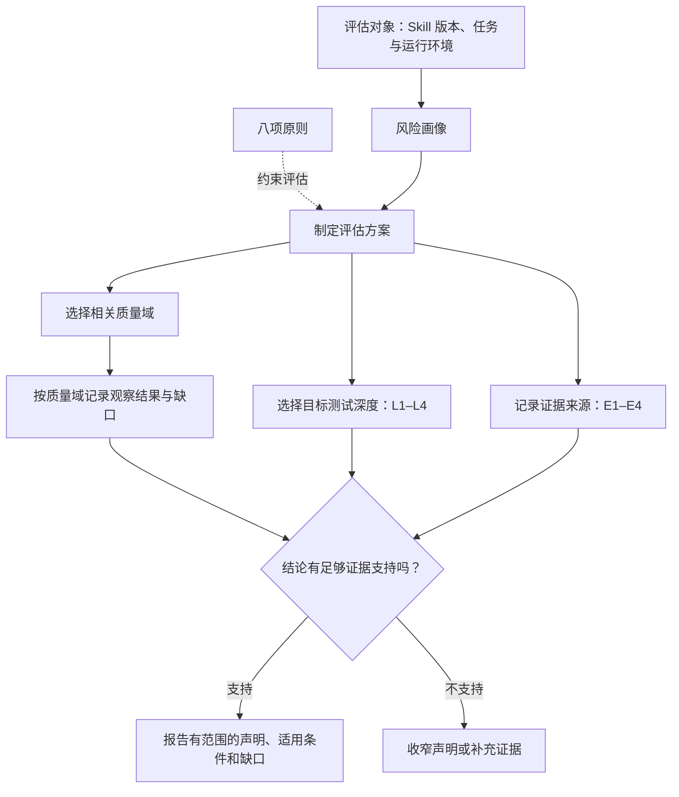
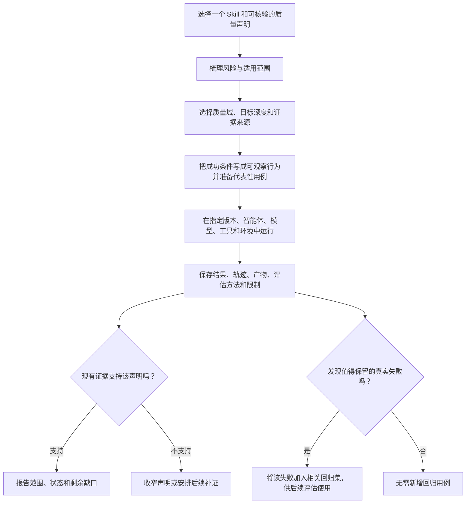

Skill 的说明文件写得清楚、通过结构检查，只能说明它具备了合格的起点。智能体能否选中并按要求执行，或在不同模型和工具下稳定工作，还要进一步验证。

Skill 的实际表现受技能包、用户任务、智能体、模型、工具、运行环境、上下文和运行状态共同影响。评估质量时，也要说明这些条件及对应证据。

Skill 质量工程工具包（Skill Quality Engineering Toolkit，SQET）和 Skill 质量评测模型（Skill Quality Evaluation Model，SQEM）用于组织这类评估。SQEM 帮助团队确定评估内容、验证深度和需保留的证据，并判断这些证据能支持怎样的质量声明。它遵循一条边界：

质量声明 ≤ 可用证据（Quality Claim &lt;= Available Evidence）

## SQET 和 SQEM 分别是什么

SQET 是 Awesome QA Skills 仓库中的方法与治理文档，说明如何设计、评估、验证、演进和审查智能体技能。SQEM 是其中的核心评测模型，提供质量维度、风险评估、验证深度和证据边界。

SQET 和 SQEM 是方法文档与评测模型，不是新的可安装 Skill 或评测运行器。SQET 复用仓库现有的评测契约和运行工具，不另建全仓库共享用例库；每个 Skill 的评测配置由对应 Skill 维护。仓库中供智能体调用的 Skill 工程类技能（目录名为 Skill Engineering Skills）与 SQET 方法文档分属不同层。

当前 SQET 仍处于试点验证阶段，主要验证这套方法是否容易理解、执行成本是否可接受，以及能否发现真实问题。试点结果不能证明全仓库的运行质量、跨模型兼容性或业务验收，也不能代替发布批准或作为认证。

## SQEM 从七个质量域检查 Skill

七个质量域把“Skill 好不好”拆成不同的问题。一次检查不必在每个域做同样深，但应明确哪些结论已有证据、哪些仍缺少证据。

| 质量域 | 要回答的问题 | 常见检查内容 |
| --- | --- | --- |
| 规范质量 | Skill 是否符合约定？ | 入口文件、元数据、名称、描述、目录和引用是否有效 |
| 设计质量 | 这个 Skill 应该做什么？ | 目标、输入输出、前置条件、能力边界、非目标和相邻 Skill 的区别 |
| 包质量 | Skill 包是否完整、易用？ | 引用资源、脚本、依赖、渐进式披露，以及中英文能力是否一致 |
| 行为质量 | 智能体能否正确使用它？ | 发现、触发、选择、遵循指令、产出结果、处理失败和副作用 |
| 有效性质量 | 它是否带来实际提升？ | 在相同任务、智能体、模型和环境下比较使用与不使用 Skill 的结果、成本和风险 |
| 兼容性质量 | 它在哪些环境中被验证过？ | 指定的智能体、模型、工具、环境和语言中的实际运行证据 |
| 证据与演进质量 | 质量结论还能否追溯？ | 版本、运行记录、已知缺口、失败复现、回归用例和后续改进 |

SQEM 不把七个域合并成一个总分。“规范质量通过”不能证明“行为可靠”，一次任务成功也不能证明 Skill 比不使用它更有效。按域记录结果，团队能看清具体差距，避免平均分掩盖这些差异。

## 八项原则决定怎样评估

模型的原则用于约束评估方式和质量声明：

- 用证据判断，不凭一次“看起来不错”的印象。
- 验证可观察行为，不要求模型每次使用相同措辞。
- 按风险选择测试深度，不追求所有组合的穷举。
- 先用确定性断言和规则检查，再考虑评判模型或人工评审。
- 把有价值的真实失败沉淀为回归用例。
- 宣称有效之前，先建立合理的对照基线。
- 兼容性要在目标环境中实际验证，不能从符合规范推断出来。
- 质量声明不能超过证据边界。

没有必要为所有 Skill 跑同一套大型测试。风险、能力和质量声明不同，所需证据也不同。

## 测试深度和证据来源是两条轴

SQEM 用 L1 到 L4 描述测试深度，用 E1 到 E4 描述当前证据来源。两组等级相互关联，衡量的维度却不同。

| 测试深度 | 含义 | 常见活动 |
| --- | --- | --- |
| L1 有效 | 结构和工程基础有效 | 规范、静态检查、Skill 包完整性 |
| L2 已验证 | 关键行为已有基本验证 | 正向、负向、必要的边界用例，行为契约和基础回归 |
| L3 已评测 | 按风险进行了更完整的评估 | 扩展用例、重复运行、基准、回归、运行时和兼容性抽样 |
| L4 有较强实践证据 | 有更广、更长时间的实践记录 | 多种运行环境、跨模型或跨智能体、真实项目和历史回归证据 |

所有维护中的 Skill 都应达到 L1；仓库对正式 Skill 建议以 L2 作为最低目标。是否需要 L3 或 L4，要看风险和准备做出的质量声明。L4 代表证据更成熟，不代表 Skill 完美。

| 证据来源 | 可以支持的观察 |
| --- | --- |
| E1 静态 | 规范、结构、元数据、引用和静态检查结果 |
| E2 评测 | 断言、行为评测、评判器和回归结果 |
| E3 运行时 | 真实智能体运行框架、基准比较、跨模型或跨智能体运行 |
| E4 真实使用 | 项目使用、真实失败、用户反馈和长期记录 |

例如，静态检查通过可以支持“包结构符合检查规则”，却不能证明“已在所有模型上验证”。缺少运行证据时，应记录为未运行、受阻或证据不足，不能据此判为通过。

## SQEM 模型图例

图中展示了 SQEM 的核心关系：风险画像和八项原则共同约束评估方案；质量域确定检查范围；L1–L4 表示测试深度，E1–E4 表示证据来源。两组等级分别记录，最后依据“质量声明 ≤ 可用证据”检查结论是否有支撑。

### 图例

| 图中元素 | 含义 |
| --- | --- |
| 评估对象 | 明确 Skill 版本、代表性任务及目标运行条件 |
| 质量域 | SQEM 的七个检查维度；按域记录，不合并成一个总分 |
| 八项原则 | 约束评估方法和结论表达，例如行为可观察、按风险选深度、先建立基线 |
| L1–L4 | 测试深度，表示验证做到什么程度 |
| E1–E4 | 证据来源，表示目前掌握哪类证据；与 L1–L4 不是同一条等级轴 |
| 结论边界 | 质量声明不超过当前证据能支持的范围；不足时补证据或降低声明强度 |

## 不同角色可以怎样使用

| 使用者 | 推荐用法 |
| --- | --- |
| Skill 作者 | 先写清能力边界和目标，再补行为契约、代表性用例和运行证据；每次修复真实问题时更新回归集 |
| 仓库维护者 | 用统一的质量画像记录各域状态；把 L1、必要的 L2 检查放进维护流程；根据风险为重点 Skill 增加评测，不要求所有 Skill 都达到 L4 |
| QA 负责人或评审者 | 用风险和证据审查质量声明；确认缺口、责任人和下一步验证，再决定是否接受剩余风险 |
| 使用 Skill 的团队 | 只依赖已验证的能力范围；记录实际使用的智能体、模型、工具和环境。运行条件变化后，重新确认相关兼容性 |

开始使用 SQEM 不需要迁移到指定评测平台。团队可以先用文档和模板定义评测契约，再把用例接入现有运行器、脚本或持续集成流程。SQEM 明确评估意图和证据边界，不要求另建评测引擎。

## 一次评估可以从这里开始

先选一个具体 Skill 和一条可核验的质量声明，例如：“在指定智能体和模型下，这个 Skill 能根据给定需求生成测试设计，覆盖主要正向、负向和边界场景。”聚焦可观察结果，避免只写“这个 Skill 很好用”。

随后为声明画出风险范围。SQEM 建议检查七个方面：

| 风险维度 | 需要判断什么 |
| --- | --- |
| 推理复杂度 | 任务是简单判断、多步骤处理，还是复杂推理 |
| 触发歧义 | Skill 能力是否独特，还是容易和相邻 Skill 重叠 |
| 副作用 | 是否只返回建议、创建产物，或会修改外部状态 |
| 工具依赖 | 不依赖工具、依赖单个工具，还是依赖多个工具 |
| 影响程度 | 失败造成的业务或用户影响有多大 |
| 模型敏感度 | 不同模型下是否表现相近，或已知对模型敏感 |
| 失败可发现性 | 错误是否明显，还是容易被合理措辞掩盖 |

风险画像用于确定评测类型、目标测试深度、兼容性范围和运行时验证力度。

再把成功条件写成可观察行为。为代表性任务准备正向用例，确认不相关任务不会误触发，并覆盖必要的边界、失败和回归场景。评估方式从最低成本且可靠的选项开始：确定性断言、规则检查、脚本或领域评估器、评判模型，最后才是人工评审。人工检查应留给自动化难以判断、但对风险决策重要的部分。

为便于复核，应记录 Skill 版本、任务输入、智能体、模型、工具、环境、运行结果、相关轨迹和产物，以及评估方法及其局限。要证明 Skill 带来增量价值，就在相同条件下比较使用与不使用 Skill 的结果；要声明它兼容某个智能体或模型，就保留该环境中的运行记录。

最后整理相关质量域的证据、状态、已知缺口和下一步验证。报告应说明结论依据和仍未确认的部分；单一分数不能代替这些信息。

实际流程中，拉取请求阶段可运行静态检查、变更 Skill 的关键评测和回归抽查；发布前再运行相关完整评测、关键回归、选定的基准和兼容性抽样，并更新证据报告。跨模型或长期回归等成本较高的检查，可按计划定期执行。

## 常见问题

### 没有智能体运行环境，能先开始吗？

可以先做规范、设计和包检查，并准备行为契约与评测用例。报告中要注明目前只有静态证据、运行行为尚未验证；不要将 L1 结果描述为 Skill 整体通过。

### 换了模型或智能体，需要重新评估吗？

至少重新评估受变化影响的部分。智能体、模型、工具和上下文变化，可能影响触发、指令遵循、输出和副作用。记录确切版本与环境，并按风险抽取有代表性的兼容性用例；未执行过的组合不能标记为已兼容。

### 评测失败时，应该先改提示词吗？

先复现并分类失败。问题可能来自触发或选择、Skill 指令、引用资源、工具、上下文、模型波动，也可能来自评测用例或评判器。保留运行证据，找出原因后再修正；真实且重要的失败应转成回归用例。

### 七个质量域和所有用例都要一次跑完吗？

不用。七个域用于完整描述质量，风险分析用于决定每次做到多深。低风险、边界清楚的 Skill 可以先有轻量证据；高影响、会修改状态或失败难发现的 Skill，就需要更严格的运行、回归和人工审查。

### SQEM 是认证或发布批准吗？

SQEM 用于组织评估并准确表达证据，不提供认证，也不代替发布批准。风险是否可接受，仍由业务或发布负责人决定；当前 SQET 仍处于试点验证阶段。

### 遇到证据缺口时，报告该怎么写？

写明缺少哪些证据、缺失原因、受影响的声明，以及下一步怎样补齐。没有运行时证据时，根据实际情况标记 NOT_RUN、BLOCKED、UNASSESSED 或 NOT_SCORED；样本不足时标记 INSUFFICIENT_EVIDENCE。报告需要一个结果，也不能把未知写成通过。

## 用 12 篇文章把模型走一遍

这组文章先介绍为什么 Skill 需要质量工程，再讲模型、用例、评估和持续改进。你可以按顺序阅读，也可以直接跳到需要的主题。

| 主题 | 文章与可带走的内容 |
| --- | --- |
| 认识对象 | Skill 也需要测试：从能用走向质量可信。看懂为什么静态合法、能够触发和结果看起来合理仍不足以证明质量。文章：https://inaodeng.com/zh-cn/blog/ai-testing/skill-quality-engineering/skill-quality-engineering-01-testing-agent-skills/ |
| 认识对象 | 智能体技能（Agent Skill）是什么：从规范到运行时的完整链路。理解入口文件、引用资源、技能包和运行时如何共同影响结果。文章：https://inaodeng.com/zh-cn/blog/ai-testing/skill-quality-engineering/skill-quality-engineering-02-specification-to-runtime/ |
| 模型基础 | 如何定义 Skill 质量：建立 SQEM 质量模型。了解七个质量域、八项原则，以及模型为何不使用单一总分。文章：https://inaodeng.com/zh-cn/blog/ai-testing/skill-quality-engineering/skill-quality-engineering-03-sqem-quality-model/ |
| 模型基础 | Skill 测试金字塔：构建分层的 Skill 测试体系。根据风险选择 L1 到 L4 的测试深度，并理解它与 E1 到 E4 证据来源的区别。文章：https://inaodeng.com/zh-cn/blog/ai-testing/skill-quality-engineering/skill-quality-engineering-04-testing-pyramid/ |
| 触发与行为 | Skill 触发测试：如何检查 Skill 的发现、选择与触发。用正向、负向、边界和改写用例检查路由。文章：https://inaodeng.com/zh-cn/blog/ai-testing/skill-quality-engineering/skill-quality-engineering-05-trigger-testing/ |
| 触发与行为 | Skill 行为测试：从固定答案验证转向行为契约测试。以必须、建议和禁止的行为约束评估结果、轨迹、产物与副作用。文章：https://inaodeng.com/zh-cn/blog/ai-testing/skill-quality-engineering/skill-quality-engineering-06-behavior-testing/ |
| 评估与价值 | Skill 评测设计：从成功标准到可验证的评估证据。把成功标准拆成用例，选择适当的评估器并保存运行记录。文章：https://inaodeng.com/zh-cn/blog/ai-testing/skill-quality-engineering/skill-quality-engineering-07-eval-design/ |
| 评估与价值 | Skill 基准测试：这个 Skill 真的比不使用 Skill 更好吗。设置合理基线，对照使用与不使用 Skill 的结果、成本和负面影响。文章：https://inaodeng.com/zh-cn/blog/ai-testing/skill-quality-engineering/skill-quality-engineering-08-benchmarking/ |
| 评估与价值 | Skill 兼容性：换个智能体或模型还能正常工作吗。明确智能体、模型、工具、环境和语言范围，用实际证据支持兼容声明。文章：https://inaodeng.com/zh-cn/blog/ai-testing/skill-quality-engineering/skill-quality-engineering-09-compatibility/ |
| 持续治理 | Skill 回归测试：修改后如何证明没有破坏原有行为。根据改动影响选择回归范围，并把真实失败保留下来。文章：https://inaodeng.com/zh-cn/blog/ai-testing/skill-quality-engineering/skill-quality-engineering-10-regression-testing/ |
| 持续治理 | Skill 证据：PASS 之前先问证据能证明什么。区分静态、评测、运行时和真实使用证据，避免结论越界。文章：https://inaodeng.com/zh-cn/blog/ai-testing/skill-quality-engineering/skill-quality-engineering-11-evidence-boundaries/ |
| 持续治理 | Skill 质量循环：用 QA 方法持续治理智能体技能。把匹配、设计、验证、评估、发布、观察、回归和改进连成持续过程。文章：https://inaodeng.com/zh-cn/blog/ai-testing/skill-quality-engineering/skill-quality-engineering-12-quality-loop/ |

## 把一次结果变成质量循环

每次评估发现问题后，都应记录任务、Skill 版本、智能体和模型、运行环境、观察到的行为、预期行为和失败证据。接着判断问题原因，修改 Skill、用例或运行条件，再运行相关验证；把有代表性的失败加入回归集，并将结论和剩余缺口留给下一轮评估。

不同业务、模型和智能体可能需要不同的评估配置。随着证据积累，团队可以调整评估方法、工具和流程。

## 延伸阅读与方法资料

Skill 质量工程工具包说明文档：https://github.com/naodeng/awesome-qa-skills/blob/main/docs/skill-quality-engineering/README.md

Skill 质量评测模型（SQEM）: https://github.com/naodeng/awesome-qa-skills/blob/main/docs/skill-quality-engineering/SKILL_QUALITY_EVALUATION_MODEL.md

Skill 评测契约：https://github.com/naodeng/awesome-qa-skills/blob/main/docs/skill-quality-engineering/SKILL_EVAL_CONTRACT.md

SQEM 试点计划：https://github.com/naodeng/awesome-qa-skills/blob/main/docs/skill-quality-engineering/SKILL_QUALITY_PILOT.md

行为契约模板：https://github.com/naodeng/awesome-qa-skills/blob/main/docs/skill-quality-engineering/templates/SKILL_BEHAVIOR_CONTRACT_TEMPLATE.md

质量画像模板：https://github.com/naodeng/awesome-qa-skills/blob/main/docs/skill-quality-engineering/templates/SKILL_QUALITY_PROFILE_TEMPLATE.md

可调用的中文 Skill 工程类技能：https://github.com/naodeng/awesome-qa-skills/tree/main/skills/zh/skill-engineering

可调用的英文 Skill 工程类技能：https://github.com/naodeng/awesome-qa-skills/tree/main/skills/en/skill-engineering

## 结语

Skill 质量工程帮助团队说明：一个 Skill 在什么条件下经过哪些验证、还存在哪些未知，以及下一步该验证什么。可以从一个具体 Skill 和一条重要质量声明开始，再根据真实结果调整模型和流程。每项质量结论都应落在证据支持的范围内。
