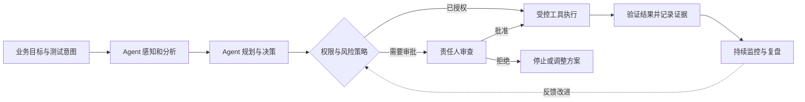
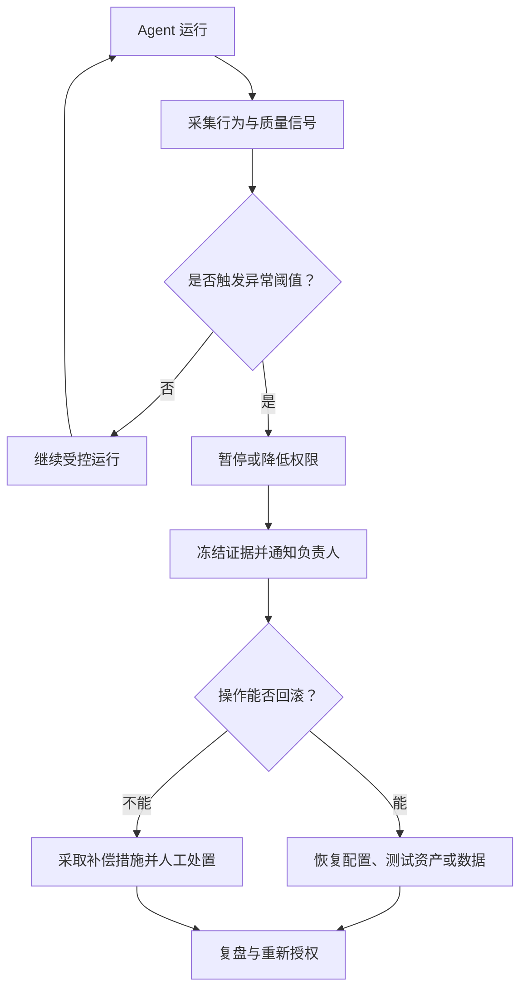
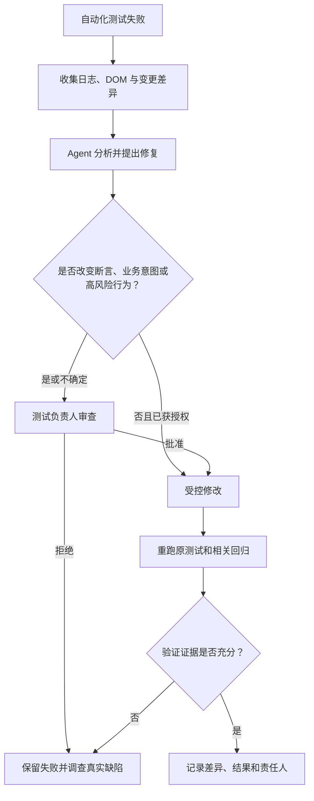
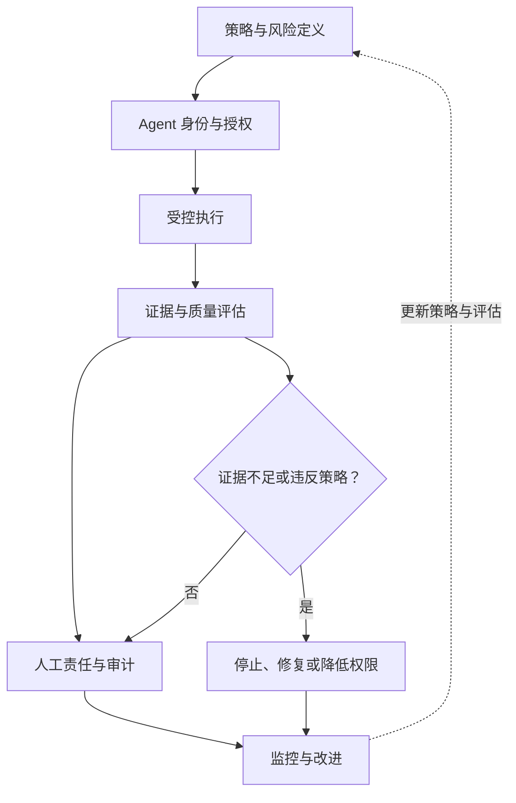

> 来源：Nishan Joseph，ACCELQ，2026-10-14

> 原文: https://www.accelq.com/blog/agentic-ai-governance-framework/

> 阅读定位：厂商博客中的测试 Agent 治理框架；下文区分原文观点、外部资料和工程延伸。

Agent 开始参与需求分析、测试生成、执行和维护后，团队需要回答一个问题：它能自主做到哪一步，哪些行为必须有人负责？

Nishan Joseph 在 ACCELQ 的文章将治理概括为一组政策、角色和技术控制，用来规定 Agent 可以做什么、谁对它的行动负责，以及行动如何留下记录供后续审查。对测试团队来说，治理对象不只是生成的答案，还包括 Agent 读取的数据、调用的工具、修改的测试资产、触碰的环境和它作出的决策。

治理不是让每一步都停下来等人点击批准。关键在于让自主权与风险相称，并确保重要行动有明确负责人、可核验的证据和停止或恢复的路径。

## 建议与行动需要不同的治理边界

传统生成式 AI 助手通常提供建议，等待人来决定是否采用。Agent 则可能自行规划、调用工具、执行操作，再继续下一个任务。两者的治理边界因此不同。

| 维度 | 生成式 AI 助手 / Copilot | Agentic AI |
|---|---|---|
| 行为方式 | 生成建议，等待人工采用 | 自主规划、调用工具并继续执行任务 |
| 测试示例 | 生成测试脚本，由工程师审查 | 发现 Schema 变化，修改回归测试并推进流水线 |
| 治理对象 | 输出内容、隐私与合规 | 输出、权限、工具调用、环境变更和决策链 |
| 人工参与 | 通常逐项确认 | 按操作风险设置检查点 |
| 典型失效 | 错误测试代码被人采纳 | 错误测试代码被自动执行或合并，甚至影响发布 |

许多现有 QA 流程是为“助手给出建议、工程师审查”设计的。当 Agent 能直接写入测试仓库或触发流水线时，治理必须延伸到它实际接触和改变的对象。

下面的闭环是对治理过程的工程化表达，并非 ACCELQ 产品内部架构：

## 为什么测试需要专门的治理层

测试 Agent 会接触接近生产的数据和复杂的测试环境。环境隔离与数据脱敏需要成为治理设计的一部分。另一个更难察觉的问题是：测试全部通过，不等于系统行为正确。套件可能验证了错误的业务规则；即使报告需求覆盖率为 100%，也可能遗漏决定发布是否安全的一条规则。

因此，AI 生成的测试需要适当的审查关口。下面的控制项是基于原文风险的工程延伸：

| 风险来源 | 可能的失效 | 可考虑的控制 |
|---|---|---|
| 测试数据 | Agent 读取未脱敏的客户数据 | 数据最小化、脱敏和访问隔离 |
| 测试环境 | Agent 修改共享数据库或外部服务 | 沙箱、环境白名单和受限凭据 |
| 测试生成 | 断言与业务意图不一致 | 需求追溯、独立审查和执行证据 |
| 测试选择 | 关键回归场景被错误排除 | 影响分析证据、风险阈值和人工复核 |
| 测试自愈 | 修复定位器时掩盖真实回归 | 审查变更差异、保留原始测试意图并重新验证 |
| 发布流水线 | Agent 越权绕过质量门禁 | 职责分离、强制审批和不可绕过的策略 |

## 六大治理支柱

### Agent 清单与身份

原文建议像管理新的服务账号一样管理每个测试 Agent：记录它能访问什么、由谁负责、在哪个环境运行。Agent 可能随着平台升级、新集成或工程师的个人实验进入团队；如果清单没有持续更新，就容易出现未登记的 Shadow AI。

以下字段是工程示例，不是原文规定的固定格式：

| 登记字段 | 示例 |
|---|---|
| Agent ID | regression-agent-01 |
| 负责人 | QA 自动化负责人 |
| 用途 | 选择并执行回归测试 |
| 运行环境 | Staging |
| 可用工具 | 只读代码仓库、测试执行器 |
| 禁止操作 | 写入生产环境、跳过发布门禁 |
| 凭据与审计 | 短期凭据、任务 ID、操作日志 |

### 按风险限定自主权

只提出测试建议的 Agent，与能把重新生成的回归套件推入 CI/CD 的 Agent，不应拥有相同权限。原文建议按自主程度分层，但没有规定统一等级。下表的 L0–L4 是为了说明控制强度而增加的工程示例，不是正式标准。

| 等级 | 可执行动作 | 典型控制 |
|---|---|---|
| L0：只读 | 阅读需求、代码和日志 | 只读权限 |
| L1：提出建议 | 生成测试或修复建议 | 人工接受后才生效 |
| L2：受控执行 | 在隔离环境执行已授权测试 | 环境与工具白名单 |
| L3：受限修改 | 修改测试脚本并提出 PR | 变更差异验证与代码审查 |
| L4：高影响动作 | 修改关键门禁或触及高风险环境 | 明确授权、强制审批与审计 |

权限应绑定到具体工具、数据、环境和操作，而不能只依赖 Agent 的名称或等级。L4 表示需要更严格的授权和审计，不代表 Agent 可以自行批准生产发布。

### 基于风险设置人工检查点

每一步都要求人工审查，会抵消使用 Agent 的意义。原文提出“责任落到具体姓名上”（name-on-the-line）：每个重要决策都应有明确的人承担责任。具体角色会因组织而异，下面是分工示例。

| 关键节点 | 责任安排示例 |
|---|---|
| 定义测试意图 | QA 工程师 |
| 批准生成的测试合并 | QA Lead 或测试负责人 |
| 审查自愈后的测试修改 | 原测试负责人 |
| 批准高风险环境操作 | 环境或系统负责人 |
| 签署发布风险 | 组织指定的发布决策人 |

审批人必须看到足够的上下文和证据，不能把检查点做成一个没有信息支撑的“同意”按钮。

### 可追溯与审计

Agent 的每次行动都应该留下结果和证据：它看到了什么、作了什么决定、改了什么，以及为什么。这样团队数月后仍能还原一次测试变更，而不只看到“Agent 更新了回归套件”这句描述。

工程上可以关联 Agent、模型和策略版本，工具参数摘要、代码差异、执行日志、审批记录及任务 ID。日志也需要脱敏并限制访问。“完整审计”不等于不加区分地保存所有敏感提示词、客户数据或凭据。

### 可解释性

当 Agent 标记缺陷、降低某个场景的优先级，或判断一次变更不需要重新验证时，审查者需要能看懂它的理由。解释要能指向需求、代码、测试结果或权限规则；说得流畅不代表证据充分。

| 不足以审查的说法 | 更便于审查的说明示例 |
|---|---|
| “无需回归” | “本次差异只修改静态资源；未发现直接调用依赖，但尚未验证运行时配置的影响。” |
| “测试已自愈” | “定位器从 A 改为 B，断言没有修改；目标元素语义与原测试一致，且已重新执行。” |
| “缺陷优先级低” | “问题影响非关键展示路径，目前未发现数据错误；业务影响仍待确认。” |

这些说明是工程示例。真正的可解释性还需要独立验证，不能只依赖 Agent 对自身行为的描述。

### 持续监控与回滚

Agent 会随着应用版本、数据和环境变化而表现漂移。上个季度运行良好，不代表经过几次重大版本更新后仍然可靠。治理机制要持续监控异常，并允许单独暂停或回滚某个 Agent，而不必停止整条流水线。

外部通知、真实支付和不可逆的数据操作不一定能够回滚。对这类动作，应优先在执行前禁止或设置审批。

## 2026 年的标准与监管背景

ACCELQ 原文将监管与行业动向作为治理背景。它们说明治理讨论正在展开，但不等于已经形成适用于所有测试 Agent 的统一标准。

| 来源 | 截至原文所述的进展 | 对测试 Agent 的参考意义 |
|---|---|---|
| 新加坡 IMDA | 2026 年 1 月发布专门面向 Agentic AI 的自愿治理框架，5 月更新 v1.5 并加入十余个案例 | 风险界定、人类责任、技术控制和用户理解 |
| 美国 NIST | 2026 年 2 月启动 AI Agent Standards Initiative；身份与授权相关概念文件的意见征集于 4 月 2 日截止 | Agent 身份、认证、授权、审计与互操作 |
| 欧盟 AI Act | Digital Omnibus 调整了部分高风险义务的适用时间 | 结合系统用途、风险分类和具体法规要求判断义务 |
| Gartner | 预测到 2026 年底，约 40% 的企业应用将包含任务型 Agent | 这是市场预测，不是已发生的采用率 |
| IDC | 报告企业计划将平均 16.7% 的 AI 支出投向 AI Agent 安全与治理 | 反映预算关注度，不是测试行业的普遍实测值 |

IMDA 的 2026 年 5 月更新吸收了 60 多家组织的行业反馈，并列出十余个真实部署案例。反馈组织与案例贡献方不是同一份名单；官方材料列出的贡献方包括 Google 和 PwC。ACCELQ 原文指出，这些案例当时并非专门针对软件测试。

NIST 的 Agent 身份与授权概念文件仍属于相关工作的一部分；公开意见征集已于 2026 年 4 月结束。ACCELQ 原文发表时称尚未发布最终标准。对团队而言，这些材料可以作为控制设计的参考，但不应被误写成已经生效的测试 Agent 专属标准。

Digital Omnibus 将 Annex III 高风险系统相关义务的适用日期调整为 2027 年 12 月 2 日，将 Annex I 产品相关系统的日期调整为 2028 年 8 月 2 日。ACCELQ 原文指出 Article 50 透明度义务仍按原有的 2026 年时间表执行。具体义务还受条文和过渡安排影响，应核对欧盟官方现行文本。AI Act 的风险分类取决于系统的应用场景，不能只看 Agent 的自主程度。

## AI 生成测试产物也要接受治理

只治理 Agent 的账号和权限还不够。测试用例、脚本、回归套件和缺陷报告也需要自己的质量规则，因为它们会影响团队的测试结论和发布决策。

### 用覆盖映射解释覆盖率

不要只记录一个覆盖率数字，还要说明每条测试保护哪项需求或验收标准。以下是学习笔记中的示例：

| 测试产物 | 对应验收标准 | 风险目标 | 治理状态 |
|---|---|---|---|
| 支付成功 | AC-PAY-01 | 交易正确性 | 可追溯 |
| 重复支付 | AC-PAY-03 | 幂等性 | 可追溯 |
| 折扣与税费 | AC-PRICE-02 | 金额一致性 | 待复核 |
| Agent 推测的退款规则 | 无明确来源 | 需求假设 | 需澄清 |

没有明确来源的测试不一定没有价值，它可能暴露需求缺口；但必须标成假设，不能当作已确认的业务规则。

### 检查重复、所有权和自愈

Agent 为了追求“全面”可能在不同流程中生成近似场景。测试数量增加不代表关键风险都得到覆盖。Agent 可以编写测试，但是否保留、修改或退役，需要由明确的人负责。

自愈测试也要经过与新测试相同的审查。Agent 修复一个失效定位器时，也可能顺手掩盖真实的界面或业务回归。下面的流程是工程延伸示例：

### 研究结果要放回研究范围内理解

ACCELQ 引用了一项 2026 年的研究：Dimple Bajaj 与 Deepak Khetan 的论文《Governance Controls for AI-Generated Test Artifacts in Autonomous Software Testing》。论文摘要报告，作者在 Defects4J 和 PROMISE 数据集上评估治理感知的自主测试框架 GATF；与研究基线相比，治理相关风险降低 89.6%，并报告治理准确率 94.3%、测试产物可靠性 96.5%、合规准确率 94.2% 和可解释性表现 90.8%。

研究提到，缺少检查的 AI 测试产物可能包含逻辑幻觉、违反合规要求、安全风险和较差的可解释性。这些数字属于论文所描述的特定研究设置，不是生产环境中的普遍收益，也不能推导为任何 Agent 加上治理层后都会降低 89.6% 的风险。应结合论文方法、数据集和指标定义阅读。论文发表于 2026 年 6 月。

## 组织需要共同承担治理责任

ACCELQ 原文将治理分给三个主要职能：

| 角色 | 主要职责 |
|---|---|
| QA 领导 | 给测试 Agent 划分风险等级、定义审查范围，并对测试与发布质量承担责任 |
| 平台 / DevOps | 建立身份、访问控制、审计日志，并在 CI/CD 中落实人工检查点 |
| 安全 / 合规 | 处理受监管数据、第三方审计，以及 NIST AI RMF 等框架或行业规则的衔接 |

原文认为，QA 领导需要参与，是因为测试团队最了解哪些失败只是噪音，哪些是真正的质量信号。从工程实践看，产品负责人、架构负责人、系统负责人和发布负责人也可能需要参与。不能默认 QA Lead 单独拥有所有业务发布风险的批准权。

## 从 AI Native Quality Engineering 看治理

以下是工程延伸，用来区分 Agent 的能力、质量工程和治理分别要回答什么问题：

| 能力层 | 关键问题 | 典型机制 |
|---|---|---|
| Agent Capability | Agent 能完成测试任务吗？ | 需求分析、测试生成、执行和自愈 |
| Agent Quality Engineering | 结果与行为可靠吗？ | 评估、回归、证据核验和失败分析 |
| Agent Governance | Agent 被允许做什么、谁负责、行为能否追溯？ | 授权、审批、审计、监控和回滚 |

三者不能互相替代：结果看起来正确，不能替代权限控制；审计记录完整，也不能证明测试断言本身正确。

## 对 Agent Skills 的启发

治理同样适用于 Agent Skills。可以从三个角度审查：

- **Skill Quality：** 输出是否满足任务目标。
- **Skill Safety：** 工具调用和数据处理是否遵守边界。
- **Skill Governance：** 谁能安装、授权、升级、停用和审计该 Skill。

例如，只读分析需求的 Skill 与执行数据库变更的 Skill，不应共用同一权限模板。评估除了检查触发条件和输出质量，也要验证工具调用边界以及异常情况下的行为。

## 厂商架构应与通用治理原则区分

ACCELQ 原文最后介绍了自家平台的四层架构：感知（Perception）、推理（Reasoning）、行动（Action）和治理（Governance）；并列出四类护栏：测试数据处理（Test Data Handling）、执行安全（Execution Safety）、决策验证（Decision Verification）和报告透明度（Reporting Transparency）。

文章还将平台内的 Agent 分为 Discovery、Automation Generation、Change Analyzer 和 Execution Agent，分别承担应用发现、测试生成、自愈分析和执行决策等职责。这些属于 ACCELQ 的产品描述，展示了一种实现方式，不是独立验证的行业标准，也不意味着治理必须依赖某一家平台。

原文也承认，专门针对测试领域、经过独立记录的 Agent 治理案例仍然有限。引用厂商材料时，应把产品说明、研究结果和行业标准分开看。

## 总结

Agentic QA 治理的重点不是要求所有 Agent 行动都经过人工批准，而是让自主权与风险相匹配，并让关键行为具有明确责任、可核验的证据、持续监控和可恢复机制。

- **能力**决定 Agent 能做什么。
- **质量工程**验证 Agent 做得是否可靠。
- **治理**决定 Agent 被允许做什么，以及出问题时由谁负责。

**Agentic QA 的成熟，不是无限放权，而是在权限可控、证据可信、责任可追溯的前提下，让 Agent 安全地承担更多质量工程工作。**

## 参考来源

- ACCELQ 原文: https://www.accelq.com/blog/agentic-ai-governance-framework/
- arXiv 研究论文: https://arxiv.org/abs/2606.08806
- 新加坡 IMDA Agentic AI 治理框架更新: https://www.imda.gov.sg/resources/press-releases-factsheets-and-speeches/factsheets/2026/updated-model-ai-governance-framework-for-agentic-ai
- NIST AI Agent Standards Initiative: https://www.nist.gov/artificial-intelligence/ai-agent-standards-initiative
- NIST Agent 身份与授权概念文件: https://csrc.nist.gov/pubs/other/2026/02/05/accelerating-the-adoption-of-software-and-ai-agent/ipd
- 欧盟 AI Act 修订法规 Regulation (EU) 2026/1744: https://eur-lex.europa.eu/legal-content/EN/TXT/?uri=CELEX%3A32026R1744
- Gartner 企业应用 Agent 预测: https://www.gartner.com/en/newsroom/press-releases/2025-08-26-gartner-predicts-40-percent-of-enterprise-apps-will-feature-task-specific-ai-agents-by-2026-up-from-less-than-5-percent-in-2025
- IDC Agent 安全与治理支出调查: https://www.idc.com/resource-center/blog/ai-agent-governance-enterprise-investment/
- NIST AI Risk Management Framework: https://www.nist.gov/itl/ai-risk-management-framework
