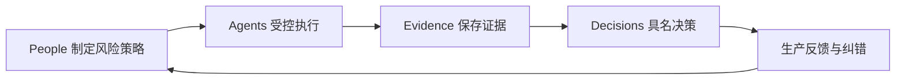
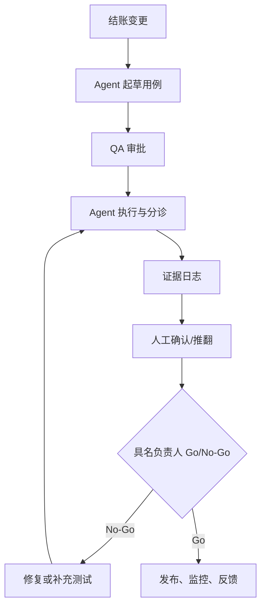

# AI 质量编排：让 Agent 执行测试，发布决策有据可查

> 学习来源：Rosie Sherry，《AI quality orchestration: how testing and quality engineering teams coordinate people, agents, evidence and decisions》，Ministry of Testing，2026-11-12。本文为学习笔记与实践扩展，并非原文翻译。原文：https://www.ministryoftesting.com/insights/ai-quality-orchestration-how-testing-and-quality-engineering-teams-coordinate-people-agents-evidence-and-decisions

## 目录

- [为什么需要 AI 质量编排？](#为什么需要-ai-质量编排)
- [People、Agents、Evidence、Decisions 如何形成闭环](#peopleagentsevidencedecisions-如何形成闭环)
- [人机怎样分工？](#人机怎样分工)
- [渐进式自主：按犯错代价授权](#渐进式自主按犯错代价授权)
- [证据不能只有最终测试结果](#证据不能只有最终测试结果)
- [决策权和升级机制](#决策权和升级机制)
- [结账流程案例](#结账流程案例)
- [最小 MVP：先做一个失败分诊闭环](#最小-mvp先做一个失败分诊闭环)
- [TDD / Eval：用失败场景约束自主权](#tdd--eval用失败场景约束自主权)
- [相关术语](#相关术语)
- [从一个任务开始，再讨论是否扩大自主权](#从一个任务开始再讨论是否扩大自主权)
- [局限、FAQ 与总结](#局限faq-与总结)
- [实操检查清单](#实操检查清单)

## 为什么需要 AI 质量编排？

AI 让写代码、生成测试、执行回归、分析日志都更快，但当 Agent 进入交付流水线，一个新问题出现了：**谁允许它采取行动、它依据什么判断、谁对错误负责？**

假设夜间回归有两条失败，Agent 把其中一条标记为 flaky，另一条标记为真实回归。仅有一份“测试总体通过”的报告远远不够。团队还应知道：它看了哪些日志？调用了什么规则？是否遗漏历史失败？是否有人审核了分类？如果最终误判，怎样找到原因？

Rosie Sherry 的文章将 **AI Quality Orchestration** 定位为一种**运营模式**，而不是可以直接购买的完整工具。它比传统测试编排更广：除了安排何时执行测试，还要管理人员、Agent、证据和决策。作者也明确指出，这是一套值得试验的工作模型，并非成熟行业标准。

> 关键在于明确自动化的边界，以及系统拿不准时要留下哪些可信证据。

## People、Agents、Evidence、Decisions 如何形成闭环

| 层次 | 主要责任 | 常见产物 |
|---|---|---|
| **People** | 制定风险策略、设定可发布条件、审查和追责 | 质量策略、授权规则 |
| **Agents** | 在授权范围内起草、执行、分诊、汇总 | 候选用例、测试运行、分析建议 |
| **Evidence** | 记录测试依据、系统判断、人工干预和结果 | 可追踪记录、原始日志 |
| **Decisions** | 由具名的人接受风险和作 Go/No-Go 决定 | 具名审核及发布决定 |



这四部分需要形成一条闭环。证据缺失会让 Agent 的判断无法追溯；责任人不明确时，团队可能把建议当成放行结论；低风险事项若都需要逐条审批，审核本身也会成为瓶颈。具体做法应结合产品风险和团队的复核能力来安排。

## 人机怎样分工？

Agent 比较适合高重复、可验证的活动：从明确需求起草候选测试，运行已批准的测试套件，对失败进行初步聚类，关联代码变更，汇总日志和证据。

人则负责**风险策略、质量判断和责任接受**。例如用例能否进入回归套件、严重缺陷如何定级、是否接受剩余风险、是否继续发布，都应有明确的个人负责人。Agent 可以提供建议，但不能替人承担决策责任。需要多人会签时，也要写明最终责任人。

这里的“质量在环（Quality in the loop）”比机械的“人工在环（Human in the loop）”更重要：审查者要识别虚假断言、隐含假设、证据缺口，而不只是点击批准。

## 渐进式自主：按犯错代价授权

| 等级 | 工作方式 | 示例 |
|---|---|---|
| L1 Assistive | 仅建议，人决定与执行 | Agent 提出日志根因候选 |
| L2 Supervised | 限定执行，关键点审核 | Agent 生成测试，QA 审批入库 |
| L3 Conditional-autonomous | 符合护栏自动处理，例外升级 | 对已登记 flaky 测试有限重试 |

**坏的授权**：“让 AI 处理一些测试失败。”

**好的授权**：“Agent 只可对指定服务中已确认的 flaky 测试重试最多两次；保留第一次失败和每次重试证据；未知失败、安全或支付断言失败立即升级；不得修改正式测试结果。”

自主权应分阶段授予，也应该可以暂停或收回。先用 L1 积累人工审核数据，只有达到明确定义的门禁才考虑 L2、L3。Agent 具备某项能力，并不意味着它自动拥有对应权限；限制必须在工具和账号层执行，而不能只靠提示词。

## 证据不能只有最终测试结果

每项重要 Agent 工作至少记录：

1. **测什么、为什么测**：需求、风险或变更来源；
2. **Agent 如何判断**：输出、规则版本、事实依据及不确定性；
3. **人怎样处理**：由谁接受、修改、拒绝，原因是什么；
4. **后续真实结果**：是否有缺陷逃逸，分诊判断是否正确。

以下是供团队自行设计的最小记录示例（**不是原文规定的标准**）：

```json
{
  "task_id": "TRIAGE-001",
  "change_ref": "PR-128",
  "agent": {"name": "failure-triage", "version": "1.0", "level": "L2"},
  "test_run": "RUN-456",
  "suggestion": {"type": "flaky_candidate", "evidence": ["log://RUN-456"]},
  "review": {"reviewer": "named-reviewer", "decision": "overridden", "reason": "failure reproducible"},
  "outcome": {"final_classification": "regression", "production_impact": "unknown"}
}
```

记录应保留原始日志和修订历史，并落实数据最小化、脱敏和访问控制。要让系统从拒绝中获得改进信号，需要有人审核记录，再决定是否调整提示词、规则或 Eval；不能假设它会自动学会。

### 人工推翻率

人工推翻率可表示为：

**人工推翻率 =（人工修改或拒绝的建议数 ÷ 已审查的建议数）× 100%**

它有助于判断 Agent 是否逐渐可信，但绝不应单独用于升权：低推翻率也可能意味着审查不认真。还要结合**真实缺陷漏判率、严重度、证据完整率、误报、权限违规、恢复能力与人工审核成本**。模型随口给出的“95% 置信度”也不能替代校准或真实证据。

## 决策权和升级机制

建议用一张矩阵明确授权：

| 动作 | Agent | 人 |
|---|---|---|
| 测试排期 | 可按批准规则安排 | 制定规则 |
| 已知 flaky 重试 | 可受控执行 | 审核策略和例外 |
| 用例入正式回归 | 可提交候选 | 审批测试意图与断言 |
| 缺陷分诊 | 可给初判 | 关键严重度定级 |
| 风险签字 | 仅提供证据 | 具名责任人 |
| Go/No-Go | 仅提供分析 | 具名发布决策者 |

必须升级的情况包括：未知失败、证据缺失、判断冲突、超出权限、触及支付或数据完整性、重试次数到上限、无法安全回滚。**拒绝和推翻必须留下原因**，否则整个系统失去校准能力。

## 结账流程案例

原文以结账流程发布解释闭环：变更进入流水线，Agent 起草回归场景；测试人员审查；Agent 夜间执行，报告一条 flaky 候选和一条折扣码真实回归；人工核实阻断风险，并记录对 flaky 分类的推翻；具名发布负责人参考证据做 Go/No-Go 决策。



Agent 可以加快场景准备和失败分析；最终发布判断仍由负责人作出，Agent 的分析只是决策输入。

## 最小 MVP：先做一个失败分诊闭环

不要从多 Agent 平台开始。建议选择**自动化测试失败分诊**这种重复、边界明确、结果容易评估的活动：

- 输入：CI 结果、日志、代码变更、历史失败；
- Agent：输出分类候选、依据、待核查项；
- 策略：未知和高风险失败强制升级；
- 审核：人接受/推翻、记录理由；
- Eval：用历史真实误判构建回归集；
- 输出：可追溯的分诊报告，而不是修改正式测试结果。

四阶段实施：**定义契约与证据 → L1 辅助型 → 建立评估数据 → 验证后有限 L2/L3**。优先复用 GitHub Actions、现有测试框架、Issue/PR 和结构化日志，而非新建孤立平台。

## TDD / Eval：用失败场景约束自主权

| Given | When | Then |
|---|---|---|
| 未知失败，无 flaky 历史 | Agent 分诊 | 保留失败，升级人工，不得标通过 |
| 已知 flaky，重试已达到上限 | Agent 再次处理 | 停止，归档每次执行，提交人工 |
| Agent 认为 flaky，人判断为 regression | 人工推翻 | 原结论和推翻原因都可追溯 |
| Agent 试图访问不允许的服务 | 工具调用 | 在权限层拒绝并留审计 |
| 证据存储失败 | Agent 完成任务 | 不发布“已审查通过”的结论 |

此外，要评估 prompt injection、工具故障、重复操作、上下文缺失和任务超时。目标不是仅证明 Agent 会成功，还要证明它**会安全失败**。

这些验收条件可以放进现有测试框架或独立 Eval 集合。每条都要保留输入、预期行为和实际证据；如果 Agent 或工具更新导致行为变化，应重新运行相关场景。这里的测试设计属于本文的实践扩展，不是原文规定的标准。

## 相关术语

- **Agentic testing**：由 Agent 自主探索应用、生成并执行测试，再报告结果。它是质量编排中的执行方式之一。
- **Harness engineering**：为 Agent 搭建让任务可运行、可观测、可限制和可恢复的工程环境。
- **Dark factory**：Dan Shapiro 对高度自主的软件交付模式的称呼；当 Agent 规划、构建、测试和交付而没有人审查代码时，判断就更需要落实在规格、护栏和证据里。

这些词描述不同的讨论方向，并不代表已有统一成熟的行业方案。本文依照原文用法作简要说明。

## 从一个任务开始，再讨论是否扩大自主权

Rosie Sherry 建议从回归分诊或测试起草等重复任务开始，先选一种自主模式，连接需求、现有自动化和执行结果，并从第一天记录证据。只有在结果和人工审核记录都支持时，才扩大自主范围；若误判变多或风险上升，应收回权限。

团队可以把日常质量工作列出来，再标注哪些由人主导、AI 辅助，哪些可由 AI 执行、人来审核。例如需求启动和风险分析通常需要人主导；脚本起草、测试数据准备和梳理陌生代码库可以先尝试让 AI 协助。任务和风险不同，分工也应随之调整。

带回团队讨论的问题：

- 如果 Agent 的分诊让错误缺陷进入生产，谁负责？团队能否还原过程？
- 哪些质量决策可以交给 Agent，哪些必须由人做？原因是什么？
- 新同事能否通过现有记录还原上次发布的 Go/No-Go 决策？
- 自主程度最高的环节，是否也有足够证据和护栏？
- 出现什么信号时，团队会降低或收回已经授予的权限？

## 局限、FAQ 与总结

**Q：小团队需要完整四层平台吗？** 不需要。一个任务、一种自主等级、一个具名责任人、一份结构化证据日志就可以开始。

**Q：推翻率低就能开放更多权限吗？** 不能。还应独立检查漏判、错误代价、审查质量和权限安全。

**Q：已有 CI/CD 为什么还要治理？** CI/CD 负责执行编排，但不必然记录 AI 决策依据、人工推翻、权限和风险接受。

**Q：所有任务都要人工审批？** 不必。低风险、规则清晰且验证充分的工作可条件自主；关键风险决策保留具名责任人。

原文也指出风险：小团队可能被流程拖慢；Agent 归属不清；未经审核的反馈可能造成漂移；目前也没有可以直接买来覆盖整套模式的平台。Rosie Sherry 引用 Gartner 在 2025 年发布的预测：超过 40% 的 Agentic AI 项目可能在 2027 年底前被取消，原因包括成本上升、商业价值不清和风险控制不足。这是预测，不是已发生的数据。相关来源见参考资料。

**最终原则：让 Agent 执行，让证据说话，让人承担关键质量决策。**

## 实操检查清单

- [ ] 活动范围与自主等级清楚
- [ ] 具名 Agent owner、审核人、发布责任人
- [ ] 规则可以在工具层执行和撤销
- [ ] 测试依据、日志、Agent 判断均可回溯
- [ ] 人工修改/拒绝及理由保留
- [ ] 未知失败、关键风险和证据缺口会升级
- [ ] 建立独立 Eval、误判分析与降级机制
- [ ] 复用现有 CI、需求与测试资产

**参考资料**

- Ministry of Testing，AI Quality Orchestration：https://www.ministryoftesting.com/insights/ai-quality-orchestration-how-testing-and-quality-engineering-teams-coordinate-people-agents-evidence-and-decisions
- Gartner，Agentic AI 项目预测：https://www.gartner.com/en/newsroom/press-releases/2025-06-25-gartner-predicts-over-40-percent-of-agentic-ai-projects-will-be-canceled-by-end-of-2027
