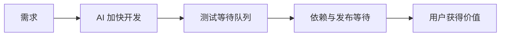
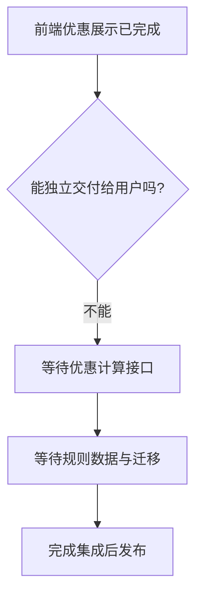
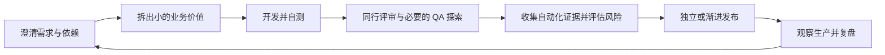

# AI 让开发更快，为什么测试却越来越忙？真正瓶颈可能是团队文化

## 目录

- [开发更快，交付为什么没有同步变快](#开发更快交付为什么没有同步变快)
- [测试积压从哪里来](#测试积压从哪里来)
- [质量共担不是取消 QA](#质量共担不是取消-qa)
- [依赖为什么在发布前集中出现](#依赖为什么在发布前集中出现)
- [AI 适合用在哪些环节](#ai-适合用在哪些环节)
- [四周试点怎么安排](#四周试点怎么安排)
- [常见问题](#常见问题)

## 开发写得更快，不代表用户更早拿到价值

AI 可以加快写代码，却不一定缩短从需求到可用软件的时间。如果测试仍被当作开发完成后的交接环节，或工作项之间的依赖一直没有处理，AI 可能让等待队列变得更长。先找出瓶颈，再调整协作与任务拆分，最后判断 AI 能在哪些环节降低成本。

## 开发更快，交付为什么没有同步变快

Cassandra H. Leung 在原文中提到两类团队反馈：开发人员提交更多 MR，测试人员赶不上；产品团队的 “Ready for Deployment” 队列里，则堆着等待其他任务完成的事项。人们开始问，能不能再加一些 AI 来提速。

要先分清两种速度：

- **局部产出速度**：写代码、提交 PR/MR、生成测试或完成单个技术任务。
- **端到端交付速度**：从确认用户需要什么，到用户拿到可用价值所需的时间。

如果下游容量和协作方式没有变化，上游产出增加，等待队列也可能变长。下图是流程示意，不是原文统计数据：

## 测试积压从哪里来

常见模式是开发完成后把任务交给 QA：开发标记 Ready for QA，QA 负责全部验证，发现问题后退回开发修复，再由 QA 重测。AI 提高变更产出后，这种交接更容易形成队列；问题不一定是 QA 变慢，也可能是原有工作方式承受不了更多变更。

可能的原因包括：开发缺少测试经验；自动化框架只有 QA 会用；Definition of Done 没包含必要的验证；提测时没有自测证据；团队默认由 QA 独自承担质量风险。

关键不是减少 QA 测试，而是看基本验证为什么要等功能完成后才开始、又为什么集中由 QA 承担。

## 质量共担不是取消 QA

Leung 一半时间在产品团队工作，另一半参与公司的 AI Enablement 工作。她提到，即使在产品团队只有一半时间，也能跟上测试活动，因为开发人员同样参与测试。她与开发结对和辅导，帮助团队掌握测试方法和自动化框架；开发先自测，通常再请另一位开发复核；遇到高风险或需要深入审查的任务时，再请 QA 介入。自动化也和功能一起维护，而不是留到以后另开任务。

| 实践 | 想减少的等待 | 落地时要确认 |
| --- | --- | --- |
| 开发先做自测 | 把基础问题全部交给 QA | 自测对应具体行为，并保留执行证据 |
| 结对与辅导 | 测试能力集中在少数人手中 | 用真实需求练习，不只讲工具命令 |
| 共享自动化框架 | 只有 QA 能编写和调试测试 | 运行、调试和维护方式对开发也可用 |
| 按风险邀请 QA | 每项任务都排队等 QA | 安全、权限和关键数据有明确审查规则 |
| 在功能工作中维护自动化 | 测试债务被推迟到以后 | 按风险选择单元、API、集成或 E2E 检查 |

质量共担不等于取消 QA，也不要求所有角色做同一份工作。开发需要验证自己的变更；QA 可以把更多精力放在测试策略、复杂探索、跨模块风险、辅导和质量证据上。产品与技术负责人仍需明确业务规则、架构选择和发布风险。

## 依赖为什么在发布前集中出现

另一类队列出现在 “Ready for Deployment” 阶段。任务 A 已完成，却必须等任务 B；B 又依赖 C，许多阻塞到发布前才显现。依赖往往在需求发现和细化阶段的任务拆分中已经形成。

例如，团队把“订单优惠”拆成数据库、后端接口和前端展示三个技术任务。每项都能独立开发，却未必能单独交付用户可用的优惠功能。AI 可以让其中一项更早完成，但不会消除它对其他任务的依赖。

可以按垂直业务价值拆分：先交付一种基础优惠，再扩展更多规则，之后再支持组合优惠。每个切片应包含交付这部分价值所需的前后端和数据工作。底层设施、迁移或外部依赖有时无法拆开，应明确写成前置条件，安排负责人、集成顺序和协调时间。

Feature Flag 可以分离代码部署与功能启用，帮助控制发布风险；它无法替代依赖发现、任务细化和跨团队沟通。

### Refinement 时的依赖检查

- 这个任务完成后，用户能获得什么独立且可验收的价值？
- 发布是否必须等待另一个任务？如果是，是否明确记录为前置条件？
- 会涉及哪些 API、数据库、其他团队或版本兼容要求？
- 能否把技术任务组合成更小的端到端价值切片？
- 若无法拆分，集成顺序、联调时间和发布约束是否清楚？

## AI 适合用在哪些环节

AI 可以降低根因整改的成本，但不应只给原有交接流程套一层自动化：

| 难点 | AI 可以辅助 | 仍需团队确认 |
| --- | --- | --- |
| 开发不熟悉测试设计 | 提示边界条件、起草测试骨架 | 业务预期和断言是否有效 |
| 自动化维护成本高 | 协助定位和更新失效测试 | 测试是否可重复、是否误报 |
| PR 影响范围不清 | 查找调用方和可能的副作用 | 真实代码、配置与依赖关系 |
| 任务拆分隐藏阻塞 | 建议垂直切片和依赖顺序 | 各切片是否能独立交付价值 |
| 测试积压严重 | 汇总排队时间和返工模式 | 瓶颈究竟是能力、交接还是其他依赖 |

原文评论区中，Lisa Crispin 也指出 AI 会放大团队已有的好做法和坏做法。这个观点提醒团队：工具可以帮忙找依赖、准备验证，但不能替代互信、共享责任和可靠的工程实践。

## 四周试点怎么安排

下面是一份建议的试点节奏，不是原作者规定，也不保证四周就能改变团队文化：

| 周次 | 尝试 | 可以检查什么 |
| --- | --- | --- |
| 第 1 周 | 回看近期工作项，区分等待测试和等待依赖 | 排队时间、返工、阻塞原因基线 |
| 第 2 周 | 选择一个小功能，尝试开发自测与结对 | 自测记录、执行证据、发现的问题 |
| 第 3 周 | 对新需求进行依赖评审和价值切片 | 前置条件、切片是否可发布 |
| 第 4 周 | 对比试点结果并复盘 | 排队和返工变化、风险、团队反馈 |

衡量时可以看端到端交付周期、测试排队时间、依赖阻塞时间、返工和重测，以及生产质量结果。不要把 PR 数量或自测勾选率当作唯一成功标准；如果速度提高但生产问题恶化，应重新评估控制措施。

## 常见问题

**开发负责测试后，还需要 QA 吗？**

需要。QA 不必成为每项工作的重复验收关口，但仍负责测试策略、复杂探索、培训和跨系统风险。高风险变更也可能需要独立验证。

**每个任务都必须可以独立发布吗？**

不一定。尽量拆成更小、完整的用户价值；无法拆开的技术依赖要提前登记并协调。

**Feature Flag 没有用吗？**

有用。它可以在部署代码后暂缓启用功能，但不能解决隐藏依赖或不合理的任务拆分。

**可以先上 AI 测试工具吗？**

可以让 AI 帮忙降低明确的重复成本，但应先找出积压原因。否则只会让工作更快地流入更长的队列。

原文认为，AI 并未突然制造这些积压，而是让原有的交接和依赖问题更明显。测试积压需要团队重新分担质量工作；发布等待则需要改进需求细化、任务拆分和依赖协调。AI 可以辅助这些改变，不能替团队做出组织决定。

本文是《AI 时代的软件质量反思》系列第三篇，讨论如何把质量责任和交付依赖纳入日常协作。

## 参考与延伸

- Cassandra H. Leung, “Drowning in a Testing Backlog? Your Problem Isn’t AI, It’s Culture,” November 11, 2026: https://www.cassandrahl.com/blog/drowning-in-a-testing-backlog-your-problem-isnt-ai-its-culture/
- Lisa Crispin 对原文的评论，同上：https://www.cassandrahl.com/blog/drowning-in-a-testing-backlog-your-problem-isnt-ai-its-culture/
- Martin Fowler, “Feature Toggles (aka Feature Flags)”: https://martinfowler.com/articles/feature-toggles.html
- Agile Manifesto, “Principles behind the Agile Manifesto”: https://agilemanifesto.org/principles.html

## 更多参考

- 个人网站链接：[https://inaodeng.com/zh-cn/](https://inaodeng.com/zh-cn/)
- 微信公众号：软件测试同学
- AI 生成测试检测项目：[https://github.com/AI-Native-QA-Lab/ai-test-auditor](https://github.com/AI-Native-QA-Lab/ai-test-auditor)
- DeepSeek QA 工作台项目：[https://github.com/naodeng/dsh-qa](https://github.com/naodeng/dsh-qa)
- 更多 AI 测试技能：[https://inaodeng.com/zh-cn/qaskills/](https://inaodeng.com/zh-cn/qaskills/)
- 更多测试百科：[https://inaodeng.com/zh-cn/wiki/](https://inaodeng.com/zh-cn/wiki/)
- 更多 AI 百科：[https://inaodeng.com/zh-cn/AIWiki/](https://inaodeng.com/zh-cn/AIWiki/)
