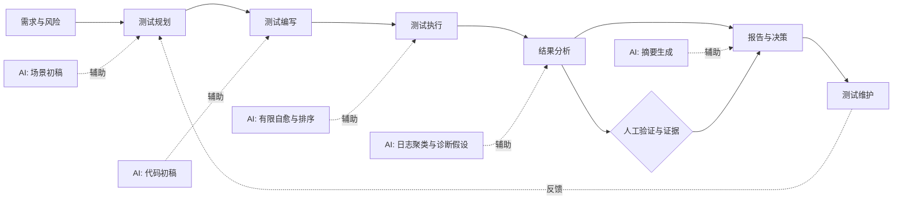
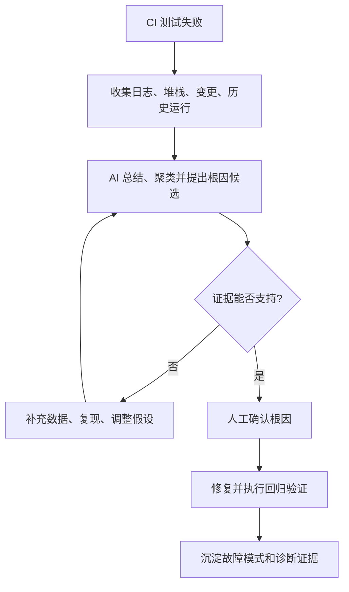
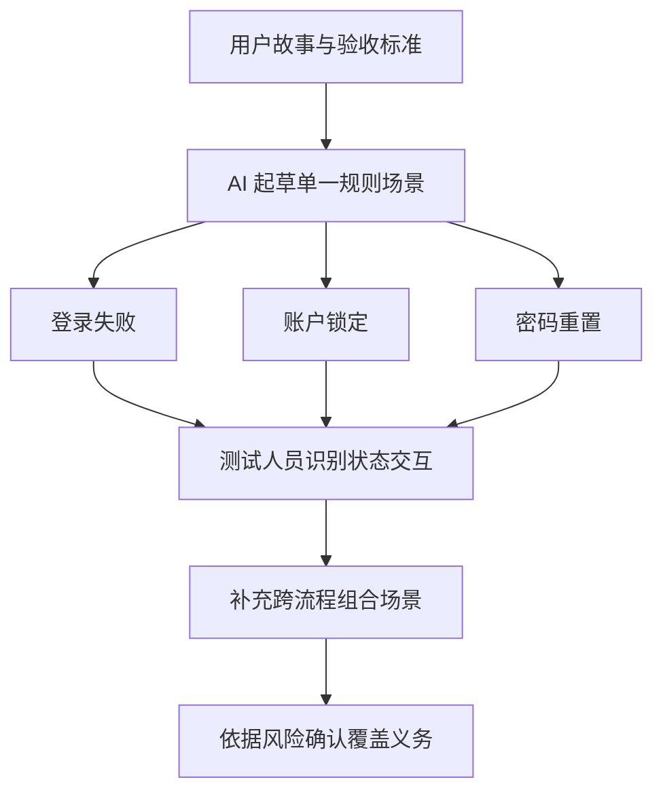
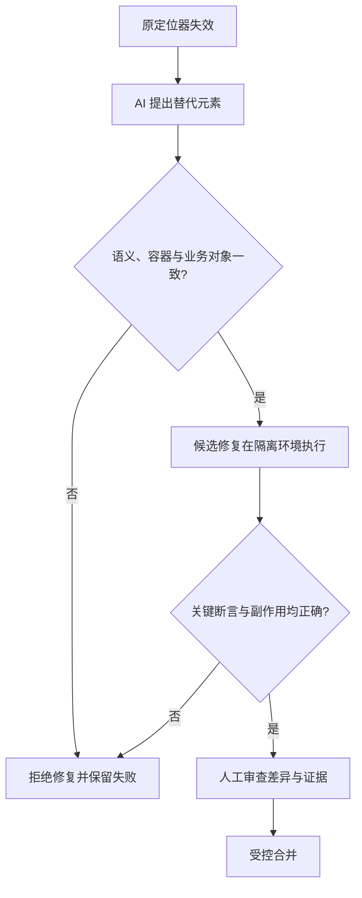
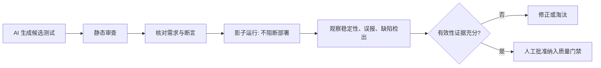
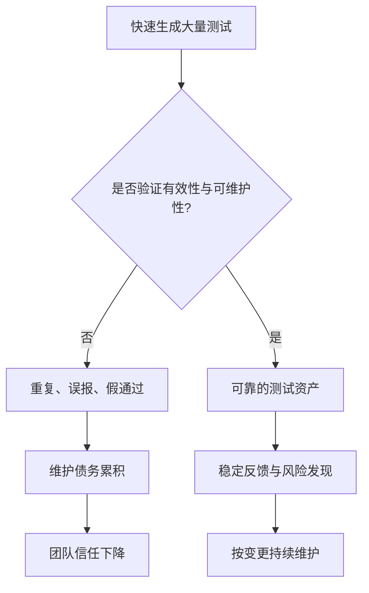
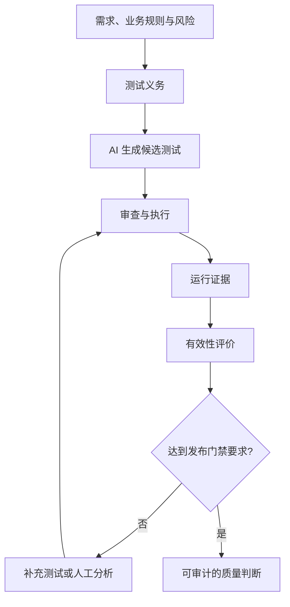

> **资料来源**：Lucio Daza，Ministry of Testing Moment，2026-11-06，Where AI actually helps in testing, and where it just looks like it does: https://www.ministryoftesting.com/moments/where-ai-actually-helps-in-testing-and-where-it-just-looks-like-it-does；Atulpriya Sharma，Testkube，2026-10-26，Using AI in the Software Testing Lifecycle: https://testkube.io/blog/ai-across-software-testing-lifecycle。
>
> **阅读说明**：前者是对后者的评论与提炼；以下优先还原两篇文章的论点，另以“工程延伸”标识独立建议。Testkube 是测试平台厂商，其产品功能与效果描述应与独立研究证据区分。

## 核心判断：AI 在测试中确有帮助，演示效果仍需验证

Atulpriya Sharma 沿着软件测试生命周期（STLC）检查 AI 在规划、编写、执行、分析、报告和维护中的作用。Lucio Daza 的评论强调：**失败分析最有说服力，测试场景起草也有实际帮助；自愈定位器和无人审查的自动测试生成则容易被过度宣传。**

评估 AI 时，需要明确它介入哪个阶段、拿到什么输入、产出什么证据，以及最终由谁作出判断。



## 六个阶段的实际价值与局限

| STLC 阶段 | AI 较有价值的工作 | 容易出错或被夸大的部分 | 需要保留的判断 |
|---|---|---|---|
| 规划 | 从 PRD、用户故事、验收标准起草正向、负向和边界场景 | 多条件交互、风险排序；“AI 能制定完整测试策略” | 业务风险、覆盖范围和优先级由人确认 |
| 编写 | 生成测试代码初稿、样板代码 | 无意义断言、重复或不稳定的生成结果 | 审查断言和可维护性，验证测试有效性 |
| 执行 | 选择器变更后的有限修复、测试排序、视觉差异辅助判断 | 时序、数据、环境、并发引起的失败；“完全自主执行” | 修复前后行为一致性和失败原因 |
| 分析 | 日志总结、失败聚类、flaky test 分类、根因候选 | 把可能原因误当已证实根因 | 用运行证据验证假设 |
| 报告 | 将测试结果和趋势整理成可读摘要 | 把上游错误包装成确信的结论 | 核查来源、分母、时间范围和结论 |
| 维护 | 经审查和验证的测试可能减少后续返工 | 无审查批量生成导致维护债务 | 保留所有权、变更审查和淘汰机制 |


*图：原图来自 Testkube 的软件测试生命周期文章，已译为中文；它展示规划、编写和执行三个阶段，分析、报告与维护阶段见本文后续章节。来源链接见上方资料来源。*

原文认为 AI 对范围清晰、预期明确的单元和集成测试更容易发挥作用；端到端测试受环境与时序影响更大，性能测试又涉及基线与负载条件，不能套用相同的有效性判断。

## 失败分析：最值得优先尝试

CI 失败后，人工通常要在大量日志、历史运行、最近变更和环境信息之间切换。AI 适合先完成信息压缩与线索整理，而不是直接宣布根因。

原文引用 Google Auto-Diagnose 研究：**在 71 个经过人工复核的集成测试失败中，约 90% 的案例识别出了正确根因**。这个数字是特定研究样本的结果，不等于任何团队接入模型后都能达到 90% 的准确率，也不意味着无需人工确认。



**工程延伸**：失败分析的评价不应只看“AI 给出的解释是否流畅”，还应看定位耗时、人工核验成本、误导率、复现成功率，以及不同语言和框架下的效果差异。

## 场景起草：擅长扩展清单，不擅长保证完整性

输入 PRD 或用户故事，AI 可以快速列出常见的正常路径、异常路径和边界条件。但当多个业务规则相互作用时，漂亮的场景列表仍可能遗漏关键状态组合。

例如，账户登录、失败锁定和密码重置分别看都合理，却可能漏掉“连续登录失败后重置密码，再尝试登录”的跨流程情形。



| 只测单一功能 | 进一步需要验证的交互 |
|---|---|
| 登录失败时提示错误 | 多次失败是否触发锁定或限流 |
| 密码重置成功 | 锁定状态下重置后是否允许登录 |
| 新密码可以登录 | 旧会话、旧凭据是否失效 |
| 邮件或短信验证码有效 | 重复使用、过期和重放是否受限 |

**工程延伸**：把 AI 输出视为“候选场景”，用状态迁移、决策表、边界值、风险建模和需求追溯补足，而不是用场景数量代表覆盖完整性。

## 自愈定位器：修好选择器，不代表修好测试

原文将 self-healing 的有效范围限定为：**元素选择器发生变化，但目标元素的业务含义没有改变**。它并不能普遍解决 flaky test。

原文引用的一项针对 **161 个 flaky test 修复**的研究中，约 **45%** 与异步等待有关，约 **20%** 与并发有关。该比例属于研究样本中的修复分类，不能直接推广为所有项目 flaky test 的原因分布。

更严重的风险是 **false pass（假通过）**：自动修复把定位器指向一个外观相似、语义不同的元素，使原本应该失败的测试通过。



**工程延伸**：可为自动修复记录旧/新定位器、页面快照、元素语义、变更原因、运行证据和审批人。不能只以“修复后测试通过”作为批准依据。

## AI 生成测试：通过不等于有效

原文指出，AI 生成的测试可能**能编译、能执行、结果为绿，但断言没有验证任何重要行为**。代码看起来整齐，并不能说明断言有意义。

例如，下面的测试只检查接口返回了成功状态，却没有验证订单是否真正创建、金额是否正确：

```javascript
// 反例：绿灯不能证明核心业务正确
const response = await request.post('/orders', { data: order });
expect(response.status()).toBe(200);
```

更合理的做法是根据已确认的业务契约验证关键结果，并使用独立证据核对副作用；具体断言必须依据项目真实需求，不能由 AI 自行臆造。



这里的“影子运行（shadow run）”是指让新测试与正式套件一起执行并收集结果，**但暂时不影响部署判定**。它能帮助观察稳定性，却不能单独证明测试能发现真实缺陷；仍需要断言审查、故障注入、变异测试或已知缺陷回放等补充证据。

## 报告与维护：容易被忽视的下游成本

AI 可以把复杂测试数据转成面向团队的摘要，但如果前面的诊断错了，报告可能把错误结论写得更像事实。质量报告应明确区分**观测事实、AI 推断和人工确认结论**。

测试维护同样不是“生成越快越好”。如果批量生成的测试重复、断言薄弱、依赖脆弱数据，短期覆盖数量增长可能变成长期维护债务。



## 如何判断“真的有用”

以下是**工程延伸**，并非 Testkube 原文给出的统一行业评分标准。评估 AI 应用时，应把它当作一项需要验证的工程变更；是否带来收益仍要用团队自己的数据判断。

| 评价维度 | 推荐观察信号 | 需要防范的误判 |
|---|---|---|
| 效率 | 完成同等质量任务的总耗时，包括人工审查 | 只统计生成耗时，不统计返工 |
| 有效性 | 真实缺陷检出、断言质量、风险覆盖 | 把用例数量或通过率当作质量 |
| 可靠性 | 误报率、漏报率、跨环境稳定性 | 只展示一次成功 Demo |
| 可解释性 | 日志、来源、推断、验证证据是否可追溯 | 将模型解释当作事实 |
| 安全与合规 | 敏感数据是否获准输入第三方模型 | 忽视代码、日志、凭据泄露风险 |
| 维护成本 | 后续修改、定位和淘汰成本 | 只计算初次生成的收益 |

对于 AI Native QE，可将工作分为三层：**AI 提供候选、质量工程验证候选、交付治理决定是否采信**。它既保留了 AI 的效率优势，也避免把未经验证的模型输出直接变成发布依据。

## 关于数据与研究证据的理解

| 引用数字或判断 | 原文实际支持的范围 | 不应推导出的结论 |
|---|---|---|
| Auto-Diagnose：71 个失败案例中约 90% 正确定位 | 特定研究中经人工复核的集成测试失败 | 所有 AI 根因分析工具均有 90% 准确率 |
| 161 个 flaky-test 修复中，45% 为异步等待、20% 为并发 | 引用研究样本的修复分类 | 所有团队的 flaky test 都遵循同一比例 |
| 89% 组织在试点或部署 GenAI、15% 实现企业级应用 | Testkube 引用的 World Quality Report 2025 口径 | 89% 的组织已实现规模化或取得确定 ROI |
| AI 在失败分析和场景起草表现较好 | 两篇文章的阶段性综合判断 | AI 在所有测试类型、项目和技术栈中表现相同 |

这些数字可作为研究方向和试点假设，但不能替代团队自身的基线测量。

## 延伸思考：从“测试自动化”转向“测试证据自动化”

传统讨论常聚焦 AI 能生成多少测试、执行多少步骤；两篇文章提醒我们，更关键的是这些测试**是否验证了正确的事情，以及结论能否被复核**。



在这个视角下，AI 最适合降低**信息处理、候选生成和失败定位**的成本；而需求是否正确、风险是否可接受、断言是否有意义、发布是否安全，仍需要可追溯的证据和明确的责任主体。

## 结语

**AI 在测试中的价值真实存在，但不是每个环节都值得同样投入。** 失败分析和场景起草更适合作为早期落地切入点；自愈、测试生成和自主执行则需要更严格的验证，尤其要防止“假通过”带来的虚假质量信心。

AI 可以接手部分重复的信息处理和初步定位，让测试人员把更多时间留给风险判断、证据核对和质量决策。

## 参考资料

- Lucio Daza，Where AI actually helps in testing, and where it just looks like it does，Ministry of Testing，2026-11-06: https://www.ministryoftesting.com/moments/where-ai-actually-helps-in-testing-and-where-it-just-looks-like-it-does
- Atulpriya Sharma，Using AI in the Software Testing Lifecycle，Testkube，2026-10-26: https://testkube.io/blog/ai-across-software-testing-lifecycle
- 文章中提及的 Google Auto-Diagnose、flaky-test 修复研究及 World Quality Report 2025，均为 **Testkube 原文转引**；本笔记未独立复核其原始研究方法与数据。
