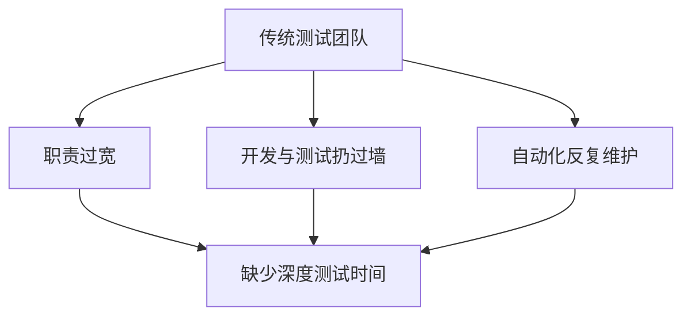
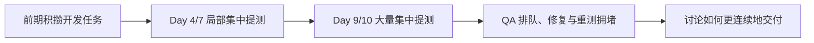

# DVSA 的质量工程转型：为测试留出深度，让质量成为团队能力

> 访谈嘉宾：Sam Webb（DVSA Lead Test Engineer），主持：Rosie Sherry，Into the MoTaverse，2026-11-11。本文根据用户提供的转录、中文笔记和官方简介整理。官方访谈：https://www.ministryoftesting.com/media-sessions/quality-engineering-at-the-dvsa-rebuilding-a-test-team-for-depth

## 目录

- [从外包走向内部质量能力](#从外包走向内部质量能力)
- [接手时暴露出的团队问题](#接手时暴露出的团队问题)
- [岗位改革：SDET 与测试工程师](#岗位改革sdet-与测试工程师)
- [质量不只属于测试团队](#质量不只属于测试团队)
- [统一估算与共同交付](#统一估算与共同交付)
- [成熟度：让质量不依赖某一个人](#成熟度让质量不依赖某一个人)
- [用 Jira 数据让团队看到交付瓶颈](#用-jira-数据让团队看到交付瓶颈)
- [自动化数量不是价值](#自动化数量不是价值)
- [变革如何获得认同？](#变革如何获得认同)
- [实操：分阶段转型路线](#实操分阶段转型路线)
- [AI 时代与 FAQ](#ai-时代与-faq)
- [总结](#总结)

## 从外包走向内部质量能力

英国驾驶与车辆标准局（DVSA）负责车辆 MOT 检查、驾驶考试和部分路边执法相关服务。Sam Webb 具有约 18 年测试经验。他加入 DVSA 后参与推动从多年依赖外部承包商的交付模式，转向建设内部软件与质量工程能力。约两年间，质量团队规模接近翻倍，并计划逐步增长。

Sam 观察到，部分外包项目因交付时间和 Sprint 承诺的压力，可能倾向于先用手工方式顶上，暂缓自动化或测试分层。内部团队则要长期承担维护成本。**激励方式与长期责任会影响工程投入**；这不应被概括成所有外包团队都缺少质量意识。

他甚至认为，偶尔未完成 Sprint 也可能成为学习机会；为了每个 Sprint 表面成功而牺牲长期工程能力，往往得不偿失。

## 接手时暴露出的团队问题

**第一，结构和职责不够清楚。** 约 12 名测试工程师向同一测试经理汇报，经理主要忙于协调，缺少亲自参与测试的时间。

**第二，测试仍被当成外围工序。** 开发修改代码、自动化套件失败，责任就落在 QA 身上。一位测试人员曾在七八个月内第五次重构自动化测试包。不断修脚本，不一定等于系统质量在进步。

**第三，岗位要求过度全面。** Sam 用“Ninja Unicorn（忍者独角兽）”形容一个测试工程师被期望同时承担分析、探索、框架、脚本、数据、工具等一切工作。上下文切换消耗巨大，难以形成专业深度。

## 岗位改革：SDET 与测试工程师

| 角色 | 主要定位 | 主要贡献 |
|---|---|---|
| **SDET** | 具有开发能力的测试工程师 | 为整个交付团队建设集成、契约、API、E2E 框架和工具 |
| **Test Engineer** | 具有业务判断力的技术测试工程师 | 风险分析、探索、决定测什么和不测什么、定义工具需求 |

Sam 明确反对将第二类角色简单称为“手工测试人员”。他们会使用 Postman、Bruno、DataGrip 和各种自动化工具，是技术专业人员。他还把测试工程师比作测试框架的“产品负责人”：他们向 SDET 提出业务和验证需求，SDET 建设共享工具，开发与 QA 共同使用。

改革初期，团队担心会制造“自动化”和“手工”两套孤岛。Sam 的原则是：**工具服务整个交付团队，而不只服务测试团队**。SDET 需要理解测试意图，测试工程师也可以写代码；角色区分的是主要投入方向，不限制个人学习和协作。

对 Cucumber 的看法同样如此：Gherkin 的价值在于业务可读。如果 PO、BA 从不看场景，只在开发内部流转，就浪费了共享业务理解的优势。可邀请 PO、BA 提供反馈，但仍需测试专业人员审核场景的准确性。

## 质量不只属于测试团队

Sam 在访谈中用工作定义区分几个术语：

| 概念 | 主要关注 |
|---|---|
| Testing | 实际验证行为与执行测试 |
| QC | 对已有产物作检查，如代码评审 |
| QA | 通过策略和流程预防问题，如 Three Amigos、Refinement |
| QE | 贯穿更广交付体系的质量工程方法 |

这些是 Sam 在访谈中使用的工作定义，并非行业唯一标准。PO 提供业务价值和验收反馈；BA 尽量将需求拆成能交付价值的小块；UCD 在设计阶段考虑用户体验；开发在写代码时维护规范和测试；质量工程团队继续提供专业引领。质量共担也需要明确各角色的责任。

Sam 用砌花园墙的工人作比喻：工人一边砌一边检查墙体是否对齐，而不是完工后另请一个测试员才开始检查。软件开发也应在工作过程中持续验证。

## 统一估算与共同交付

Sam 不喜欢将开发点数和测试点数、甚至运维点数拆成完全隔离的估算。假设某个故事开发只要 1–2 点、测试却需要 10 点，开发可协助增加自动化；若开发复杂而现有测试覆盖充足，测试工程师可更多参与其他风险任务。

统一估算保留专业分工，也让团队能围绕整体交付调配力量。团队要共同承担一个可交付的工作项，不必把各岗位清单是否全部打钩当作目标。

## 成熟度：让质量不依赖某一个人

Sam 提出一个带有挑战性的目标：小型交付团队里的测试工程师暂时不在时，团队仍应能**在既定风险政策下安全发布**。要达到这个目标，自测、工具、自动化和发布门禁都需要融入团队日常工作。测试工程师仍负责专业的风险分析和探索；安全、合规与高风险业务也可能要求独立审核。

他也强调 Shift Right：生产中不仅要问“功能是否符合用户故事”，还要问“是不是业务真正需要的结果”。因此除了提前澄清需求，还需要监控、业务指标和生产反馈。反过来也警惕过度 Shift Left——在错误时点不断追问可能阻碍推进。DVSA 当时只在约一半交付团队实施 SDET 模式，改革仍在渐进进行。

## 用 Jira 数据让团队看到交付瓶颈

很多团队说“QA 人手不足”。Sam 先看 Jira 的累计流图（CFD）和多次 Sprint 的流动数据，发现前几天几乎没有任务进入测试，第 4 天和第 7 天出现一波，第 9、10 天有巨大高峰。

这时问题不只是 QA 能否更快执行测试：即使末尾涌入的任务都测完，发现 Bug 后还有修复和重测时间吗？增加人员可能缓解峰值，但无法自动消除批量交接。

建议通过 CFD 同时观察在制品 WIP、队列宽度、工作项到达时间、重测次数和真实交付周期。不能仅用一张 CFD 图就断言永远不需要招聘，但它能帮助团队从“抱怨人手不足”转到“具体在哪里等待”的讨论。

## 自动化数量不是价值

Sam 举出“我们有一万条自动化”的说法：重要问题应是这些测试是否提供有用反馈、维护成本如何、能否快速定位缺陷。把复杂用户旅程、数据库校验和 API 检查都塞进庞大 E2E 测试，可能导致又慢又 flaky，开发难以发现哪一层坏了。

更合理的测试分层：

| 层次 | 适合验证 |
|---|---|
| 单元/组件 | 计算规则、条件分支、局部行为 |
| API/契约 | 请求响应、错误处理、服务兼容 |
| 集成/数据库 | 真实依赖和数据一致性 |
| 关键 E2E | 少数高价值用户旅程 |

低层次检查提供快速、具体反馈，复杂端到端测试只承担它独有的业务验证价值。Cucumber 可以帮助共同理解行为，但不应成为把所有断言堆进同一条 120 步脚本的理由。

访谈还讨论了“把测试扔进垃圾桶”的说法：Sam 回忆一位社区讲者曾建议，持续六个月都通过的测试可以考虑删除。Sam 认为照字面执行过于极端，但认同团队应定期治理低价值测试。长期通过的测试仍可能保护关键权限。删除或归档之前，要评估它的风险价值、替代覆盖、维护成本和运行频率。

## 变革如何获得认同？

Sam 认为质量负责人有时要像销售一样善于讲故事与展示数据。砌墙类比让人理解“内建质量”，CFD 让人看到“不是简单缺人”。Bug 也能反映验收标准、业务理解与开发假设的问题。跨政府部门社区和 MoTaverse 能提供外部案例，让长期只在一个组织工作的人获得新视角。

对领导层也应展示具体结果：更快的反馈、更少返工、更稳定的测试资产、更可靠的交付。只说“我们做了很多测试”，无法完整解释团队价值。

Sam 还提到，他见过有公司裁撤测试工程师、集中投入自动化，却没有把质量反馈环一起建立起来；后来又需要重新招回测试人员。自动化能承担重复执行，不能代替深入探索和专业判断。这是他的行业观察，不是关于所有公司的统计结论。

## 实操：分阶段转型路线

这一部分是学习笔记基础上的**编辑扩展**，非 DVSA 官方路线图。

1. **诊断**：观察几个 Sprint 的 CFD、测试排队、自动化维护时间、生产缺陷和返工；
2. **责任澄清**：约定开发自测、SDET 共用工具、Test Engineer 深度分析、PO/BA 验收责任；
3. **选一队试点**：同步推进测试分层、共享框架、需求细化、风险评审；
4. **恢复测试深度**：将 QA 从大量重复确认中释放出来做探索式与跨服务分析；
5. **用指标检验**：交付周期、等待时间、有效反馈、flaky、维护成本及生产影响；
6. **决定扩展**：基于真实证据而不是岗位名称或自动化数量。

### 团队检查清单

- [ ] 开发修改代码后承担相关测试维护责任
- [ ] SDET 工具可被整个交付团队使用
- [ ] QA 有明确的深度探索与风险分析时间
- [ ] PO/BA 参与业务行为和验收讨论
- [ ] 使用 CFD 观察测试批量涌入和等待
- [ ] API、契约、数据库与关键 E2E 层次清楚
- [ ] 定期审查低价值测试，不仅增加数量
- [ ] 生产反馈能够反哺测试策略

## AI 时代与 FAQ

**Q：SDET 与 Test Engineer 必须是独立职位吗？** 不一定。小而成熟的团队可以由一人兼任，重点是减少上下文切换和职责盲区。

**Q：开发会自测就不需要 QA？** 不对。团队需要专业的风险分析、未知场景探索和反馈闭环。

**Q：通过六个月的测试都该删？** 不对。它仍可能是保护核心风险的唯一哨兵；应先评估独特价值。

**Q：AI 自动生成测试越多越好吗？** 不对。Sam 的经验提醒：在不了解产品的情况下写更多测试，可能只是放大维护负担。当 AI Agent 越来越会写代码，理解好软件和质量原则的人反而更重要。

## 总结

DVSA 的核心经验不是“招聘更多 SDET”这么简单，而是**让专业分工带来深度，让共享工具促进质量共担，让交付数据驱动文化转变**。SDET 为全团队造工具，测试工程师不再反复证明本该由开发先验证的正常路径，而是调查复杂业务、关键风险和意料外的交互。测试效率由反馈价值决定，而不是由测试数量决定。

这是一则案例，不是所有组织都适用的模板。各团队应结合产品、风险和交付模式调整岗位协作、测试分层与度量方式。

**参考资料**

- Ministry of Testing 官方访谈：https://www.ministryoftesting.com/media-sessions/quality-engineering-at-the-dvsa-rebuilding-a-test-team-for-depth
- Martin Fowler，The Practical Test Pyramid：https://martinfowler.com/articles/practical-test-pyramid.html

## 更多参考

- 个人网站链接：[https://inaodeng.com/zh-cn/](https://inaodeng.com/zh-cn/)
- 微信公众号：软件测试同学
- AI 生成测试检测项目：[https://github.com/AI-Native-QA-Lab/ai-test-auditor](https://github.com/AI-Native-QA-Lab/ai-test-auditor)
- DeepSeek QA 工作台项目：[https://github.com/naodeng/dsh-qa](https://github.com/naodeng/dsh-qa)
- 更多 AI 测试技能：[https://inaodeng.com/zh-cn/qaskills/](https://inaodeng.com/zh-cn/qaskills/)
- 更多测试百科：[https://inaodeng.com/zh-cn/wiki/](https://inaodeng.com/zh-cn/wiki/)
- 更多 AI 百科：[https://inaodeng.com/zh-cn/AIWiki/](https://inaodeng.com/zh-cn/AIWiki/)
