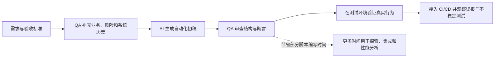
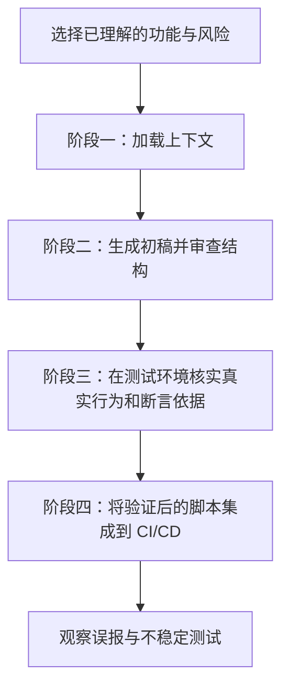
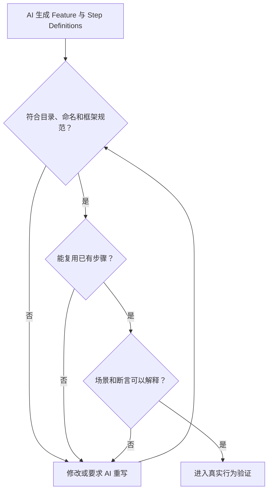
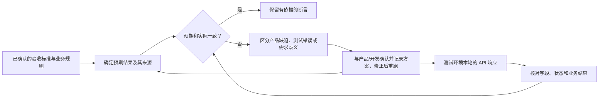
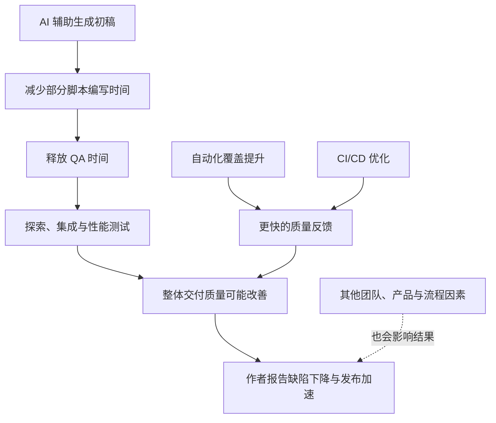
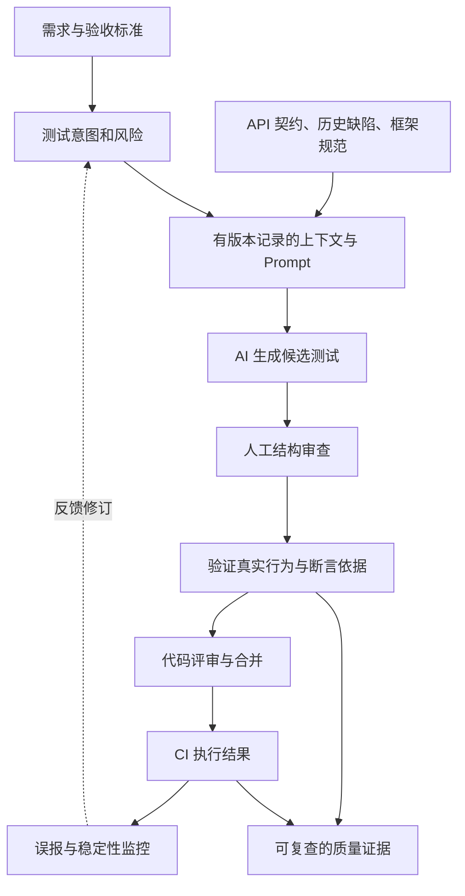

高流量 B2B 平台每月要交付多个版本时，QA 很容易花大量时间把验收条件逐条改写成自动化脚本。探索性测试和集成测试还没开始，写脚本就已占去不少时间。

Amna Zafar 在 Ministry of Testing 的文章中介绍了她从 2023 年年中开始尝试的四阶段方法：提供明确上下文、人工审查初稿、在测试环境验证行为，再持续监控。AI 负责起草重复性代码，QA 判断测试是否覆盖了正确的行为。

原文：From Script Writer to Test Strategist: https://www.ministryoftesting.com/moments/from-script-writer-to-test-strategist

作者 Amna Zafar 是高级 QA 工程师，持有 ISTQB 认证。她的案例来自一款高流量 B2B 平台的核心零售应用，使用 RestAssured、Cucumber BDD 和 Jenkins。文中会区分作者报告的经验与为团队复用而补充的工程建议。

## 工作重心从“写得快”转向“测得对”

直接把用户故事交给 AI 生成完整测试套件，通常会得到泛化脚本。上下文不足时，AI 可能猜接口、漏掉边界条件，或写出看似合理却违反业务规则的断言。QA 还得花时间返工，节省的时间可能很有限。

作者将 AI 定位为结构化工作流中的初稿伙伴。她的方法大致如下：



代码生成更快，不代表测试覆盖了重要风险，也不代表断言反映了正确的业务预期。

## 四阶段工作流



### 阶段一：加载上下文

作者会提供 API 契约或端点规格、数据模型、过去版本已知的边界情况，以及团队使用的 RestAssured 和 Cucumber BDD 语法。她也会附上现有 Step Definition 示例，让 AI 遵循团队的步骤组织和命名习惯。

| 提供给 AI 的上下文 | 帮助回答的问题 |
| --- | --- |
| API 契约与端点规格 | 路径、参数、状态码和响应结构是什么？ |
| 数据模型 | 字段类型、必填规则和数据关系是什么？ |
| 验收标准 | 哪些业务行为已经得到确认？ |
| 历史边界情况 | 哪些过去的缺陷或特殊规则需要回归？ |
| 框架语法与现有步骤 | 如何遵守团队的实现、复用和命名习惯？ |

下面的 Prompt 示例按原文方法重写，并非作者原话：

```text
请使用 Java、RestAssured 和 Cucumber BDD，
为订单查询接口生成自动化测试初稿。

API 契约：<粘贴经过确认的接口定义>
数据模型：<列出字段、类型和约束>
验收标准：<列出已确认的业务规则>
历史边界：<列出已知缺陷和回归场景>
现有 Step Definition：<提供团队采用的代码示例>

请覆盖正常路径和失败场景，优先复用已有步骤。
先列出每个场景的断言及其依据，再给出代码。
对缺少依据的预期标记“待确认”，不要自行补全。
```

上下文越准确，初稿越可能贴近团队现状。上下文不能代替需求澄清；验收标准互相矛盾时，QA 仍要推动相关人员作出决定。

### 阶段二：生成初稿，先审查结构

作者先以 Code Reviewer 的方式审读初稿，检查它是否符合框架惯例、能否复用 Step Definition、命名是否一致，以及场景是否易懂。

她报告的结构审查通常需要 15–20 分钟；过去从空白开始编写一份初稿需要 2–3 小时。这个比较针对初稿编写与审查，并不代表整个测试生命周期也缩短到相同程度。

下面把作者列出的结构检查项整理成复审路径；修改后重审是便于执行的工程化表达，不是原文规定的固定步骤。



结构审查能发现代码组织问题；脚本即使整洁、执行稳定，也不能证明预期结果正确。

### 阶段三：验证真实行为和断言依据

阶段三要核实每条断言。作者发现，AI 会生成“看起来对、实际上错”的断言，例如假设批发买家和零售买家适用相同折扣，或给动态订单号写入固定值。

核对时不能只把 API 当前返回的值复制成期望值。被测系统本身可能有缺陷；测试预期应来自已确认的业务规则、接口契约或独立准备的测试数据。若预期与响应不一致，还要判断是产品缺陷、测试实现错误，还是需求仍有歧义。

| AI 可能给出的断言 | 为什么需要质疑 | 更可靠的核对依据 |
| --- | --- | --- |
| 所有买家的 `discountRate` 都是 `0` | 零售促销和批发定价规则可能不同 | 已批准的客户类型规则与独立测试数据 |
| 订单号等于 `ORD-10001` | 订单号通常由运行时生成 | 创建结果中的 ID、格式和关联关系 |
| 金额只需返回 HTTP 200 | 状态码没有验证价格是否正确 | 契约中确认的税、折扣和舍入规则 |
| 无效请求也返回 HTTP 200 | AI 可能从正常路径推断状态码 | 对失败场景明确规定的错误契约 |

以下代码是工程示意，不是作者项目中的真实接口或测试代码。它展示如何验证动态订单号与规则预期。示例夹具假设已确认 `SKU-42` 的批发单价为 125.00、数量为 4，且本例不计税费和折扣。`fixture`、`requestSpec` 和路由应映射到项目的测试数据与接口；金额预期应独立于响应：

```java
String orderId = fixture.createWholesaleOrder("SKU-42", 4);
BigDecimal expectedTotal = new BigDecimal("500.00"); // 已确认的测试规则：125.00 × 4

Response response = given()
        .spec(requestSpec)
        .pathParam("id", orderId)
    .when()
        .get("/orders/{id}");

response.then().statusCode(200);
assertThat(response.jsonPath().getString("id")).isEqualTo(orderId);
assertThat(response.jsonPath().getBigDecimal("total"))
        .isEqualByComparingTo(expectedTotal);
```

固定金额只适用于本例说明的夹具规则；实际测试还应纳入适用的折扣、税费和舍入条件。这里的重点是，订单 ID 来自本次创建结果，金额预期则来自独立确认的规则。

下面把真实行为与断言依据的核对展开成处理路径；不一致后的修复、澄清和重跑是工程建议，原文没有规定固定回退节点。



只有规则和证据支持时，才修改断言。把实际响应直接当成标准答案，会让测试替系统中的错误背书。

### 阶段四：集成并观察

作者把验证后的脚本接入 Jenkins，并在最初三个发布周期观察误报和 Flaky Tests（不稳定测试）。这是她在该项目中采用的观察窗口，不能视为行业通用标准。

作者也观察到，AI 初稿在动态数据上更容易写入固定值。对于订单号、时间戳和异步操作，测试应检查适当的业务不变量、数据关联或有界完成条件。模式匹配有时比固定值更稳，但应由业务规则决定断言形式，不能为了消除失败而弱化验证。

| 容易脆弱的检查 | 可以考虑的验证方式（工程建议） |
| --- | --- |
| 订单号等于固定字符串 | 检查格式，并与本次创建操作返回的 ID 对应 |
| 时间戳等于固定文本 | 按契约检查时区与允许的时间窗口 |
| 固定等待几秒后继续 | 等待可观察且有上限的完成条件 |
| 多个测试共用会变化的账户余额 | 使用隔离数据和可重复的前置状态 |
| 失败时反复重试直到通过 | 保留失败记录，区分环境、数据和产品原因 |

## 案例数据说明了什么

作者报告，每个功能的脚本编写时间减少约 **60%–70%**。这是她在该项目中的编写时间观察，不是独立测量的行业结果，也不能推断整体 QA 工时减少同等比例。

| 作者报告的结果 | 更精确的解读 |
| --- | --- |
| 每个功能的脚本编写时间减少约 **60%–70%** | 指脚本编写时间，不等于端到端测试周期缩短同样比例 |
| 结构审查约 **15–20 分钟**，过去从零写初稿约 **2–3 小时** | 两者比较的是不同的初稿工作方式，不包含后续完整验证 |
| 核心零售应用在所述期间 Sprint 交付后零缺陷 | 作者报告的阶段性结果，不能证明没有未发现缺陷或未来不会出现缺陷 |
| 全平台生产缺陷最多下降 **90%**，发布周期加快 **50%** | 作者把改善与自动化覆盖提升、CI/CD 反馈加快等因素联系起来，不能全部归功于 AI |
| 更多时间用于探索性、集成和性能分析 | 作者描述的工作重心变化，没有给出具体时间分配比例 |

原文没有提供完整基线、统计方法、对照组或独立审计数据。这些数字只能作为作者的案例观察，不能据此认定 AI 普遍带来同样收益。



## QA 从脚本编写者走向测试策略师

作者所说的角色转变，关键在于时间重新分配：AI 起草重复性代码，QA 把更多时间用于理解风险、核实断言和决定下一步测试。

| 工作重点 | 以脚本编写为中心 | AI 辅助下的策略工作 |
| --- | --- | --- |
| 主要产出 | 自动化脚本 | 风险覆盖、可信断言和可解释的质量证据 |
| 时间投入 | 手写重复步骤 | 业务理解、测试设计、结果验证 |
| AI 的角色 | 被当成自动生成器 | 受上下文和人工判断约束的初稿伙伴 |
| 完成标准 | 脚本能运行、测试变绿 | 断言有依据，重要风险得到验证，结果可以解释 |


AI 可以补充候选场景，却不能判断团队最需要控制哪些风险。它未必能识别错误的验收标准，也未必掌握系统历史或只存在于团队经验中的规则。测试设计和业务判断仍由 QA 负责。

## 方法可以迁移，领域风险需要重新评估

作者认为这套四阶段方法不绑定某个自动化框架。提供 Selenium、Cypress 或 Playwright 的语法示例与团队约定后，也可以沿用这套工作流；生成的测试仍需按各框架约定和真实行为审查。

作者也在探索将这套方法用于医疗科技，并提到 GDPR、NHS 数据标准、漏报对患者安全的影响和监管审计追踪。原文没有报告该方法在医疗科技领域落地或验证成功。高风险环境还需按适用法规、数据治理和患者安全要求，重新设定上下文、审查与证据标准。

## 工程延伸：保留从需求到执行的证据链

下面是为团队复用四阶段方法补充的工程建议，原文没有声称该架构已在项目中实施。每个关键测试都可以关联需求与风险、测试意图、生成版本、人工审查结论、断言依据和执行结果：



这样的记录能帮助团队区分“生成了多少测试”与“测试实际证明了什么”。如果要评估 AI 辅助测试，可以另外观察错误断言、审查成本、需求覆盖缺口和运行稳定性；具体指标应结合项目风险定义，不能直接从本文案例数字推导。

AI 可以加快机械性的初稿编写。QA 仍需验证需求、断言和真实行为，生成的代码才有机会成为可信测试。节省下来的时间应投入测试策略和质量证据，这就是从脚本编写者走向测试策略师的实际变化。

来源：Amna Zafar, “From Script Writer to Test Strategist,” Ministry of Testing / MoTaverse, 2026-10-30. https://www.ministryoftesting.com/moments/from-script-writer-to-test-strategist
