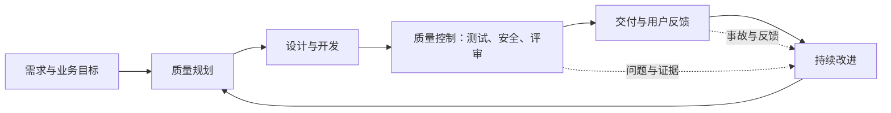
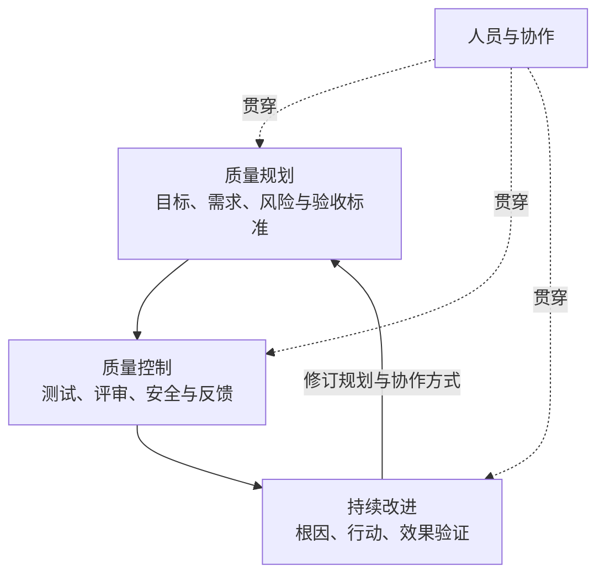
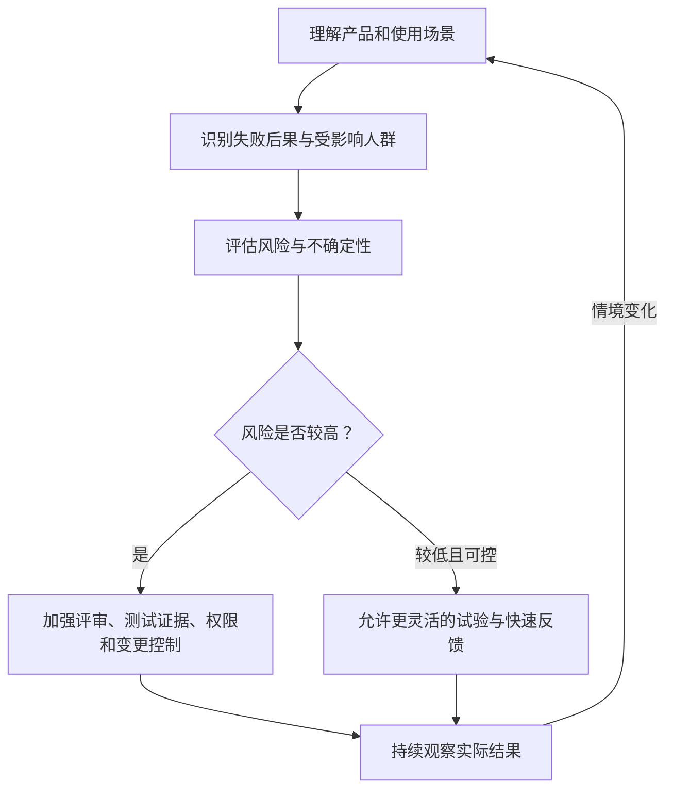
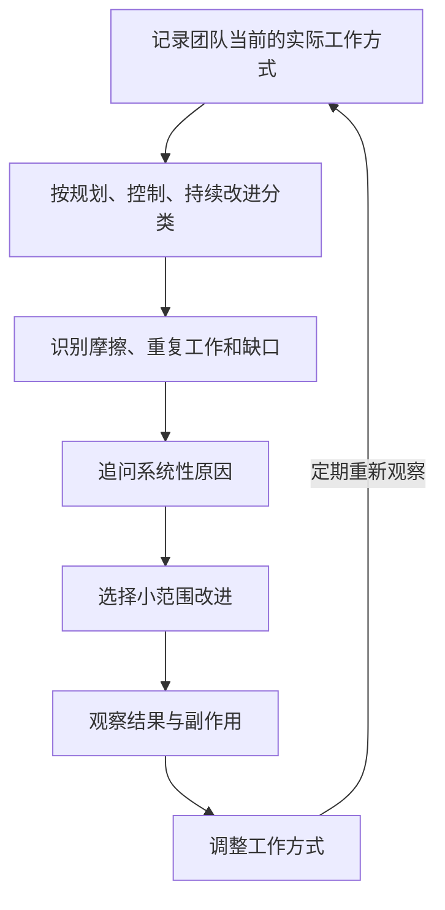
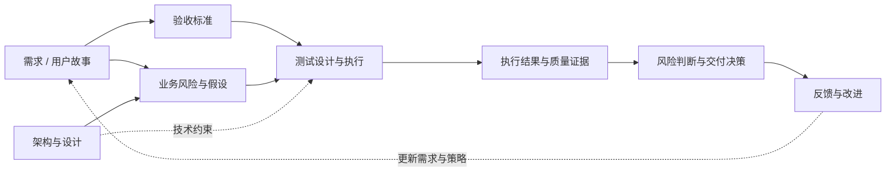
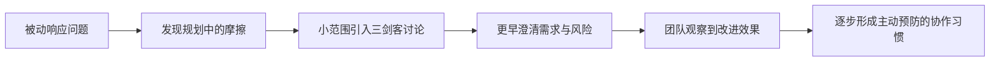

## 核心观点：不要只修复测试发现的问题，还要改进产生问题的系统

Melissa Fisher 从测试工作中的一个反复出现的现象切入：**测试中暴露的问题，根因往往不在测试本身**。问题可能来自前期规划不清楚、设计阶段未识别风险，也可能来自复盘提出的改进措施始终没有落地。

因此，质量工作的视角需要从“发现并报告缺陷”，扩展为“观察整个系统如何产生质量结果，并改进其中的薄弱环节”。

Rosie Sherry 用一句话概括这一方向：**“单靠测试，做不出好产品。”（原话：“You can't test your way to a good product.”）** 仅靠增加测试，无法替代好的产品规划、团队协作和持续改进。

这并不意味着测试不重要，而是说测试只是质量管理系统中的一个环节。

**图示解读**：测试是发现问题与提供反馈的重要机制，但质量改善需要反馈进入规划、开发和协作方式，形成闭环。

## 什么是系统：从机场塔台理解 QMS

Melissa 在工作坊里让参与者想象自己站在机场塔台：能看到飞机、天气、机组、乘客、行李和航班安排。每个要素都可能运转正常，但如果彼此之间没有协调机制，整个机场仍可能出现延误、行李丢失等问题。

软件团队也类似。需求、设计、开发、测试、部署、运维和用户支持不是互不相干的工作，而是相互影响的系统。

| 机场系统 | 软件交付系统 | 可能出现的摩擦 |
|---|---|---|
| 航班计划 | 需求、迭代和发布计划 | 目标不清、排期冲突 |
| 机组与地勤 | 产品、研发、质量保障（QA）、运维 | 责任不清、交接遗漏 |
| 行李流转 | 测试数据、代码、配置与工件流转 | 数据缺失、版本不一致 |
| 塔台协调 | 跨团队协作与发布协调 | 信息不同步、依赖阻塞 |
| 天气与外部限制 | 外部服务、监管、基础设施风险 | 不确定性与突发故障 |
| 航班延误后的调查 | 缺陷分析、事故复盘 | 只处理症状、不改根因 |

Melissa 对 QMS 的直观解释是：**采用结构化的工作方式，以满足运营方、客户和其他利益相关者的期望。**

需要注意：这是一种帮助初学者理解的类比，不是 ISO 9001 的正式定义。

## “质量是摩擦的缺失”：一个观察系统的视角

访谈中 Melissa 引用了“**Quality is the absence of friction**”（质量是摩擦的缺失）这一说法，用它来解释质量专业人员如何观察系统中的阻力、返工、重复劳动和重大问题。文字稿将引述者转写为“Stuart Crocken”，但姓名可能存在语音转写误差，因此此处不将其作为已经核实的署名。

“摩擦”不一定是产品缺陷，也可能是：

- 需求在多个会议中反复解释，却仍没有共同理解。
- 开发完成后才发现验收标准存在冲突。
- 自动化测试不断失败，但多数时间花在环境和数据修复上。
- 每次复盘都提出相同问题，却没有人跟进改进。
- AI 帮助生成大量内容，人工去重和复核反而耗时更长。

| 可见现象 | 可能的系统性原因 | 值得追问的问题 |
|---|---|---|
| 同一类缺陷反复出现 | 需求澄清或设计评审不足 | 为什么问题总在开发后期才被发现？ |
| 回归测试越来越慢 | 测试套件缺少治理 | 哪些测试仍在提供有效风险证据？ |
| 复盘没有效果 | 行动项缺少负责人和验证 | 哪些改进真的改变了工作方式？ |
| AI 输出数量增加但效率下降 | 输入质量、审查策略或职责分工不清 | 生成速度提高后，整体交付周期是否缩短？ |

**边界说明**：摩擦是有用的诊断线索，但不能把“没有摩擦”当作质量的唯一标准。安全、合规、可靠性和用户价值仍需要明确的质量要求；必要的评审或安全门禁即使增加短期工作量，也可能降低长期风险。

## 从三个切入点观察质量管理体系

Melissa 在工作坊中把可由团队主动改善的部分归纳为三个方面：**质量规划、质量控制、持续改进**。她同时提到，完整的质量管理还涉及管理、领导力和审计等内容。因而这三个方面是便于实践的简化框架，而不是完整 QMS 的全部组成。

| 切入点 | 关键问题 | 软件团队中的典型活动 | 典型缺口 |
|---|---|---|---|
| 质量规划 | 我们是否知道要交付什么、为什么、风险在哪里？ | 需求澄清、三剑客讨论、验收标准、风险分析 | 需求模糊、重要假设未验证 |
| 质量控制 | 我们如何识别和控制偏离预期的结果？ | 测试、代码评审、安全检查、发布验证 | 检查滞后、证据不足 |
| 持续改进 | 我们是否从反馈中改变了系统？ | 复盘、根因分析、行动项跟踪、流程改进 | 只讨论问题、不落实行动 |

Melissa 特别强调：不仅要记录团队**做了什么**，还要观察团队**怎么做的**。例如，团队可能已经有复盘会议，但如果行动项没有落实，“有复盘”并不等于“持续改进有效”。

## 根据产品风险调整治理强度

访谈中使用医疗设备、支付问题和笔记应用说明：不同产品的失败后果不同，质量管理方式不能一刀切。

| 访谈中的例子 | 主要风险 | 治理倾向 |
|---|---|---|
| 医疗设备 | 可能危及生命 | 更严格的验证、变更控制和证据要求 |
| 支付功能 | 财务损失、交易错误 | 强调交易正确性、异常处理和数据一致性 |
| 笔记应用 | 一般功能和体验问题 | 在适当范围内可更灵活地实验和迭代 |

以上只是访谈中的**说明性例子**，不是固定的行业风险分级。实际风险还取决于使用场景、数据敏感性、影响范围及适用法规。一个笔记应用如果处理高度敏感数据，也可能存在严重风险；支付系统的某些故障也可能造成重大损害。

对于 AI 智能体，低风险任务可以更适合试验性使用；涉及高风险系统或不可逆操作时，则需要更谨慎的授权和审查。**“可以试验”不等于“可以无约束地自动执行”。**

## 摩擦地图：把抽象的 QMS 变成可讨论的团队现状

Melissa 在 MoTaCon 工作坊使用了一张简单的纸，划分为规划、控制和持续改进三个区域，要求参与者写下团队当前实际在做的事情、具体做法以及存在的缺口。

她建议在变化较快的环境中，尤其是 AI 持续改变工作方式的背景下，每 **6–12 个月**重新观察一次。

| 质量规划 | 质量控制 | 持续改进 |
|---|---|---|
| 需求如何进入团队？ | 重要风险如何验证？ | 复盘问题如何追踪？ |
| 谁参与验收标准讨论？ | 测试与安全检查何时发生？ | 是否验证改进效果？ |
| AI 生成的范围由谁复核？ | 自动化失败如何归因？ | 同类问题是否反复出现？ |
| 哪些假设尚未确认？ | 是否存在未经验证的质量结论？ | 哪些流程正在增加返工？ |

### AI 时代的摩擦案例

**案例：AI 生成验收标准，规划反而变慢。**

AI 智能体能快速生成需求范围和验收标准，但输出存在重复或模糊内容，人工需要花数小时清理。局部看，生成速度提高了；从系统看，规划总耗时可能增加了。

值得优化的可能不是“再换一个更快的模型”，而是输入上下文、输出结构、去重方式、审查责任和验收标准的质量要求。

**案例：AI 生成代码量增加，理解与审查跟不上。**

访谈提出的问题是：工程师是否真正理解自己提交的代码？如果理解不足，可能需要调整评审流程、培训方式和安全护栏，而不是只用代码产出量评价效率。

这两个案例来自访谈中的讨论；具体解决措施应结合团队现状验证，不能预先认定某项工具一定能减少摩擦。

## 常见误区：QMS 不是增加会议和流程

| 常见想法 | 访谈中的回应 | 更准确的理解 |
|---|---|---|
| 现在没出事故，不需要改变 | 当前正常不代表未来没有风险 | 关注未来风险和机会 |
| QMS 会让团队变慢 | QMS 旨在减少返工、重复和救火 | 评价总体效果，而不是流程数量 |
| 复盘就是处理眼前最烦的问题 | 应从整个系统观察真正薄弱的地方 | 同时考虑短期症状和系统性根因 |
| 质量是 QA 团队的责任 | 质量依赖跨角色协作 | QA 提供专业能力，组织共同承担质量责任 |
| AI 让每个环节更快，系统就更快 | AI 也可能制造新的审查和协调成本 | 看端到端流动效率与风险 |

Rosie 也提醒，推动系统变化不总能靠强推。团队需要理解组织的现实约束，从能产生实际作用的小改进开始。

## QMS 与 ISO 9001：可迁移的是系统思维

Melissa 提到 **ISO 9001**，并把质量管理体系的经验与制造业、汽车生产线和医疗器械等领域联系起来。她认为，软件行业可以借鉴这些领域关于系统、过程和持续改进的经验。

但这里应作两点区分：

- ISO 9001 是通用的质量管理体系要求标准，不只适用于制造业；不能据此说软件行业尚未采用 QMS。
- 访谈表达的是：软件团队可以更主动地借鉴系统性的质量管理思维，而不是仅围绕测试活动组织质量工作。

**工程延伸**：在软件团队中，可以借鉴过程方法、风险思维、基于证据的决策和持续改进等理念；是否需要正式认证、怎样建立管理体系，则取决于组织的业务与合规要求。

## 从测试管理到质量编排：未来可能的发展方向

Rosie 提到一次关于测试管理的线上课程，其中讨论了“编排”以及数据的上下文和关系。她提出：当我们连接 Jira 工单、验收标准、测试、架构图和其他文档时，管理的已经不只是测试活动，是否应更接近质量管理体系？

课程讲者使用了 **质量编排（Quality Orchestration）** 一词。Melissa 也认同这个方向，并指出 AI 可能帮助团队更快消化信息、识别风险和假设。

| 视角 | 主要关注点 | 示例 |
|---|---|---|
| 测试管理 | 测试计划、用例、执行与缺陷 | 测试管理平台 |
| 质量管理体系 | 组织如何规划、控制和改进质量 | 跨团队工作方式、责任与反馈机制 |
| 质量编排 | 将相关信息、角色和活动连接起来 | 需求、风险、设计、测试与结果之间的关系 |

**重要边界**：质量编排是访谈中的发展方向和讨论用语，不应理解为所有组织都会从测试管理平台线性升级到某一种统一工具。

**工程延伸**：这些关系可以由链接、结构化元数据或知识图谱表达，但工具形式不是重点。重点是让团队能够回答：为什么要测这个、测到了什么、还有什么没有证据、哪些风险尚未解决。

## AI 在 QMS 中的机会与边界

访谈没有给出成熟的智能体自主权限标准，而是明确提出尚待探索的问题：**多少工作可以交给智能体，哪些环节仍需要人工审查？**

从访谈观点出发，可以将 AI 的作用理解为帮助整理信息、发现假设和识别风险，而不是自动取代质量责任。

| 可能由 AI 辅助的活动 | 需要保留的判断 |
|---|---|
| 汇总需求、设计和历史缺陷 | 业务目标和需求是否被正确理解 |
| 发现文档中的冲突与遗漏 | 哪些问题是真正重要的风险 |
| 提议验收标准和测试场景 | 预期结果是否符合业务意图 |
| 整理复盘记录和行动项 | 哪些改进值得投入以及由谁负责 |
| 关联测试结果与风险证据 | 剩余风险是否可接受 |

### 可访问性为什么适合更早介入？

Melissa 特别提到，可访问性常常被放到很晚才考虑。若能在规划阶段就识别用户角色、不同能力需求和交互约束，就有机会在设计和开发前降低返工。

这体现了 QMS 的价值：不是把更多检查放到最后，而是把质量问题提前纳入系统的工作方式。

## 人与协作：比流程名称更重要

访谈后段，Melissa 强调高质量的系统往往依赖良好的协作。讨论系统时，人们容易关注流程和机制，却忽略了实际参与协作的人。

她分享了一个团队变化：刚加入时，团队主要被动处理问题；之后通过更好的质量规划、不同方式的测试和协作，逐步转向主动预防。

Melissa 并没有先要求大家正式实施“QMS”，而是从小处切入，例如组织 **三剑客（Three Amigos）** 讨论，让相关角色共同理解需求和质量风险。随着团队看到价值，这种协作方式逐渐被接受。

**工程延伸**：三剑客讨论通常由业务、开发、测试等不同视角共同参与，但参与者不必机械限定为三个人；关键是让不同专业视角尽早相遇。

## 从事故中学习：不要只看直接技术原因

Melissa 建议阅读真实事故的技术报告和根因分析，从中理解系统性问题。她在访谈中提及一件与 Hugging Face、AI 智能体和安全有关的事件，但文字稿中的描述较为口语化，缺少可独立核对的事件标识。

因此，不宜仅根据这段访谈就断言某个具体平台遭遇了怎样的成功攻击、由谁实施以及产生了什么后果。

这段讨论真正要表达的学习方法是：通过事故报告追问安全设计、权限控制、协作机制和审查过程中的缺口。即使没有深厚的安全背景，也可以从一个基本问题开始：**“这个 AI 智能体的安全风险考虑过吗？”**

## “Ahh Test”与飞轮思维

Rosie 描述了 MoTaverse 团队使用的一种直觉性决策原则。访谈文字稿将名称转写为“the r test”，MoTaverse 页面则称其为 **“Ahh Test”**。结合上下文，它指的是做决定时，团队会讨论这件事是否让人觉得合理、是否支持整个系统。

她举出的顾虑包括：增加过多工作、给团队带来压力、存在安全风险，或对某部分用户不公平。

它不是正式测试方法，也不能替代可验证的安全、合规或质量证据。它更像是团队识别不协调之处的讨论入口。

Rosie 还用飞轮作比喻：如果某个做法持续拖慢系统运转，就值得调查其中的摩擦。

飞轮不是单纯追求速度。若速度提升以牺牲安全、可靠性或团队可持续性为代价，也可能损害整个系统。

## QA 的职业发展：从执行测试到推动系统改进

Melissa 认为，测试人员在积累经验后，可以不只报告缺陷，还能对产品、流程和团队能力提出改进建议。**即使不担任管理职务，也可以发挥领导力。**

访谈提到或讨论了几类角色方向：

| 角色方向 | 关注点 | 与 QMS 的联系 |
|---|---|---|
| 质量工程师（Quality Engineer） | 测试与质量工程实践 | 识别风险、提供质量证据 |
| 质量架构师（Quality Architect） | 跨环节的质量设计 | 将质量要求嵌入系统设计 |
| 质量赋能负责人（Quality Enablement Lead） | 帮助团队形成质量能力 | 改善协作、方法和组织能力 |
| Staff 级质量工程师（Staff Quality Engineer） | 跨团队技术影响力 | 推动系统性质量改进 |
| 有测试背景的工程经理（Engineering Manager） | 团队交付与组织协作 | 将质量思维扩展到工程管理 |

这些不是访谈规定的标准晋升路径，而是嘉宾观察到的岗位演化方向。

对测试人员而言，重要变化是：**专业价值不只体现在发现多少缺陷，也体现在是否能够解释缺陷为什么产生，并帮助团队降低再次发生的可能性。**

## AI 原生质量工程的延伸思考

以下属于基于访谈的独立工程延伸，并非 Melissa 或 Rosie 在播客中提出的正式模型。

如果把 AI 原生质量工程看作一种系统能力，可以分成三个相互关联的层面：

| 层面 | 关键能力 | 需要回答的问题 |
|---|---|---|
| 质量规划 | 需求理解、风险建模、验收标准设计 | 我们是否在构建正确的东西？ |
| 质量验证与控制 | 测试策略、自动化、智能体评估、质量证据 | 我们凭什么相信它符合要求？ |
| 持续改进与治理 | 根因分析、指标反馈、权限与变更治理 | 系统如何持续变得更可靠？ |

AI 的作用可以是辅助理解上下文、生成候选方案、关联证据和发现潜在缺口；但质量责任、业务取舍和高风险决策仍需明确归属。

这个视角也提示：与其只建设更多测试工具，不如思考这些工具能否共同减少系统中的摩擦。例如，一个自动化工具即使运行很快，如果结果无法追溯到业务风险，仍可能增加团队解释和决策的成本。

## 最终理解

这期访谈并不是要求测试人员放弃测试，也不是建议每个团队立即建立庞大的 QMS 平台。

它真正推动的思考是：**测试结果只是系统运行后的一个信号。若希望质量持续改善，就需要理解信号背后的规划、控制、协作和反馈机制。**

Melissa 提供的三个切入点——质量规划、质量控制、持续改进——让团队能够从实际工作出发，识别摩擦与缺口。Rosie 则进一步将讨论扩展到质量编排、AI、团队文化与职业发展。

最值得保留的一句话是：

> **不要只测试系统的产出，也要持续改进产生这些产出的系统。**

---

*整理与核对说明：正文优先依据本期播客文字稿；机场类比、三个切入点、摩擦地图、风险差异、质量编排、三剑客讨论、“Ahh Test”和职业发展均有访谈依据。图表是为帮助理解而重新绘制的示意图，不是原节目官方图示。ISO 9001 的完整范围、事故细节和书目署名等无法仅凭访谈确认的内容，已在相应位置标明边界。*

## 值得进一步阅读的内容

- **ISO 9001**：质量管理体系要求，适合了解过程方法、风险思维和持续改进的基础框架。
- **系统思考**：帮助理解局部优化与整体效果之间的关系。
- **Elizabeth Hendrickson 等人的《Signals and Levers》**：MoTaverse 页面评论区读者补充的系统思考阅读建议。访谈中 Melissa 只表示对 Hendrickson 的一本新书感兴趣，并未在对话中确认书名。
- **真实事故的根因分析报告**：适合练习从直接故障追溯到规划、协作、设计和治理机制。
- **ISO 9001 标准信息**：https://www.iso.org/standard/9001

## 来源与说明

- **来源**：MoTaverse 播客 *Into the MoTaverse*，《从测试管理到质量管理体系》（原题：*From Test Management to Quality Management Systems*，节目页面日期：2026-10-28）
- **原文**：https://www.ministryoftesting.com/media-sessions/from-test-management-to-quality-management-systems
- **整理依据**：访谈完整文字稿、最初学习笔记；技术实践延伸另行标识。
- **阅读提示**：QMS 是质量管理体系（Quality Management System）的缩写。这篇文章以访谈为主，不等同于 ISO 9001 标准解读，也不代表嘉宾提出了一套完整、可直接认证的实施规范。
