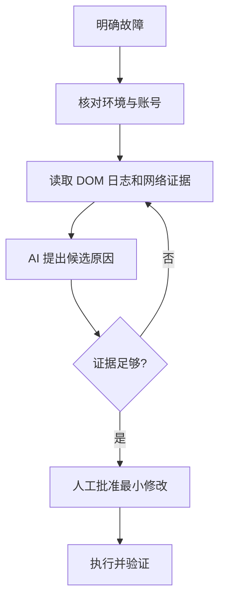

# 怎样和 AI 一起做测试：从清晰提问到安全边界

> 演讲：Kristin Jackvony，Ministry of Testing AI Chapter，2026-11-12。本文根据用户提供的逐字稿、中文学习笔记和官方简介整理，并加入 QA 实践扩展。官方页面：https://www.ministryoftesting.com/media-sessions/how-to-talk-to-ai

## 目录

- [引言：AI 很快，但不一定理解你的目标](#引言ai-很快但不一定理解你的目标)
- [AI 不会因为客气就更懂你的意思](#ai-不会因为客气就更懂你的意思)
- [先确认 AI 能看到哪些信息](#先确认-ai-能看到哪些信息)
- [AI 会给出错误答案](#ai-会给出错误答案)
- [把任务目标和输出说具体](#把任务目标和输出说具体)
- [明确 AI 可以做什么、不能做什么](#明确-ai-可以做什么不能做什么)
- [先问能缩小排查范围的问题](#先问能缩小排查范围的问题)
- [综合案例：无法点击 Confirm 按钮](#综合案例无法点击-confirm-按钮)
- [Q&A 补充的实用经验](#qa-补充的实用经验)
- [可以复用的 QA Prompt](#可以复用的-qa-prompt)
- [FAQ 与检查清单](#faq-与检查清单)
- [总结](#总结)

## 引言：AI 很快，但不一定理解你的目标

“帮我修一下自动化测试。”AI 可能立即更换定位器、增加等待，甚至删除失败断言。脚本绿了，却可能掩盖实际产品问题。Kristin Jackvony 用《星际迷航：下一代》中船员与飞船计算机的对话，解释如何让 AI 成为高效工具，而不是替代人的思考。

| 原则 | 应用在 QA 的一句话 |
|---|---|
| AI 不是你的朋友 | 清晰下达任务，不必添加冗长寒暄 |
| AI 的知识有限 | 要求来源、检查检索范围 |
| AI 会出错 | 证据优先，别被自信口吻误导 |
| 具体指令 | 给目标、范围、约束、输出 |
| 设置边界 | 定义读写权限、环境与审批 |
| 问对问题 | 先诊断，再决定改代码还是改环境 |

## AI 不会因为客气就更懂你的意思

在《Galaxy's Child》中，Geordi 模糊地要求把灯调暗“营造氛围”，计算机直接关灯。双方反复调整才得到目标亮度。与之相反，《Identity Crisis》中 Geordi 指定音频时间索引 1447–1558 和需要寻找的异常类型，任务便明确了。

用于测试，可以直接说：

- 将指定自动化测试运行五次，并汇总每次结果；
- 列出最近一次 Nightly Run 的全部失败测试；
- 定位测试失败时执行到的代码行，附堆栈。

讲者建议删掉不必要的客套话以节省 token。补充一点：**少量“请/谢谢”并非主要成本问题**，真正应该避免的是含糊、重复和没有任务价值的上下文。

## 先确认 AI 能看到哪些信息

在《Violations》中，飞船计算机认为船上没有可能导致昏迷的物质，后来发现有一种相关成分不在扫描范围内。故事中，这种成分并不是昏迷原因；例子要说明的是“没找到”不等于“已经完整检查且不存在”。

现代 AI 的限制不只来自训练数据，也包括当前上下文、检索范围、工具权限和分页。讲者遇到过 AI 把 Jira Bug 数量从 29 说成 31 的情况。她还提到，团队用 Atlassian Rovo 查找 Jira 评论时，结果只覆盖第一页，漏掉了第二页上的评论。

**实践：不要只要答案，要检索账本。**

```text
查询最近 30 天的全部缺陷。
提供查询过滤条件、数据源和结果总数。
若接口分页，逐页查询直至确认没有下一页。
列出 ID 并验证总数与实际输出行数一致。
缺少权限或无法检查全部页面时，不得声称“全部”。
```

最好区分“已验证不存在”“当前未发现”“尚未检查”“无法确认”。来源也需要自己核验，不能因为 AI 附了 URL 就认为可信。

## AI 会给出错误答案

《Conundrum》中，失忆船员信任飞船计算机，却不知道信息已经被外星人篡改。Picard 通过与原则相冲突的行为察觉不对劲。对应 QA：当 AI 判断“请求超时”，实际日志却是 403，就应继续调查。

Kristin 建议结合常识、追问依据，必要时让第二个 AI 检查一段代码。交叉模型可以带来不同视角，**但两个 AI 得出相同结论也不构成证明**：还要查看文档、运行测试或检查真实日志。

讲者也建议询问 AI 对答案有多确定。但自报的百分比没有经过校准时，不能当成可靠概率。更实用的做法是让它说明：

```text
针对你的结论列出：
1. 已确认事实及原始证据
2. 仍存在的假设
3. 至少两个替代解释
4. 下一步如何通过一次验证区分这些解释
不要给出没有校准依据的百分比置信度。
```

## 把任务目标和输出说具体

《Schisms》中让计算机“生成一张桌子”，结果有 5,047 种分类；《The Chase》中，Picard 则明确要求分析碎片分布、纠正 40 亿年星体位置变化、推算缺失部分。

提问最好包含：**背景、目标、输入、范围、限制、输出**。例如不是“分析测试”，而是：

```text
背景：Nightly Run 共 17 条失败，其中 5 条已人工确认是登录凭证失效。
任务：仅分析其余 12 条失败的共同根因。
输入：CI 报告与相关日志。
输出：失败 ID、分类、证据、待验证假设，用表格回答。
限制：不得修改测试、不得隐藏失败、不得启动重跑。
```

演讲建议明确最终产物，例如“五页测试策略 PPT”，或要求“一段话比较工具”，以减少无用输出。但仅当“5 条登录失败已确认”时才应排除它们；否则会误删真实回归信号。

## 明确 AI 可以做什么、不能做什么

《Elementary, Dear Data》中，Geordi 要求全息舱创造能击败 Data 的对手，结果 Moriarty 获得了超出预期的能力。具备终端、浏览器和 API 权限的 Agent，同样可能超范围操作。

讲者给出的警戒线包括：未经批准不得修改代码；在生产环境限制 API 请求；无权限时停下来询问，不要主动寻找凭证。Q&A 中她提到，自己需要 AWS 密钥时，只让 AI 提示去哪里查，再亲自取用密钥。她也提醒，不能把 AI 当作伦理判断者；涉及隐私、身份冒用或密钥操作时，必须由人设定权限边界并承担责任。

实践中不能只靠 Prompt：

| 风险 | 实际控制 |
|---|---|
| 误改源代码 | 只读模式、工作树隔离、diff 审批 |
| 误操作生产环境 | 沙箱和网络隔离、只读账户、工具白名单 |
| 擅自读取密钥 | 最小权限、密钥隔离、脱敏日志 |
| AI 为通过测试删除断言 | 必须评审测试意图和断言变更 |
| 反复重试产生费用 | 限额、超时、重试上限和取消机制 |

只写“只能 GET”也不保证安全：部分有缺陷的服务可能让 GET 产生副作用，应用仍需用权限与环境隔离保护。

## 先问能缩小排查范围的问题

《Remember Me》中，Crusher 医生问出“宇宙的本质是什么”，得到一个直径 705 米的球体的答案，才意识到自己处于异常的空间环境中。

测试失败也可能来自意料外的环境和身份：

- 到底连的是 QA 还是 Production？
- 测试实际使用哪个身份，权限是什么？
- 数据库和接口返回什么错误？
- 页面是否加载完毕、按钮是否真的可交互？
- 失败是定位器问题，还是业务请求返回 403？

**先收集区分根因的证据，再决定是否修改测试。**

## 综合案例：无法点击 Confirm 按钮

某条 Cypress 测试失败：

```javascript
cy.get('[data-testid="confirm-button"]').click();
```

不要立即要求 Agent “修好这个脚本”。应让它读取当前日志和 DOM，依次检查：元素存在/可见/禁用/遮挡，iframe，待完成的 API 请求，环境、账号、数据及前端错误。输出假设与证据，不准先改文件。若确认后端 403，就该解决凭证和权限问题，而非加入固定等待或 force click。修复完成后还需验证原始断言保留、业务行为正确、重复运行结果稳定。



## Q&A 补充的实用经验

**什么时候先找人？** Kristin 倾向于先与开发沟通意图：测试新功能，问“你本来希望怎么工作”，可能会发现被遗忘的 PDF 下载场景。AI 无法凭空知道尚未表达的业务意图。人不应只是 Agent 循环里的批准按钮，而应提供批判性判断。

**新手如何入门？** 先用 AI 做日常信息查询，再让它解释术语和概念，再逐渐分析一小段代码。早期明确“只解释，不修改”。

**如何识别貌似成功的失败？** 复核完整分页、数量一致性、来源真实性；若 AI 回答过快或结果少得异常，主动问它是否真的检查了所有范围。

## 可以复用的 QA Prompt

```text
# 背景
系统、版本、测试环境与业务目标
# 任务
需要解决的问题，完成标准
# 输入
指定文件、日志、接口或需求
# 范围
允许调查的目录、环境和时间窗
# 禁止
不得修改代码、删除断言、访问生产写入接口、寻找密钥
# 输出
事实、证据、假设、下一步验证；控制篇幅
# 升级
证据不足或权限不足时停止并说明
```

## FAQ 与检查清单

**Q：是否完全不能说“谢谢”？** 不是。讲者主张高效沟通，少量礼貌用语通常不是主要成本。

**Q：问两个 AI 是否能排除幻觉？** 不能。需独立证据验证。

**Q：Agent 自报 95% 把握，可以相信吗？** 不宜单凭数字判断；要求证据与可复现验证。

**Q：所有问题都先问 AI 吗？** 业务意图、团队约定与责任决策，往往更适合先找相关人员。

- [ ] 目标和期望输出明确
- [ ] 来源、总数、分页与权限已核对
- [ ] 区分已知事实、假设和未知
- [ ] 工具权限、执行环境和禁止动作明确
- [ ] 高风险修改需具名授权
- [ ] 最后经过真实运行和业务断言验证

## 总结

Kristin 最后的比喻非常鲜明：**AI 是锤子，人是建筑师。** 不是让锤子自己盖房子，而是由人理解目标、判断风险，再选择工具。对 QA 而言，最佳顺序是：**先思考、再提问；先核查、再相信；先设边界、再行动。**

**参考资料**

- Ministry of Testing 分享页面：https://www.ministryoftesting.com/media-sessions/how-to-talk-to-ai
- Melissa Fisher 会议笔记：https://www.ministryoftesting.com/moments/learning-about-how-to-talk-to-ai-ai-chapter-event
- The Thinking Tester：https://thinkingtester.com/

## 更多参考

- 个人网站链接：[https://inaodeng.com/zh-cn/](https://inaodeng.com/zh-cn/)
- 微信公众号：软件测试同学
- AI 生成测试检测项目：[https://github.com/AI-Native-QA-Lab/ai-test-auditor](https://github.com/AI-Native-QA-Lab/ai-test-auditor)
- DeepSeek QA 工作台项目：[https://github.com/naodeng/dsh-qa](https://github.com/naodeng/dsh-qa)
- 更多 AI 测试技能：[https://inaodeng.com/zh-cn/qaskills/](https://inaodeng.com/zh-cn/qaskills/)
- 更多测试百科：[https://inaodeng.com/zh-cn/wiki/](https://inaodeng.com/zh-cn/wiki/)
- 更多 AI 百科：[https://inaodeng.com/zh-cn/AIWiki/](https://inaodeng.com/zh-cn/AIWiki/)
