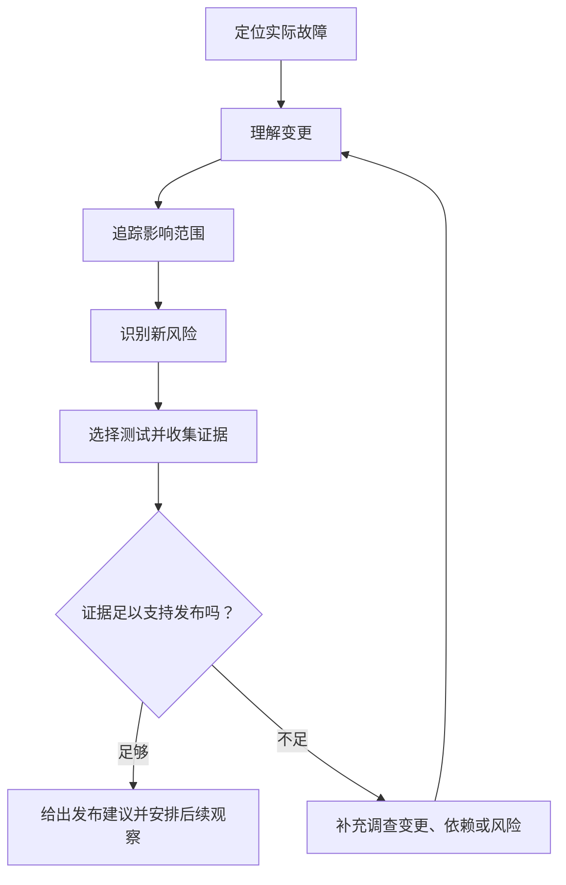
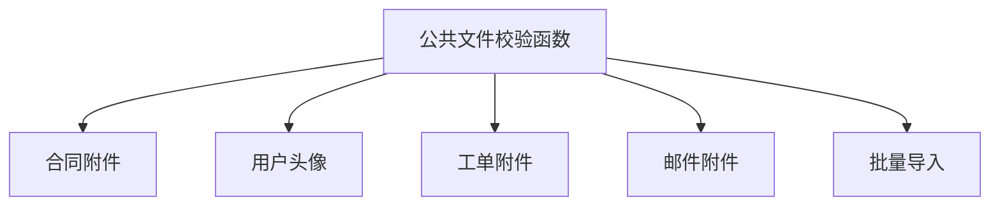

# Hotfix 应该怎么测？从 Bug 修复验证到基于风险的发布决策

> 学习来源：Hanisha Arora，《How to test a hotfix》，WonderProxy Blog，2026-11-11。
>
> WonderProxy Blog: https://wonderproxy.com/blog/how-to-test-a-hotfix/

本文先整理原文关于 Hotfix 测试的核心思路，再把文件上传案例、风险分级、发布结论模板、AI Native QA 与 Skills 工作流和检查清单作为实践延伸说明。后面的示例是为解释方法而设计，不代表真实项目的测试记录；落地时需要按本项目的业务规则调整。

假设下午五点，生产环境里有用户无法上传合同附件。开发修好后发来消息：“Hotfix 已经好了，麻烦尽快验证。”

一种常见做法是照着工单重做一次。问题没有再出现，就回复“通过”。另一种做法是为了保险，把整套回归测试全部跑完。前一种可能漏掉修复带来的副作用，后一种可能花很多时间验证与这次变更无关的路径。

更有用的问题是：改动了什么、它还会影响哪里、哪些测试能给出相关证据？Hotfix 测试不是把完整回归缩短一点，也不是不加区分地把全部测试再跑一遍。测试范围应围绕实际变更和风险来定，最后说明现有证据能支持什么发布判断。

## 把 Hotfix 测试做成反馈循环

可以用六个问题组织调查和测试：

| 要回答的问题 | 工作重点 |
| --- | --- |
| 哪里坏了？ | 区分用户看到的现象和系统实际失败的位置。 |
| 改了什么？ | 找出代码、配置或行为发生了哪些变化。 |
| 还影响哪里？ | 追踪调用方、业务流程、数据和系统依赖。 |
| 现在可能坏什么？ | 根据改动提出具体、可验证的风险。 |
| 应该测什么？ | 选择能验证这些风险的场景，优先复用有效测试。 |
| 证据足以支持发布吗？ | 汇总通过、失败、未执行项和剩余风险，再给出建议。 |



这不是必须从头走到尾的直线流程。测试中发现的新依赖或无法解释的结果，可能说明影响分析不完整；这时回到代码、配置或业务流程重新调查，比继续机械地增加用例更有价值。

## 先复现用户报告，再找到真正的失败位置

“用户上传文件失败”只是观察到的现象。故障可能是文件格式不支持、大小超过限制、用户没有权限、后端接口报错、网关拒绝请求、前端解析响应失败，也可能是文件已保存但数据库记录没有写入。每一种原因都要求不同的验证。

开始测试前，先把这些条件问清楚：

| 维度 | 需要确认的内容 |
| --- | --- |
| 用户 | 所有用户都遇到问题，还是只有某类用户？ |
| 数据 | 哪种文件、大小或业务数据会触发？ |
| 环境 | 浏览器、设备、配置或环境是否相关？ |
| 权限 | 用户角色、资源归属或权限状态是否相关？ |
| 状态 | 问题是否只在某个业务状态下出现？ |
| 频率 | 每次都能复现，还是偶尔发生？ |

还要确定请求在哪一步失败：浏览器没有发送请求、网关拦截、后端返回错误，还是前端处理响应出错？可以用修复前的基线记录触发条件和证据，方便与修复后的结果比较。

| 项目 | 示例记录 |
| --- | --- |
| 操作 | 上传一个 10 MiB 的 PDF |
| 用户与状态 | 普通用户，处于合同编辑状态 |
| 实际结果 | 收到 HTTP 413 |
| 预期结果 | 按业务规则允许的文件成功上传 |
| 证据 | API 响应、网关日志、Trace ID |
| 复现频率 | 每次都发生 |

如果问题无法稳定复现，不要把“没再看到”直接写成“已修复”。可以结合日志、监控、异常时间、用户操作和系统状态继续调查，并记录哪些条件尚未确认。至少要弄清用户观察到了什么、系统在哪里失败，以及什么证据能表明修复有效。

## 看清代码改动改变了什么行为

QA 不必对实现风格做完整代码评审，但需要理解改动影响了什么行为。阅读 Diff，再确认它使用了哪些函数、查询、校验、API、权限规则或配置。

| 改动内容 | 接下来要查什么 |
| --- | --- |
| 公共函数 | 哪些模块和业务入口调用它？ |
| 数据库查询 | 哪些流程依赖结果？空结果、排序或旧数据会怎样？ |
| 校验规则 | 哪些入口共用规则？边界和异常输入怎么处理？ |
| API 响应 | 哪些客户端消费字段和错误码？ |
| 权限判断 | 哪些角色、资源归属和权限状态受影响？ |
| 工作流状态 | 哪些入口可以进入或离开该状态？ |
| 配置 | 是否影响其他实例、环境或服务？ |

例如，业务规则规定文件上限为 10 MiB。下面的改动只多了一个等号：

```diff
- return size < 10 * 1024 * 1024;
+ return size <= 10 * 1024 * 1024;
```

改动行数很少，仍需要确认这个校验是否被多个入口共用、其他业务是否有不同上限、API 或网关是否另有约束，以及允许等于上限是否符合真实规则。理解行为变化，才能决定该测什么。

## 追踪变更会影响的路径

影响范围（Blast Radius）指一项改动可能波及的调用方和业务流程。假设文件大小校验由五个入口共用：合同附件、用户头像、工单附件、邮件附件和批量导入。工单只报告合同附件失败，但公共函数改动也可能影响另外四个入口。



可以从四类依赖查找影响范围：

| 依赖类型 | 检查内容 |
| --- | --- |
| 代码依赖 | 函数调用方、公共模块引用、接口消费者和配置引用。 |
| 业务依赖 | 哪些用户流程会触发改动后的逻辑。 |
| 数据依赖 | 字段、历史数据、查询条件和关联记录是否改变。 |
| 系统依赖 | 缓存、消息队列、第三方服务、网关和运行时组件。 |

SQL 改动要看查询结果、排序、分页和数据过滤；校验改动要看边界与异常输入；权限改动要看角色和资源归属；API 改动要看兼容性和错误处理；公共函数改动要检查其他调用方。

已有清单能告诉我们以前检查过哪些路径，但不能代替本次的影响分析。先找到真实调用方，再从既有用例中挑选相关场景，并为没有覆盖的风险补测试。不是每个调用方都要完整回归，重点是判断它是否依赖这次被改变的行为。

## 重测原始问题，也验证触发条件

修复部署到测试环境后，按原始用户、数据、权限、状态和操作步骤重测。原始场景仍失败，就要继续调查修复为什么没有生效。

只重复同一个例子还不够。假设原问题发生在 10 MiB 文件上，围绕边界选择少量代表场景：

| 场景 | 验证目的 |
| --- | --- |
| 低于 10 MiB | 检查边界以下仍然正常。 |
| 正好 10 MiB | 重现原始边界问题。 |
| 高于 10 MiB | 确认超限文件仍被正确拒绝。 |
| 不同文件类型 | 确认文件类型规则没有被绕过。 |
| 不同用户角色 | 确认权限行为仍符合业务要求。 |
| 原始条件不存在 | 确认正常路径没有被修复逻辑破坏。 |

这些场景不是所有 Hotfix 的固定套餐。应该根据改动决定要检查哪些边界、用户类型或业务状态。重点是确认修复处理了导致故障的条件，而不只是让原来的一个例子通过。

## 围绕变更选择回归场景

不同改动需要不同的检查重点：

| 改动类型 | 优先检查 |
| --- | --- |
| 条件判断 | 条件成立、不成立及临界点附近的行为。 |
| 共享函数 | 其他调用方是否仍符合各自的业务规则。 |
| 工作流状态 | 从不同入口进入状态、重复操作和异常状态。 |
| 数据库查询 | 查询结果、历史数据和依赖查询的流程。 |
| 权限逻辑 | 允许与拒绝访问、角色切换、资源归属和越权路径。 |

还可以用几个问题查找容易遗漏的风险：受影响的旧流程还正常吗？换一种用户类型会怎样？历史数据能否继续处理？错误提示和恢复方式是否合理？原始条件不存在时，修复会不会影响正常路径？

这些问题是分析提示，不要求每次全部执行。例如，文件上传修复没有碰登录逻辑，也没有发现共享依赖，就无需只因担心而重测所有登录流程。如果依赖关系尚未查清，应该把这项不确定性记入风险，而不是假定没有影响。

## 用风险决定测试深度

测试范围既不该只限于原始 Bug，也不该因为“任何地方都可能出错”而无限扩大。判断投入时，至少考虑四个因素：

| 风险因素 | 要问的问题 |
| --- | --- |
| 用户影响 | 影响多少人？是否触及关键用户路径？ |
| 业务影响 | 是否涉及客户数据、支付、安全或运营？ |
| 变更复杂度 | 改动是否跨越共享函数、API、SQL 或多个流程？ |
| 现有信心 | 相关自动化是否覆盖这次行为，结果是否可靠？ |

代码行数不能代表风险大小。几十行独立 UI 样式变动，可能只需验证相关页面和交互；一个权限条件的微小修改，却可能让用户访问他人的资源。

下面的低、中、高分类是团队讨论用的实践模型，不是来源文章提供的统一评分标准：

| 因素 | 低 | 中 | 高 |
| --- | --- | --- | --- |
| 用户影响 | 少量用户 | 部分用户 | 大量用户或核心路径 |
| 业务影响 | 非关键展示 | 一般业务操作 | 支付、安全或关键数据 |
| 变更复杂度 | 独立局部修改 | 涉及多个模块 | 公共能力或跨服务 |
| 测试信心 | 相关证据充分 | 部分证据不足 | 关键行为尚未验证 |

不要把等级简单相加成一个发布分数。严重的越权、数据完整性或资金风险应有单独的强制门槛，不能被其他低风险项抵消。

自动化测试通过能增加信心，但前提是测试确实覆盖变更行为、断言有效、执行可重复且结果可追溯。500 条无关用例通过，也不能证明共享函数的边界已验证；测试数量不等于风险覆盖。

## 用证据支持发布建议

发布建议需要结合四个问题：原始故障有多严重？修复可能波及什么？不修复会造成什么后果？修复失败或引入新问题会带来什么后果？涉及支付、数据完整性、安全或核心业务时，通常需要比普通 UI 问题更充分的验证，例如更深入的边界检查、权限或安全验证、数据一致性检查、关键流程回归及必要的性能验证；还要考虑部署、回退和发布后监控。

有限的测试无法证明系统其他地方绝不会出问题。更可行的做法是说明已识别的风险、测试证据、未验证范围和剩余不确定性，再由有权限的负责人结合组织的风险承受能力决定是否发布。

| 建议 | 适用判断 |
| --- | --- |
| Go | 关键测试通过，证据足以覆盖已识别风险，剩余风险在可接受范围内。 |
| Conditional Go | 存在已知非阻断风险，且已明确批准的缓解措施和监控方案。 |
| No-Go | 关键测试失败、重大风险未解除，或关键证据仍然不足。 |

这三类结论是团队沟通用的实践模板，不是对所有组织的统一发布规范。

QA 负责说明测试范围、风险、证据和缺口，并给出专业建议。发布负责人、业务负责人、技术负责人或团队治理流程负责作出最终决定；“测试通过”本身不会消除风险。

## 文件上传 Hotfix 案例

以下是一个用于串联方法的假设案例，不是实际项目记录。生产中部分用户无法上传 10 MiB 的 PDF 合同附件，开发发现公共校验函数把等于上限的文件也拒绝了。

| 先确认的事实 | 案例记录 |
| --- | --- |
| 用户与文件 | 普通用户上传 PDF 合同附件。 |
| 实际结果 | 请求在文件大小校验处失败。 |
| 预期结果 | 业务规则允许不超过 10 MiB 的文件。 |
| 复现证据 | 原始操作、请求响应和相关日志。 |

Diff 显示判断从 `size < MAX_FILE_SIZE` 改为 `size <= MAX_FILE_SIZE`。调查确认 `MAX_FILE_SIZE` 的数值和单位，再检查五个调用入口及其他层级限制。初步影响表可以这样写，实际优先级必须按项目数据调整：

| 入口 | 需要确认的风险 | 示例优先级 |
| --- | --- | --- |
| 合同附件 | 原始问题是否解决，合同能否继续访问。 | P0 |
| 用户头像 | 是否有独立的头像大小限制。 | P1 |
| 工单附件 | 临界值变化是否符合原有规则。 | P1 |
| 邮件附件 | 应用限制是否与邮件服务限制冲突。 | P1 |
| 批量导入 | 超限或无效文件会如何处理。 | P1 |

验证原始场景时，除了检查页面提示，还要确认请求成功、业务记录创建、文件实际保存、用户能够访问文件，并检查相关日志。随后检查小于、等于和大于上限的文件、不同类型和用户，以及其他上传入口。若头像规则是 2 MiB，就要确认共享校验没有绕过这条独立限制。

假设所有相关场景通过、自动化回归覆盖了变更、没有未解决的关键风险，并且回退方案已经确认，团队可以据此提出 Go 建议。表里的结果是假设值；真实结论必须来自真实执行记录。

发布后可观察上传成功率、HTTP 413 与其他错误日志、文件处理耗时、用户反馈和关键业务成功率。若指标异常，应按预先约定的条件暂停放量、回退或继续修复。回退应用版本不一定能恢复已经变化的数据，因此涉及数据修改时还要确认补偿或恢复方案。

## 把经验沉淀为团队实践

| 做法 | 实际作用 |
| --- | --- |
| 先读 Diff 和依赖，再选测试 | 让测试范围对应真实行为变化。 |
| 建立变更、风险、测试、证据映射 | 说明每项测试为什么执行，也能发现没有验证的风险。 |
| 优先复用相关自动化 | 从单元、API、集成到必要的 UI/E2E，按影响选择。 |
| 记录没有执行的场景 | 写明原因、剩余风险、后续观察和补测计划。 |
| 发布前确认回退和恢复能力 | 检查数据兼容、不可逆修改、补偿方式和责任人。 |
| 修复后补齐质量资产 | 把有长期价值的复现用例加入回归，并回顾问题为何漏检。 |
| 把重复且稳定的分析沉淀为 Skill | 固定输入、边界和交付方式；结论仍要依据本次变更证据。 |

变更映射可以很简单：文件大小判断对应边界测试，共享函数对应调用方回归，错误处理对应异常场景与响应日志。Hotfix 结束后还可以回顾：原始问题为什么没有提前发现？影响分析是否漏掉依赖？哪些共享组件反复引入问题？哪些测试可以放进 CI？哪些监控能更早发现同类故障？只有当同类分析反复出现、步骤稳定且结果可复核时，再把它沉淀为 Skill，并用失败样本检查它是否可靠。这样既能解释测试选择，也能让发布评审看到证据从哪里来。

## 用 AI Native QA 和 Skills 串起 Hotfix 流程

这里说的 AI Native QA，不是让聊天机器人在测试结束时补写几条用例，而是把 AI 放进一条能复核的质量工作流：模型帮助分析当前材料，Skills 固化重复任务的步骤和边界，测试工具执行检查并留下结果，QA 根据证据判断风险，发布负责人作出发布决定。AI 可以减少整理和重复分析的时间，但不会自动带来项目背景，也不能把推测变成事实。

一份可用的上下文包通常包括：事故工单和复现条件、修复前后版本或 PR Diff、已确认的业务规则、相关调用方和数据契约、已有测试与历史缺陷、目标环境和构建号，以及账号、数据和时间限制。生产日志或用户数据需要按团队规则脱敏。材料不完整时，Skill 应列出缺口，而不是把缺失信息补写成结论。

在 AI Native QA 工作流里，各部分承担不同责任：

| 组成 | 适合承担的工作 | 不能替代什么 |
| --- | --- | --- |
| AI Agent | 汇总材料、比较版本、提出风险假设和候选场景。 | 不能仅凭生成内容证明线上行为或测试已通过。 |
| Skill | 固定任务的触发条件、输入要求、分析步骤、输出格式和失败边界。 | 不会自动补齐业务规则，也不保证模型每次都正确执行。 |
| CI 或测试运行器 | 在明确的版本和环境中实际执行测试，保存日志与报告。 | 不能替负责人接受剩余业务风险。 |
| QA 与发布负责人 | 核实依据、审查范围和缺口，决定哪些风险可接受。 | 不能把未验证项写成通过。 |

团队可以把 Hotfix 流程拆成几个职责清楚的 Skills，再通过结构化交接串起来：


这些名称展示的是一种可组合的工作方式。一个 Skill 是否能读取仓库、调用测试工具或运行脚本，取决于宿主工具的能力和授权；没有实际运行，就只能给出分析或测试建议。

| 阶段 | AI 或 Skill 的交付 | QA 需要检查的关口 |
| --- | --- | --- |
| 事故分析 | 整理时间线、复现条件、已知事实、假设和缺失证据。 | 日志、请求和用户报告是否支持这些描述；相关性不能直接当根因。 |
| 变更影响分析 | 根据明确的 base/head 和 Diff，列出行为变化、调用方、数据路径和待确认依赖。 | 每条影响是否有代码或项目材料依据；仓库不可见时不得声称已检查调用方。 |
| 回归范围分析 | 按风险给出必测项、可暂缓项、排除理由和扩大范围的触发条件。 | 高风险路径是否都有验证计划；排除项是否写明依据和剩余风险。 |
| 测试设计 | 把每条风险转成边界、权限、状态或调用方场景，并注明预期结果。 | 场景是否来自业务规则；重复用例和没有依据的假设是否被识别。 |
| 执行与报告 | 测试运行器产生结果；报告汇总通过、失败、未执行项和证据链接。 | 状态是否来自实际运行记录，并关联到版本、构建和环境。 |

回到 10 MiB 文件案例：事故分析 Skill 先整理 HTTP 413、用户、文件大小和请求链路；影响分析 Skill 再检查公共校验函数的调用方；回归范围 Skill 选择合同附件为必测项，并判断头像、工单、邮件和批量导入的风险；测试设计 Skill 提出小于、等于和大于上限的场景。之后由 CI 或 QA 在目标环境实际执行。只有运行报告、请求记录和文件访问结果能证明执行状态；模型生成的测试清单本身只是待执行计划。

每次 Skill 交接都应携带来源版本、结论类型（事实、假设或建议）、证据位置、测试状态、未知项和下一步负责人。若发现新失败或依赖，返回影响分析重新评估范围；不要把所有阶段塞进一个超长 Prompt，也不要丢掉原始证据位置。

## 把 Skills 本身也纳入质量闭环

Skill 会影响测试范围和发布判断，因此它的输出也需要验证。第一次调用看起来合理，不代表换一个模型、工具或输入后仍能识别关键风险。可以为 Hotfix 工作流准备一组正向、边界和失败样本：

| 评测输入 | 期望的 Skill 行为 |
| --- | --- |
| 没有提供可复现日志或请求记录 | 保留根因未知，列出下一步取证，不补造原因。 |
| Diff 或 base/head 版本缺失 | 只输出待确认的候选影响，不声称已经检查过代码。 |
| 上限从 `<` 改为 `<=` | 识别等于边界的变化，并提出下限、边界、上限和其他调用方检查。 |
| 测试尚未运行 | 把场景标成待执行，不把设计结果写成通过。 |
| 两份业务规则互相冲突 | 显示冲突及出处，要求确认，不自行挑选一条。 |

用同一批脱敏输入和明确的评审标准，对比直接对话与使用 Skill 后的结果。关注关键风险是否漏报、判断能否追溯到来源、未知项是否保留、测试范围是否合理，以及人工复核和返工是否减少。不要只看输出长短或单一总分，也要记录失败样本和人工修改原因。

Skill 更新、模型更换、参考资料变更或执行工具变化后，重跑关键评测样本。把真实 Hotfix 中漏掉的风险转成两类回归：一类验证产品代码，另一类验证 Skill 是否能再次发现这类风险。这样形成“运行—复核—复盘—更新—回归”的质量闭环，而不是把 Skill 发布后就当成固定正确。

实践时可以遵循几条边界：

- 只有任务重复、步骤稳定且结果可评审时，才沉淀为 Skill；一次性分析不必增加维护层。
- Skill 说明适用场景、必要输入、非目标、输出证据和停止条件；背景不足时先提问或标记未知。
- 将分析、测试设计、实际执行和发布审批分开。模型建议不能冒充运行器结果，测试结果也不能代替风险接受。
- 固定并记录代码版本、构建、环境、Skill、模型和运行器版本，保留可以回到原始材料的证据索引。
- 用失败样本持续检查 Skill；发现问题时同时评估产品回归、Skill 规则和团队输入是否需要改进。

## 可复用的 Hotfix 检查清单

### 原始问题

- 按报告步骤复现问题，并记录复现频率。
- 记录用户、数据、浏览器、权限和业务状态。
- 区分观察到的现象与真正的失败位置。
- 留存必要的请求、日志和追踪证据。

### 代码变更

- 阅读 Diff，确认修改的函数、查询、校验、API 或配置。
- 找到主要调用方和依赖方。
- 分析受影响的业务流程、数据和系统组件。
- 记录尚未确认的依赖与风险。

### 原始问题和边界

- 在修复版本上重跑原始复现步骤。
- 确认修复针对的是问题条件，而不只是一个示例。
- 按变更检查边界、文件类型、角色或状态变体。
- 检查原始条件不存在时的正常行为。

### 相关回归

- 验证受影响的旧流程与相关用户类型。
- 检查历史数据、错误处理和自动化覆盖。
- 按合理影响路径扩展范围；依赖不明时记录风险。

### 风险与发布判断

- 评估用户影响、业务影响、变更复杂度和测试信心。
- 同时考虑不修复的后果，以及修复失败或引入新问题的后果。
- 记录剩余风险和未执行的关键测试。
- 判断当前证据能否支持发布建议；不足时继续调查。

### 发布和后续验证

- 确认发布审批、回退与数据恢复方案。
- 发布后执行关键业务冒烟测试。
- 检查相关监控和日志，并按结果观察、放量、回退或修复。
- 将有效复现用例和改进项沉淀到质量资产中。

### AI 与 Skills 工作流

- 提供事故材料、准确的代码版本、业务规则、相关测试和目标环境；敏感数据先脱敏。
- 确认所选 Skill 适用于当前任务，并记录 Skill 版本和工具权限。
- 要求结论标注为事实、假设或建议，并给出来源或证据位置。
- 区分建议执行、已执行、通过和失败；只有真实运行记录能证明执行状态。
- 与发布负责人复核排除路径和剩余风险；把失败样本留作产品与 Skill 的后续回归。

这份清单用于帮助思考，不要求每次 Hotfix 无差别执行全部项目。

## 常见问题

### 只剩十五分钟时，先测什么？

先评估原始问题的严重度和变更风险，再优先验证原始复现、关键边界和最重要的受影响流程。若关键风险来不及验证，应说明缺口并升级发布决定，不能默认通过。

### 不会读代码的 QA 怎么分析影响范围？

先请开发说明改动的函数、模块和调用方，再结合业务流程图、接口文档、日志和已有测试资产分析影响。逐步学习读简单的 Git Diff、SQL 和 API，也能帮助 QA 提出更具体的问题。

### Hotfix 每次都要完整回归吗？

不一定。范围取决于变更影响、业务风险、现有证据和团队发布要求。关键共享组件、基础设施改动或影响范围无法确认时，可能需要扩大回归。

### 只改一行代码，可以少测吗？

不能只看行数。还要看这一行改变了什么行为、被哪些流程调用，以及失败后果有多严重。

### 自动化测试全通过，就可以发布吗？

还要确认它们覆盖了本次改动涉及的风险，并考虑未执行场景、环境差异、部署风险和业务后果。

### 测试发现新 Bug 怎么办？

先判断严重度、影响范围和触发条件。关键风险应阻止发布并重新分析；非阻断问题也要记录、明确缓解措施，并按团队流程审批。

### 引入 AI 和 Skills 后，QA 的工作会有什么变化？

AI 和 Skills 可以承担重复分析、整理上下文和跨阶段交接。QA 会把更多精力放在提供可靠材料、核实来源、评估工作流质量，以及判断风险证据是否充分。最终发布决定仍由有权限的负责人作出。

### Skill 可以把测试标成通过吗？

只有真实执行过的测试才能确定这个状态。Skill 可以设计场景，也可以在获准时调用运行器；结果需要关联运行记录、版本、环境和证据。生成出来的用例在执行前仍是待测项。

### 为什么修复前后要保持环境一致？

配置、数据、依赖服务或环境状态都可能影响结果。若关键条件发生变化，就难以判断结果来自代码修复还是环境差异。

## 从测试结果走向发布证据

读完这篇学习资料，我最看重的不是多记住了几种测试技术，而是换了判断问题的方式。与其只问“Bug 修好了吗？”，不如接着问“改动了什么、还会影响哪里、当前证据能支持什么决定？”AI Native QA 把工作重心更多放在可靠上下文、定义清楚的 Skills、可核实的交接和结果评估上。AI 可以生成场景、整理日志，但理解业务、识别风险、选择高价值测试并判断证据是否充分，仍需要质量工程能力。

测试范围应围绕变更和业务影响确定，测试深度应由风险决定，测试报告则要说明证据和缺口。测试人员无法保证系统没有缺陷，但可以让发布决策建立在更清楚的风险与证据上。

下一次收到“Hotfix 已经好了，麻烦尽快验证”时，可以先问：

**这次改动除了修复原始 Bug，还可能影响哪些地方？**

### 参考资料

- Hanisha Arora, “How to test a hotfix,” WonderProxy Blog, 2026-11-11: https://wonderproxy.com/blog/how-to-test-a-hotfix/
- ISTQB Certified Tester Foundation Level (CTFL) v4.0: https://istqb.org/certifications/certified-tester-foundation-level-ctfl-v4-0/
- Google SRE, “Release Engineering”: https://sre.google/sre-book/release-engineering/
- Google SRE, “Monitoring Distributed Systems”: https://sre.google/sre-book/monitoring-distributed-systems/
- Awesome QA Skills: https://github.com/naodeng/awesome-qa-skills
