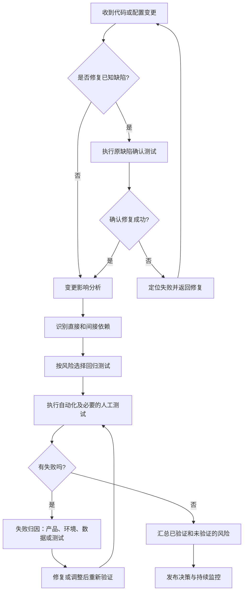
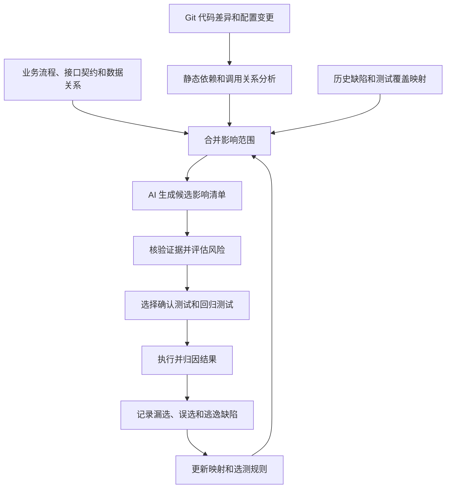

# 回归测试 vs 再测试：关键差异与最佳实践

**来源**：ACCELQ 博客《Regression Testing vs Retesting: Key Differences and Best Practices》。**作者**：Prashanth Punnam；审阅：Geosley Andrades；更新于 2026 年 9 月 16 日。

本文以原文内容和学习笔记为基础。原文观点与笔记中的实践补充会分别说明；文中的流程图是根据学习笔记整理的，并非原文配图。

原文: https://www.accelq.com/blog/regression-testing-and-retesting/

## 核心概念

**再测试（Retesting，也称确认测试）**：已知缺陷修复后，重新执行之前失败的测试，确认缺陷是否解决。验证时应尽量保留缺陷报告中的原始步骤、输入、配置和触发条件，并确认测试环境已经部署修复版本。

**回归测试（Regression Testing）**：代码、配置、依赖或环境发生变化后，重新验证既有功能，检查变更是否带来意外影响。范围通常比再测试广，但不等于每次都要执行全部历史用例；应根据变更影响、业务风险和已有证据来定。

一句话记忆：再测试回答“这个缺陷修好了吗？”，回归测试回答“修复或变更有没有弄坏其他功能？”

再测试可以确认修复是否生效、避免缺陷被过早关闭，并给出“已修复”或“仍未修复”的明确结论。回归测试则保护既有功能、支持持续交付，并为构建进入预发布或生产环境提供质量依据。两者应有各自的目标和通过标准；如果把它们混成一次没有区分的测试，团队就很难判断失败来自修复本身，还是其他流程受到影响。

### 两者的区别

| 维度 | 回归测试 | 再测试 |
|---|---|---|
| 目标 | 检查变更是否影响既有功能 | 确认某个已报告的缺陷是否修复 |
| 范围 | 可能受影响的功能、依赖和流程 | 原先失败的测试及必要边界 |
| 用例来源 | 以往通过的用例、需求和变更记录 | 原缺陷报告和复现步骤 |
| 触发条件 | 代码、功能、重构、依赖或配置变更 | 特定缺陷被标记为已修复 |
| 环境 | 可覆盖多个环境或平台 | 通常优先使用发现缺陷时的环境 |
| 自动化 | 适合自动化重复执行 | 常见为手工的一次性验证；稳定后也可自动化 |
| 失败时的含义 | 可能存在变更引起的副作用，也可能是既有问题或测试不稳定 | 修复可能无效，也可能是环境或数据不一致 |
| 主要用途 | 评估变更质量和发布风险 | 为缺陷关闭提供验证依据 |

通常先确认原缺陷已经修复，再执行范围更广的回归测试；如果两项检查彼此独立，也可以并行执行。回归测试失败也不能未经归因就直接认定为新缺陷。

## 六种回归测试类型

原文列出了六种常见类型。它们并不是互斥、处于同一分类层级的选项：例如，单元测试描述测试层级，选择性回归描述测试范围的选择方式。表中的适用场景和注意事项是学习笔记补充的实践说明。

| 类型 | 关注点 | 常见场景 | 注意事项 |
|---|---|---|---|
| 修正型（Corrective） | 小范围修补是否影响未修改的功能 | 需求和既有功能未变的小修复 | 仍需判断修复影响面 |
| 渐进型（Progressive） | 新功能或重大更新是否影响原有流程 | 新功能逐步上线 | 关注新旧行为之间的交互 |
| 全量回归（Retest-All） | 验证整个应用或完整回归套件 | 大规模变更或发布 | 成本较高，也无法自动覆盖未设计的场景 |
| 选择性（Selective） | 只运行受影响模块或流程的测试 | 常规持续交付 | 依赖影响分析和测试映射的准确性 |
| 部分型（Partial） | 检查可能被间接影响的相关区域 | 共享服务或组件发生变更 | 注意间接依赖 |
| 单元级（Unit） | 代码级变更后验证单个组件或代码单元 | 方法或组件修改 | 不能替代跨模块的集成验证 |

## 电商折扣码案例

**问题**：电商结账时折扣码计算错误。团队发现根因在一个被多个模块共用的价格计算函数中。

**再测试**：在已部署修复的版本上，使用原账号、同一折扣码、相同订单和同一环境重跑原来的失败场景。结果正确，说明这个场景的再测试通过；此时还没有验证其他功能。

**回归测试**：由于修改的是共享函数，还要验证其他折扣类型、税费、订单总额、确认邮件和退款计算。案例中，回归测试发现修复改变了折扣与税费的交互；单靠原缺陷的再测试不会发现这个副作用。

**实践要点**：确定回归范围时，缺陷修复实际改动的位置往往比工单标题更有参考价值。一个共享函数可能影响多个业务区域。

## 变更后的验证流程

**学习笔记补充：**下面的流程把确认测试、影响分析、回归执行和风险汇总串联起来；实际任务中的独立检查可以并行。

这张图展示的是逻辑关系，不要求流水线中的所有步骤都串行执行。确认测试和独立的回归测试任务可以并行，以减少反馈等待时间。

## 如何确定测试范围

原文建议每个修复都进行再测试，回归范围则根据变更实际触及的内容调整。

| 变更场景 | 再测试 | 回归测试建议 | 来源 |
|---|---|---|
| 孤立的界面缺陷修复，没有涉及共享代码 | 需要 | 根据影响判断，通常范围较窄 | 原文 |
| 修改共享服务、工具函数或接口 | 需要 | 测试已知调用方和相关依赖 | 原文 |
| 影响认证、支付或核心数据模型 | 需要 | 扩大到关键端到端流程、集成和安全检查 | 原文 |
| 配置、环境或依赖升级，没有具体缺陷 | 不需要 | 重点检查兼容性、启动、集成和关键流程 | 原文 |
| 新功能，没有已知缺陷 | 视情况 | 测试新功能，并回归相关既有功能 | 学习笔记扩展 |
| 数据库结构迁移 | 有对应缺陷时需要 | 检查迁移、回滚、数据完整性和上下游兼容性 | 学习笔记扩展 |

难点在于判断一次变更到底属于哪种情况。开发人员可能没有列出修复触及的所有共享组件，测试人员也未必能看到完整代码关系。因此，范围判断不能只依据工单上的功能名称。

### 风险评估示例

**学习笔记补充：**可按影响严重度（S）、发生可能性（L）和影响范围（B）为变更评分，每项 1–5 分：

`风险分 = S × L × B`

| 示例 | 严重度 S | 可能性 L | 范围 B | 风险分 |
|---|---:|---:|---:|---:|
| 仅修改局部文案 | 1 | 1 | 1 | 1 |
| 修改共享价格服务 | 5 | 3 | 4 | 60 |
| 修改认证令牌校验 | 5 | 3 | 5 | 75 |

评分只是帮助团队讨论优先级的工具，不是行业统一标准。低分不能自动豁免安全、合规或强制性测试门禁。

## 再测试的实践要点

### 原文中的最佳实践

1. **保留原始失败条件**：记录步骤、测试数据、环境、日志和预期结果。
2. **检查边界条件**：不要只验证报告中的值，也要检查其上下边界。
3. **确认实际改动**：测试通过可能是预期结果被重新定义，而非代码得到修复；两种情况应分别记录。
4. **谨慎处理偶发缺陷**：时序和并发问题不能只凭一次通过就关闭，应重复执行相关序列。

### 学习笔记补充的执行建议

1. **确认修复已经部署**：确保当前测试环境运行的是目标修复版本，而不是旧构建。
2. **重放原始触发条件**：尤其留意时区、权限、数据状态和第三方依赖。
3. **沉淀有长期价值的用例**：稳定且值得持续验证的缺陷复现用例，可以加入适当层级的回归套件。

## 回归测试的实践要点

### 原文中的最佳实践

1. 从实际代码差异、调用关系、接口契约、数据模型和配置依赖出发确定范围，不要只看工单描述。
2. 按风险确定优先级：共享组件、关键流程和集成需要更广的覆盖；孤立、低风险的变更可以采用较窄的套件。
3. 将自动化回归接入持续集成与交付（CI/CD），每次合并都运行。
4. 持续维护套件：移除过时用例并修复不稳定测试，避免团队逐渐忽视测试结果。

### 学习笔记补充的工程实践

1. 保留关键路径的固定保障套件，并根据变更动态选择相关测试。
2. 在单元和接口层优先取得快速反馈，把跨系统端到端测试留给高价值场景；同时分层安排快速检查、变更相关回归和定期深度回归。
3. 定期去重和退役失效用例；用例数量本身不是价值指标。
4. 发布前说明尚未覆盖的影响路径和剩余风险。

### 持续集成与交付中的分层验证

| 触发时机 | 执行内容 | 结果用途 |
|---|---|---|
| 提交或拉取请求 | 静态检查、单元测试、变更影响分析、选择性接口与集成回归、关键业务端到端测试和安全门禁 | 形成发布候选版本 |
| 发布候选版本部署后 | 冒烟测试和合成监控 | 检查部署后的关键行为 |
| 定时任务或重大变更 | 全量或深度回归 | 将结果反馈到测试选择规则 |

## 如何归因测试失败

**学习笔记补充：**回归或确认测试失败后，可先按以下线索区分修复无效、新回归、既有问题、环境数据问题、不稳定测试和过时预期。

| 失败类型 | 识别线索 | 建议处理 |
|---|---|---|
| 修复未生效 | 原始失败条件仍然出现 | 重新打开缺陷或继续处理 |
| 新引入的回归问题 | 旧版本通过，新版本稳定失败 | 关联变更并定位根因 |
| 之前存在但尚未发现的问题 | 旧版本也会失败 | 记录为既有问题并评估风险 |
| 测试数据或环境问题 | 配置、数据或依赖异常 | 修复环境后重新执行 |
| 不稳定测试 | 同一构建重复运行，结果不一致 | 调查同步、隔离和依赖问题 |
| 预期结果过时 | 产品行为经过批准后发生变化 | 更新规格和测试，并保留记录 |

## 指标与诊断

| 指标 | 示例定义 | 解读边界 |
|---|---|---|
| 缺陷重开率 | 重开缺陷数 ÷ 已关闭缺陷数 | 也受需求变化、关闭流程和统计口径影响 |
| 回归逃逸率 | 生产中发现的回归缺陷数 ÷ 已确认回归缺陷总数 | 需要稳定的缺陷归因方式和观察窗口 |
| 再测试周转时间 | 修复可验证到得出确认结论所需的时间 | 应区分等待部署与实际验证时间 |
| 回归套件通过率 / 不稳定率 | 通过用例比例，以及相同条件下重复执行结果不一致的测试比例 | 用于观察套件健康度和结果可靠性；不应直接等同于产品缺陷率 |
| 自动化覆盖率 | 自动执行的目标测试数 ÷ 目标测试总数 | 只说明执行方式，不代表测试有效 |
| 影响映射召回率（学习笔记补充） | 实际受影响测试中被选中的比例 | 需要事后核验或历史基准数据 |

**避免直接推断因果。**缺陷重开率升高，可能说明修复验证不充分，也可能由需求变化、部署错误或缺陷管理规则改变造成。回归逃逸率升高，可能意味着回归范围过窄，常见线索是共享代码的影响没有被追踪；但测试数据、环境差异或生产监控改善也会影响这一指标。单个指标的变化不能直接证明唯一根因。

## AI 辅助变更影响分析

ACCELQ 原文介绍了通过 AI 将代码差异映射到受影响组件和测试用例，从而帮助团队选择相关回归测试、跳过无关测试的做法。原文进一步描述 ACCELQ 平台会在构建达到可测试状态时判断改动是孤立影响还是涉及共享组件，推荐只做再测试或运行限定范围的回归，并随着代码库变化更新映射。作者认为，这种按实际影响选测的方式可以减少团队在短周期敏捷迭代中因猜错而重跑全套，也能减少手工维护持续膨胀的回归套件。以上均为厂商对自家产品能力和收益的描述，原文没有提供独立验证；下面的流程只保留可复用的工程思路。

**学习笔记补充：**一个通用流程可以组合代码依赖、业务流程、接口契约、数据关系和历史缺陷等证据，再由 AI 提出候选影响范围，供团队核验。

### 影响分析应留下的证据

| 字段 | 示例 |
|---|---|
| 变更组件 | `pricing.calculateTotal()` |
| 受影响的业务流程 | 结账、退款 |
| 依赖证据 | 调用路径、接口契约、数据表引用 |
| 选中的测试 | `checkout-discount`、`refund-tax` |
| 选择理由 | 共享定价逻辑可能影响税费和退款 |
| 置信度与不确定性 | 依赖图不完整，需要人工复核 |
| 未覆盖风险 | 退款通知邮件尚无自动化覆盖 |

**关键原则**：AI 可以提出有解释依据的影响假设，但不能把推荐结果直接当作覆盖完整性的证明。团队应定期使用已知变更和逃逸缺陷评估漏选情况。

## 实践检查清单

以下检查清单由学习笔记整理，用于把两类测试的目标落实到执行记录中。

### 再测试

- [ ] 已确认测试环境部署了修复版本。
- [ ] 原始复现步骤、数据和触发条件可以追溯。
- [ ] 已验证原先失败的行为是否按预期恢复。
- [ ] 已处理必要的边界情况和偶发性问题。
- [ ] 缺陷关闭结论附有验证证据。

### 回归测试

- [ ] 已识别直接和间接依赖。
- [ ] 已覆盖关键业务流程及高风险交互。
- [ ] 已说明选择或排除测试的依据。
- [ ] 失败已完成产品、测试、环境和数据归因。
- [ ] 已记录未验证范围和剩余发布风险。

## 总结

1. **再测试确认修复是否有效，回归测试检查变更是否破坏既有功能。**两者目标不同，互为补充；缺少任何一步，都可能留下未验证的修复或未发现的副作用。
2. **测试范围由实际影响和风险决定。**不应每次都全量执行，也不能只看工单标题。
3. **自动化和 AI 可以帮助选测与执行。**团队仍需用证据、可追溯记录和漏选监控约束结论。
4. **测试通过不代表风险为零。**发布判断还要考虑未覆盖范围和业务后果。

> **一句话速记**：先确认旧问题确实修复，再检查相关功能有没有被破坏，最后用已验证和未验证的证据支持发布判断。

## 参考资料

ACCELQ，《Regression Testing vs Retesting: Key Differences and Best Practices》: https://www.accelq.com/blog/regression-testing-and-retesting/
