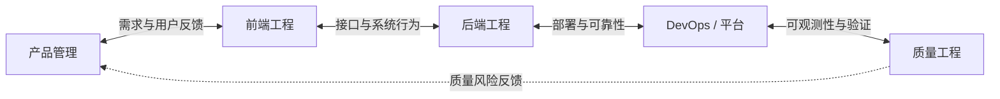
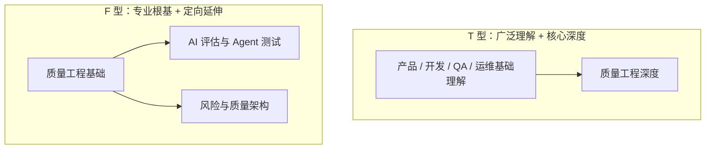
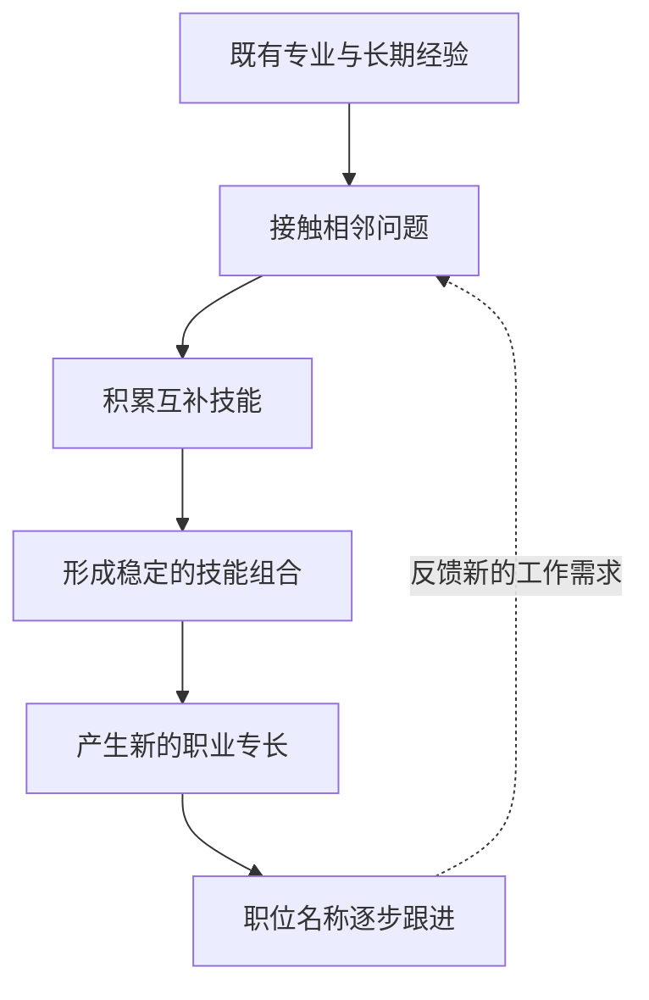
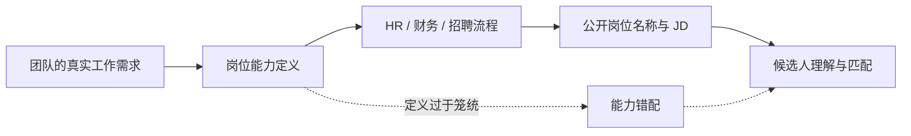
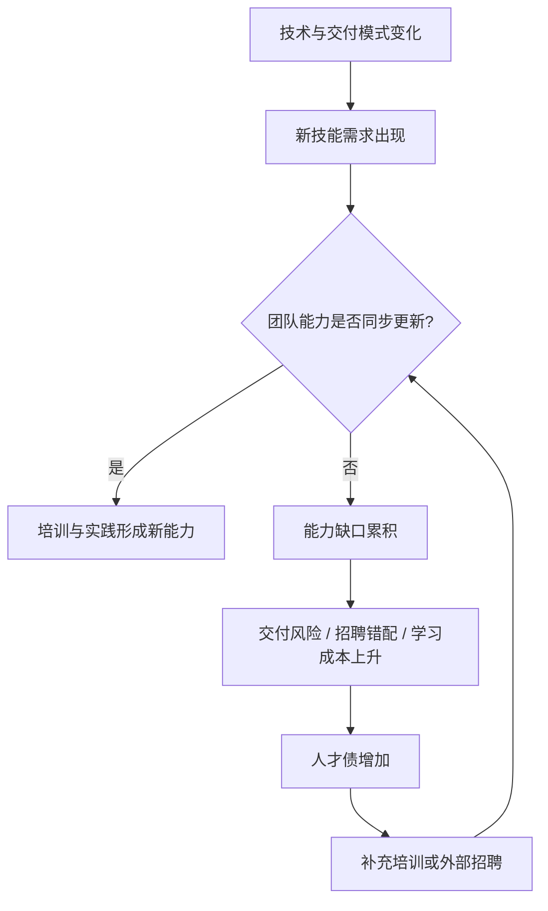
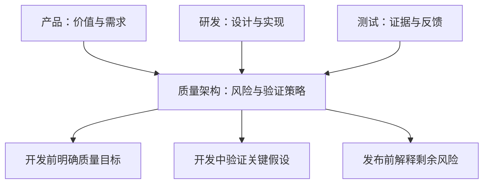
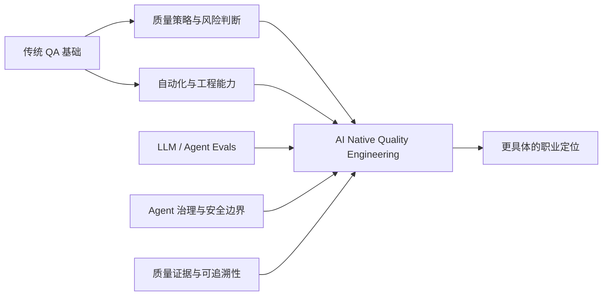

> 来源：Rosie Sherry，*Bleeding job titles: Our roles are becoming more specialised, not generalised*，MoTaverse，2026-10-20。  
> 原文：https://www.ministryoftesting.com/moments/bleeding-job-titles-our-roles-are-becoming-more-specialised-not-generalised  
> 延伸阅读：Ryan Donovan 采访 Andela 的 Cory Hymel，*Your next job doesn’t have a title yet*，Stack Overflow Blog，2026-10-14。  
> 访谈链接：https://stackoverflow.blog/2026/10/14/your-next-job-doesn-t-have-a-title-yet-emerging-role-skills-q-and-a-with-corey-hymel-of-andela/  
> 说明：下文区分**作者观点**、**访谈研究信息**和**质量工程延伸思考**；图示为学习笔记重新绘制，不是原图复制。

## 核心观点：岗位边界模糊，不等于专业能力消失

关于 AI 对技术岗位的影响，常见叙事是：每个人都必须懂产品、开发、测试、运维与 AI，因此大家都在成为“通才”（generalist）。Rosie Sherry 对此提出不同看法：**岗位间的技能交叉，也可能正在催生更精细的专长（specialisation）**。

这并不意味着一个人必须掌握所有相邻岗位的工作。一种可能的情况是，个人以一个成熟的专业领域为基础，向某个相邻领域延伸，形成具有明确业务价值的技能组合（skill bundle）。

> **核心区分：**“知道很多领域的一点知识”与“将少数相邻领域的技能组合成能够交付具体成果的专业能力”不是一回事。

| 观察到的现象 | 容易得出的结论 | 更精确的理解 |
|---|---|---|
| QA 参与需求评审与产品讨论 | QA 要变成产品经理 | QA 可能专精于需求质量、可测试性与风险发现 |
| 开发人员部署模型、关注运行成本 | 开发要包办运维 | 出现 LLM 应用工程、AI 平台与 FinOps 交叉岗位 |
| 社区人员参与产品决策 | 社区经理要什么都做 | 社区产品运营可能成为明确的复合专长 |
| AI 工具降低跨领域操作门槛 | 所有人都是全栈通才 | 跨界能力变得可用，但专业判断仍然需要积累 |

## 从传统岗位到交叉型专长

Stack Overflow 的访谈介绍，Andela 团队分析了**近 50,000 条招聘信息**，试图识别岗位名称尚未准确反映的新技能组合。受访者 Cory Hymel 表示，观察到的模式并非简单的“净通才”（net generalist），而是沿软件开发生命周期相邻岗位之间出现的技能重叠。

这里要注意：访谈没有给出完整数据集、抽样方法与统计表，因此不能据此推断“市场上不存在通才”，也不能把所有行业的招聘趋势一概而论。

图示表达的是**相邻岗位之间的能力交叉**，不是说研发工作必须按图中顺序单向流动。现实中的 QA 与产品、架构、安全、运维都可能直接协作。

### 技能捆绑（Skill Bundling）

技能捆绑不是机械叠加工具清单，而是围绕具体问题组合互补能力。

| 组合方向 | 专业基础 | 相邻能力 | 形成的价值 |
|---|---|---|---|
| Front-end Product Engineer | 前端工程 | 用户研究、反馈、优先级 | 更直接地交付产品结果 |
| LLM Application Engineer | 软件工程 | 模型集成、Agent Harness、Evals、Guardrails | 构建可验证的 AI 应用 |
| FinOps Reliability Engineer | 可靠性 / 平台工程 | 成本、模型与 Token 消耗 | 在性能、可靠性与成本之间做权衡 |
| Docs-as-Code Engineer | 技术写作 / 文档工程 | 规范驱动开发、上下文设计 | 将文档变成工程流程的输入 |
| Security QE | 质量工程 | 威胁建模、安全验证 | 把安全风险纳入持续验证 |

其中前四类来自 Cory Hymel 的访谈案例；Security QE 是结合原文评论与 QA 场景的延伸示例。

## T 型与 F 型人才：广度和延伸方向不同

T 型人才强调一个领域的深度，加上理解多个领域的广度。F 型人才在此次讨论中是一种**形象比喻**：从原有专业出发，向某个相邻岗位方向延伸。它不是通用、严格定义的职业分类标准。

| 模型 | 主要特征 | 潜在优势 | 需要避免的误区 |
|---|---|---|---|
| I 型 | 单一领域深入 | 专业深度强 | 忽略协作接口 |
| T 型 | 深度 + 横向理解 | 跨团队协作顺畅 | 把“理解”误当成“精通” |
| F 型（访谈比喻） | 以专业为根基，定向拓展相邻能力 | 容易形成差异化组合 | 将字母形状当成客观测评标准 |
| 无差别通才 | 多领域都参与，但缺少清晰专长 | 适应面可能较广 | 责任过多、专业定位模糊 |

Cory Hymel 在访谈中也明确表示，T 型与其他“字母型人才”的比较并没有得到确定的研究结论；不能把 F 型当作 Andela 已验证的统一人才模型。

## Rosie Sherry 的个人经验：看似广泛，实际选择更聚焦

Rosie 回顾自己二十多年跨越测试、UX、可访问性、质量工程、创业、伦理、社区与系统思考的经历。表面上看，她拥有广泛的技能组合；但在职业选择上，她的目标反而非常具体：以创始人身份工作、以真正的社区为核心、采用她认可的商业实践，并围绕自己支持的愿景开展工作。

她用这个经历说明：**履历上的广度，与职业身份上的聚焦可以同时存在。**

她在 MoTaverse 的观察也类似。仅招聘传统意义上的“社区经理”未必能够覆盖团队的实际需求，因为社区工作可能与产品发现、内容、服务设计等能力紧密相连。她提到同事 Simon 自然地向产品方向发展，但仍保留社区导向的工作方式，职位名称却未必同步变化。

这也解释了为什么 Rosie 假设自己需要寻找新工作时，可能采用“技术社区领导者”（Technical Community Leader）或“社区产品领导者”（Community Product Leader）一类更具体的称谓。这里是作者的职业身份设想，并非她宣布转换岗位。

## 职位名称为什么仍然重要？

职位名称不是能力本身，但它是企业招聘、组织协作和个人职业叙事的重要接口。

访谈指出，真实岗位需求从业务团队传递到 HR、财务、采购和招聘人员时，可能逐渐失去精确性。最后，组织往往使用一个笼统名称，如“AI Engineer”，但不同企业对这个名称的实际要求可能截然不同。

更有意义的岗位名称应描述：**专业基础、服务对象、关键问题和责任边界**，而不是单纯堆叠热门技术词。

例如，“AI Native Quality Engineer”只有在对应 AI 系统质量评估、Agent 行为验证、质量证据与治理等明确工作内容时，才比普通“QA”更有信息量。

## 人才债（Talent Debt）：技能变化快于组织更新

Cory Hymel 将人才债类比技术债：企业现有人员的能力组合与新工作要求出现差距后，如果长期没有补足，培训、招聘、交付和组织适应成本就会逐渐累积。

他还提到“技能半衰期”缩短的趋势。这里的半衰期是描述技能市场相关性变化的比喻，**不是每项技能都有一个确定的失效年限**。

| 技能类型 | 变化特点 | 对个人的启发 |
|---|---|---|
| 工具语法、框架命令 | 更新较快 | 学会借助工具并及时验证 |
| AI 工具链与 Agent 接口 | 演化很快 | 保持实验、评估和迁移能力 |
| 业务领域知识 | 随业务变化，但常有积累效应 | 深入理解真实业务约束 |
| 风险判断、系统思考 | 不会因某个工具升级直接失效 | 持续打磨专业判断 |
| 沟通、协作、责任意识 | 跨工具与组织长期适用 | 与技术能力一起发展 |

### 人才债如何形成

组织可以选择培养现有人才或外部招聘。前者保留业务与系统知识，后者可能更快获得某些稀缺技能，但存在适应时间与岗位匹配风险。两者不是绝对对立。

## QA 的职业身份：从角色名称走向质量问题专长

Rosie 在原文中提出，未来可能看到 DevOpsQA、AutomationQA、Security QA 等更细的岗位称谓。她的重点并不是预测这些名称都会成为行业标准，而是说明 QA 可以通过与相邻能力的结合，形成新的专业身份。

| 可能的方向 | QA 核心能力 | 交叉领域 | 主要解决的问题 |
|---|---|---|---|
| Automation QE | 自动化设计与验证 | 软件工程 / CI/CD | 稳定、可维护的持续验证 |
| Security QE | 风险驱动测试 | 安全工程 | 安全属性与攻击面的验证 |
| Reliability / Performance QE | 性能与系统测试 | SRE / 可观测性 | 可靠性、容量与性能风险 |
| Quality Architect | 质量策略与风险建模 | 产品 / 架构 / 研发流程 | 把质量机制前置到设计与交付 |
| AI / Agent Quality Engineer | 测试设计与证据判断 | LLM Evals / Agent / 安全治理 | AI 行为的有效性、可靠性与边界验证 |

这些名称是职业发展方向的说明，不是统一的职位等级体系。

### 质量架构师的交叉位置

这与原始笔记中提到的评论观点一致：质量工作可以从末端的测试执行，扩展为产品、研发和测试之间的风险建模与质量设计。

## 评论区的补充视角

评论区是理解实践经验的重要材料，但不能与招聘研究的统计结论等同。

- **Rahul Parwal：** 认为招聘和岗位边界正在变化，现实中的人可能同时具有通才和专才属性；这一点对作者的论述形成了有益补充，而不是完全否定。
- **Jesper Ottosen：** 以 DevOps 团队中的 Security QE 身份说明，跨岗位专长已经存在于实际团队中。
- **Bea Bednarek：** 她分享了自己围绕 Shift-left、质量架构、启发式方法与风险地图的工作经验，认为自己的专长位于产品、研发和测试的交叉地带。这是个人实践经验。

## 对 AI Native Quality Engineering 的延伸思考

以下属于结合 QA 职业发展的独立分析，而非 Rosie 或 Andela 直接提出的职业框架。

AI 的确让生成测试、编写脚本、调用工具等操作更容易。但当“做出一个测试”变得便宜时，专业价值可能更多转移到：**确定什么值得验证、如何建立可靠证据、如何识别虚假信心，以及如何约束自主 Agent 的风险。**

可以将未来专业定位表述为：

> **以质量工程为专业根基，向 AI 系统评估、Agent 行为验证和质量治理延伸，形成能够设计、验证并解释 AI Native 软件质量证据的复合专长。**

这比“QA 以后什么都要会”更可执行，也更符合文章讨论的定向专精逻辑。

### 从“会使用 AI”到“能对 AI 质量负责”

| 层次 | 典型能力 | 价值定位 |
|---|---|---|
| AI-assisted QA | 使用 AI 生成测试、分析缺陷 | 提高单项任务效率 |
| AI-enabled QE | 将 AI 纳入测试流程与工具链 | 提升质量工程效率 |
| AI Native QE | 设计 Agent 测试、评估与治理体系 | 建立可验证的质量能力与责任机制 |

这一分层是学习笔记中的概念性框架，不是行业已统一采纳的认证标准。其核心不是职位名称升级，而是工作对象、交付责任和证据要求发生变化。

## 值得保留的几个思考问题

- 我的专业根基究竟是什么？它是否足够深，能够支撑我判断 AI 生成的结果？
- 我正在向哪个相邻领域延伸？这种延伸是否围绕同一类真实问题？
- 我希望别人因为什么独特能力而与我合作，而不只是因为我熟悉某个工具？
- 哪些技能只是工具操作、容易迅速变化？哪些是能够跨工具迁移的判断能力？
- 如果要给我的职业定位增加一个限定词，它能否清晰描述实际责任，而不是制造更模糊的头衔？

## 总结

这篇文章挑战了一个看似合理、却过度简化的判断：AI 时代的技术工作者都将成为无所不能的通才。

Rosie Sherry 提出的另一种解释是，技能重叠正在创造更细的专业方向。Andela 访谈中的招聘观察为这种观点提供了启发，但不应被解读为对所有职业市场的绝对结论。

对 QA 来说，与其无限扩张技能清单、追求什么都会，不如保留质量工程的专业深度，向能够放大其价值的相邻领域延伸，**形成独特的技能组合，可靠地解决某类重要问题。**

---

**资料与核验说明**

- Rosie Sherry 原文（2026-10-20）：https://www.ministryoftesting.com/moments/bleeding-job-titles-our-roles-are-becoming-more-specialised-not-generalised
- Ryan Donovan 对 Cory Hymel 的访谈（2026-10-14）：https://stackoverflow.blog/2026/10/14/your-next-job-doesn-t-have-a-title-yet-emerging-role-skills-q-and-a-with-corey-hymel-of-andela/
- 本文将“近 50,000 条招聘信息”视为访谈所述研究范围，未推断未公开的比例或统计显著性。
- T 型 / F 型示意、人才债流程及 AI Native QE 能力模型均为解释性重绘；评论观点与研究结论已分开呈现。
