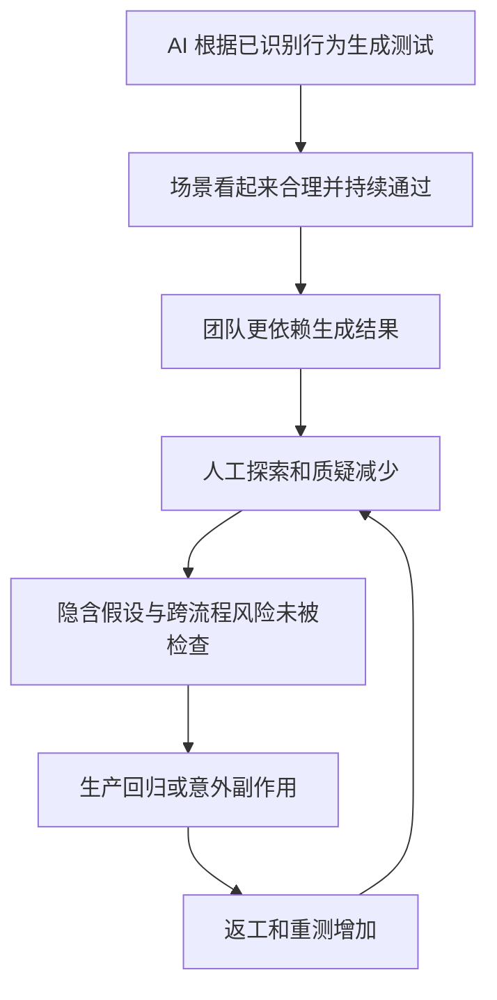
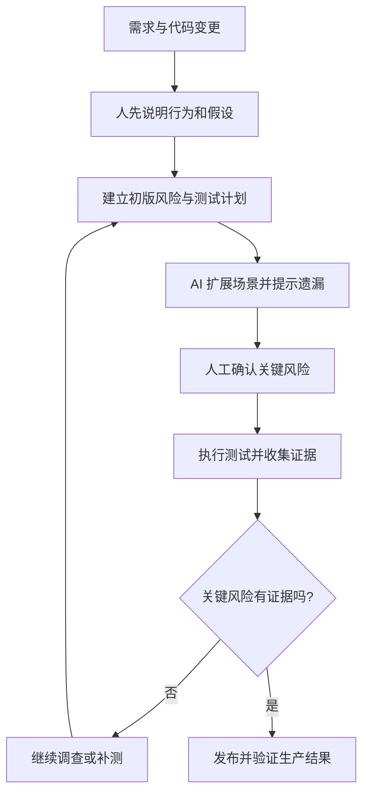

# AI 生成的测试越来越多，为什么团队反而看不见风险？

> 原文：Hanisha Arora，《Why teams miss system signals》，WonderProxy Blog，2026-06-03。https://wonderproxy.com/blog/why-teams-miss-system-signals/
>
> 文中归纳了作者提到的两个生产问题和工作流调整；模板部分是可迁移的实践建议。

## 目录

- [指标向好，生产仍然出问题](#指标向好生产仍然出问题)
- [两个让作者重新思考的缺陷](#两个让作者重新思考的缺陷)
- [AI 怎样影响测试边界](#ai-怎样影响测试边界)
- [速度指标掩盖了什么](#速度指标掩盖了什么)
- [把人的判断放回工作流](#把人的判断放回工作流)
- [一套可执行的协作方式](#一套可执行的协作方式)
- [预警信号与常见问题](#预警信号与常见问题)

## 绿灯和产出都不能单独说明团队理解了系统

流水线通过、用例增加、PR 合并更快，都可能是真实进步，但它们不能单独说明团队更理解了系统。AI 可以降低部分测试准备和执行成本，却不会自动消除隐含假设、跨流程影响和业务不确定性。

## 指标向好，生产仍然出问题

Hanisha Arora 为团队搭建 AI 辅助测试流程，让 Agent 提醒测试人员注意潜在盲点，并把已有业务用例作为上下文，帮助开发在实现功能时生成测试。初期，开发交付更快，用例数量增加，回归周期看起来也更健康。

后来，生产环境仍出现本该被发现的问题。PR 已合并，流水线全绿，评审和回归都做过，AI 生成的场景也全部通过。团队一度把困难归因于“测试拖慢开发”，作者后来意识到，变更引入的不确定性增长得比团队理解系统的速度更快。

她用 *Signal Ignorance* 描述这种状态：系统发出的信号还在，团队却逐渐不再留意。

## 两个让作者重新思考的缺陷

**第一个缺陷发生在免登录流程。** 新功能按预期应支持未登录用户，但 AI 生成的场景里没有覆盖匿名访问，团队也没有独立验证这条路径。问题不在于自动化用例执行失败，而在于一个重要行为从未进入测试设计。

**第二个缺陷出现在另一条生产流程。** 新功能看起来是独立的，生成用例和回归测试都通过了。几天后，一个不相关的流程却在生产中失败。作者将问题追溯到新旧流程共享、但验证时没人提起的一项假设；原文没有披露具体字段或实现细节，因此不应猜测根因的技术形态。

| 已看到的结果 | 尚未覆盖的部分 | 可以追问 |
| --- | --- | --- |
| 生成的用例全部通过 | 免登录行为没有进入用例 | 还需要验证哪些身份状态？ |
| 新功能的独立测试通过 | 共享假设没有被检查 | 新旧流程实际上共享什么？ |
| 回归测试全绿 | 影响路径只覆盖了已知关系 | 哪些调用或依赖还没有调查？ |

## AI 怎样影响测试边界

这不是说 AI 生成的用例必然质量差。作者持续改进提示词、补充业务上下文，生成结果通常也合理。问题在于，随着生成结果越来越常用，团队不知不觉更依赖清单：AI 列出的场景有人执行，清单以外的情况却越来越少有人主动探索。



有代码、检索结果和业务材料作为输入时，AI 可以帮助提出新的假设；但生成内容本身不能证明这些假设正确。没有被明确提供或独立验证的事实，不应被当作已确认结论。AI 更适合帮助扩展探索，而不是替团队划定探索上限。

## 速度指标掩盖了什么

团队把测试速度变慢当成自动化不足，于是增加自动化。常规回归确实更快，简单问题也减少了，但无关流程出故障、问题反复回归的现象没有随之消失。

| 指标在看什么 | 常见指标 | 单靠它回答不了什么 |
| --- | --- | --- |
| 活动和吞吐 | PR 数量、生成用例数、覆盖率、发布速度 | 关键业务依赖是否被识别？ |
| 质量与系统理解 | 回归复发、跨模块故障、重测量、未确认假设 | 需要结合变更和业务上下文才能解释，不能压成一个分数 |

当变更多、返工多、测试者疲惫时，深度探索会减少，团队也更容易依赖生成结果，隐含风险于是更难被发现。测试除了执行用例，还包括质疑需求、追踪依赖、理解状态变化，以及提出没人明确要求验证的问题。

## 把人的判断放回工作流

作者没有靠更换工具解决问题，而是重新安排人在流程中需要思考的环节。

### 生成测试前先说明行为

开发先说明功能目标、发生了什么业务行为变化、哪些既有流程可能受影响，再让 AI 生成测试。先把意图说清楚，有助于团队发现理解上的空白，也能为生成结果提供业务依据。

### 在提交前让 AI 提醒审查遗漏

作者在 pre-push 流程中加入 AI 评审，关注测试是否存在、生成时使用的上下文是否与实际变更一致、是否有未测分支或副作用，以及既有流程是否可能受影响。目标是提醒团队停下来判断，不是让 AI 代替审批。

可以先将这类审查作为提示机制运行，通过抽样了解命中情况；只有规则稳定、明确且可复核时，再考虑是否适合作为阻断条件。

### 给 QA 留出探索时间

基础路径有了验证后，QA 可以把更多时间用于探索、影响分析、模式识别和质疑假设。作者所在团队采用了“先由人建立初版测试计划，再让 AI 参与”的做法，这是针对当时过度依赖生成结果的调整，不代表所有团队都必须禁止 AI 参与早期需求澄清。

### 让指标关注回归信号

除了吞吐、发布速度和覆盖率，团队还可以观察 Bug 修复后是否复发、发布是否影响无关区域、每次发布需要多少重测，以及同类回归是否反复出现。发布模板也可以要求开发说明做了什么、为什么做，以及如何在生产中验证。

## 一套可执行的协作方式

### 变更理解卡

```markdown
## 变更理解卡
- 业务目标：
- 修改前的行为：
- 修改后的行为：
- 受影响的用户与状态：
- 相关旧流程或共享组件：
- 已确认的事实及其证据：
- 尚未确认的假设：
- 出错时最严重的业务后果：
- 测试和生产验证方式：
```

### 风险、测试与证据

| 行为变化 | 可能风险 | 建议验证 | 需要的证据 |
| --- | --- | --- | --- |
| 新增匿名访问 | 被登录拦截或越权 | 匿名、登录态和权限边界 | API 或 E2E 执行记录 |
| 修改共享接口 | 旧调用方不兼容 | 调用方回归和契约测试 | 调用关系、接口结果 |
| 修改状态流转 | 历史状态处理失败 | 状态转换和历史数据 | 测试数据、日志 |

这些是通用示例，不是原文缺陷的技术细节。

### 从理解到发布验证



每次质量回顾可以选取少量异常 PR 和生产缺陷，回看当时有哪些信息、遗漏了什么，以及什么信号没有引起注意。不要只统计模板填写率，否则文档完整也可能掩盖理解不足。

## 预警信号与常见问题

团队可以留意以下信号：

- 相同缺陷或同类回归反复发生。
- 指标持续改善，团队对发布的信心却没有提高。
- 大家能说清代码改了什么，却说不清哪些业务可能受影响。
- 遇到不确定性时，第一反应总是增加流程或工具，而不是调查原因。
- 故障事后看似可以预见，发布前却无人提出相关问题。
- QA 长期被返工挤占，几乎没有时间探索。

**是否应该停止用 AI 生成测试？**

不需要。先明确目标、风险和假设，再让 AI 扩展场景，最后用执行结果和其他证据验证。

**覆盖率是不是没有意义？**

有意义，但要说明它覆盖的对象。代码覆盖、需求覆盖和风险覆盖回答的是不同问题，不能互相替代。

**每个 PR 都需要写长报告吗？**

不需要。低风险改动可以简要说明；涉及共享组件、安全、数据或复杂状态时，再提供更深入的影响分析。模板应帮助思考，不要挤掉思考时间。

作者的调整重点是把主动提问放回流程。团队除了问“AI 生成了多少用例”，也要问“我们是否更清楚这次变更会怎样影响系统”。AI 帮助扩展和执行，人负责质疑与判断，发布结论应由可追溯的证据支撑。

## 参考与延伸

- Hanisha Arora，《Why teams miss system signals》，WonderProxy Blog，2026-06-03：https://wonderproxy.com/blog/why-teams-miss-system-signals/
- Google SRE，《Effective Troubleshooting》：https://sre.google/sre-book/effective-troubleshooting/
- ISTQB，《Certified Tester Foundation Level (CTFL) v4.0》：https://istqb.org/certifications/certified-tester-foundation-level-ctfl-v4-0/

本文是《AI 时代的软件质量反思》系列第二篇，聚焦 AI 辅助测试如何影响团队注意力、风险判断和测试设计。

## 更多参考

- 个人网站链接：[https://inaodeng.com/zh-cn/](https://inaodeng.com/zh-cn/)
- 微信公众号：软件测试同学
- AI 生成测试检测项目：[https://github.com/AI-Native-QA-Lab/ai-test-auditor](https://github.com/AI-Native-QA-Lab/ai-test-auditor)
- DeepSeek QA 工作台项目：[https://github.com/naodeng/dsh-qa](https://github.com/naodeng/dsh-qa)
- 更多 AI 测试技能：[https://inaodeng.com/zh-cn/qaskills/](https://inaodeng.com/zh-cn/qaskills/)
- 更多测试百科：[https://inaodeng.com/zh-cn/wiki/](https://inaodeng.com/zh-cn/wiki/)
- 更多 AI 百科：[https://inaodeng.com/zh-cn/AIWiki/](https://inaodeng.com/zh-cn/AIWiki/)
