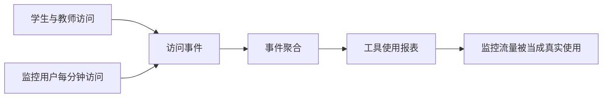
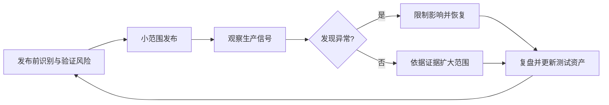

# 测试再全面，为什么上线后仍会出 Bug？从未知风险到系统韧性

> 原文：Tina Fletcher，《The bug that finally convinced me I’d never be able to find all the bugs》，WonderProxy Blog，2026-06-23。https://wonderproxy.com/blog/the-bug-that-finally-convinced-me-id-never-be-able-to-find-all-the-bugs/
>
> 本文以 D2L 报表故障为主线，后半部分补充 QA 可采用的实践。

## 目录

- [1. 一张经过充分测试的报表](#1-一张经过充分测试的报表)
- [2. 生产数据暴露了什么](#2-生产数据暴露了什么)
- [3. 漏掉的是系统事实](#3-漏掉的是系统事实)
- [4. 把意外纳入发布准备](#4-把意外纳入发布准备)
- [5. QA 可以检查什么](#5-qa-可以检查什么)
- [6. 常见问题](#6-常见问题)

## 测试能降低已知风险，却无法补全系统认知

测试可以减少团队已经识别的风险，但无法验证团队从未意识到的生产条件。发布前的测试因此需要与上线后的监控、影响控制和恢复能力配合。目标不是少测，而是同时准备好应对测试设计之外的情况。

## 1. 一张经过充分测试的报表

Tina Fletcher 在 D2L 工作时，参与开发了一份工具使用报表。学校管理员可以查看学生和教师常用哪些学习平台工具；用户每访问一个工具，系统就记录一条事件，报表再把事件汇总成饼图。

团队检查了很多情况，远不止图表是否显示正确：

| 测试范围 | 检查内容 |
| --- | --- |
| 图表展示 | 工具数量过多或过少、多语言和特殊字符、长短标签、手机和平板、浏览器兼容、屏幕阅读器 |
| 事件链路 | 事件延迟、高负载、短时间重复访问、API 访问、处理器不可用时重新排队、代用户操作、格式异常的事件 |
| 数据查询 | 无数据或无法取数、意外格式、访问权限、大数据量、并发查询、不同的时区 |

团队对事件流、数据查询和展示效果都做了验证，觉得这张简单的饼图已经测得很充分。

## 2. 生产数据暴露了什么

报表上线后，客户很快反馈图表不对：Home Page Config 占了约九成，其他工具的占比被挤得很小。调查发现，学习平台的每个生产实例都配置了一个监控用户。D2L 网络运维团队运行站点稳定性检查时，这个用户每分钟都会访问一次 Home Pages Config。

报表把监控访问和师生的真实使用一起计入。修复方式是从报表中排除这类用户。事件记录和聚合逻辑可以正常工作，统计结果却没有回答报表真正要回答的问题。

报表想说明“师生常用哪些工具”，实际统计的却是“系统收到多少次工具访问”。数据处理正确，不代表指标符合业务含义。

## 3. 漏掉的是系统事实

监控用户不存在于测试环境，测试团队此前也不知道生产环境配置了这类账号。没有这项信息，团队也就无法从已有用例推断它会影响报表。

这类风险常被称为 *Unknown Unknowns*（未知的未知）：不只是答案尚未确定，连要提出的问题也还没进入团队视野。

| 情况 | 示例 | 可采取的做法 |
| --- | --- | --- |
| 已知且已确认 | 事件需要按工具汇总 | 编写并执行对应的数据测试 |
| 已知但未确认 | 管理员代用户操作产生的事件是否计入报表 | 请产品、运维和数据负责人明确口径 |
| 信息存在但未共享 | 运维知道监控账号，研发和 QA 不知道 | 盘点运行环境，并让相关团队共同评审 |
| 尚未意识到的风险 | 自动巡检流量改变“用户使用率” | 观察生产数据分布，并在故障后复盘 |

这个案例也说明了技术结果与业务结果的区别。设计报表时，除了确认查询和聚合规则，还要定义统计对象、分母、排除规则和指标含义。数据报表、埋点、推荐系统和 AI 产品都需要回答这些问题。

## 4. 把意外纳入发布准备

原作者由此把更多精力放在异常发生后的准备上：为新功能考虑监控和告警，并验证告警是否有效；尽量拆成小步发布；条件允许时先向部分客户或地区放量，再根据早期结果扩大范围；编写并定期演练操作手册和灾难恢复流程；让日志、测试环境、测试数据和部署流程足以支持诊断与修复。

可以把这些工作整理成一个循环：

落地时可以分别检查三种能力：

| 能力 | QA 与团队可以检查什么 |
| --- | --- |
| 发现 | 业务指标、结构化日志、链路信息和告警是否能暴露异常；告警本身是否经过验证 |
| 限制影响 | 是否能小步发布、暂停放量，或在适当场景使用灰度、金丝雀发布和功能开关 |
| 恢复 | 是否有明确负责人、操作手册、恢复演练、可用的测试环境与数据，以及回退或补偿方案 |

这不是要求每个功能都配齐复杂设施，而是让投入与业务风险相称。涉及数据变更时，还要区分应用回退和数据恢复：回滚代码不会自动还原已经写入的数据。

## 5. QA 可以检查什么

### 开发前：确认哪些主体会产生数据

下面是工具使用报表的示例规则，不代表 D2L 原系统采用了这些口径：

| 事件来源 | 是否计入报告 | 需要确认的行为 |
| --- | --- | --- |
| 学生访问 | 是 | 有效访问是否被计数 |
| 教师访问 | 是 | 是否按既定口径汇总 |
| 运维监控用户 | 否 | 事件存在时是否排除在业务统计之外 |
| 自动化测试账号 | 待确认 | 账号标签和使用目的如何影响统计 |
| 管理员代用户操作 | 待确认 | 事件归属哪个用户 |
| API 自动调用 | 待确认 | 是否属于指标定义中的使用行为 |

待确认的规则应该由产品、运维和数据负责人共同给出，不能由测试人员自行补全。

### 发布前：比较测试环境与生产环境

- [ ] 生产环境是否有测试环境没有的监控用户、服务账号或巡检流量？
- [ ] 是否存在特定客户配置、历史数据或长期运行的定时任务？
- [ ] 事件处理、过滤和指标定义在不同环境中是否一致？
- [ ] 能否用脱敏或合成数据覆盖关键生产特征？
- [ ] 业务监控能否发现数据分布异常，而不只是接口报错？

### 发布后：检查业务结果

除了 HTTP 状态码，还可以观察报表总事件量、非业务账号事件占比、单个工具的异常集中度、事件处理延迟和错误率。阈值应根据历史数据与业务分布确定，不能把某个百分比当成适用于所有项目的故障线。

### 故障后：留下恢复证据

| 需要回答的问题 | 可记录的证据 |
| --- | --- |
| 哪些客户和业务指标受到影响？ | 客户范围、发生时间、指标快照 |
| 问题何时被发现？ | 告警和工单时间 |
| 能否先停止误导性报表或限制流量？ | 缓解方案及所需审批 |
| 是否需要回退、修复或重算数据？ | 技术与数据负责人的判断 |
| 如何证明服务和数据已恢复？ | 前后对比、抽样校验、监控记录 |
| 下次如何更早发现？ | 更新后的监控、测试数据或环境知识 |

质量回顾还可以关注平均发现时间（MTTD）、恢复时间、受影响的数据范围、告警有效性和恢复演练结果。看趋势和真实业务影响，不要把单个数字直接变成绩效目标。

## 6. 常见问题

**既然测试不可能覆盖所有情况，是否应该减少测试？**

不是。测试仍能减少大量可预见问题。还要为异常发现和恢复留出资源，不能用韧性建设代替基本测试。

**直接把生产数据复制到测试环境可以解决差异吗？**

不一定，还可能带来隐私和合规风险。先列出重要的环境差异，再用脱敏或合成数据覆盖关键特征，并通过获准的生产观察补充证据。

**加了监控，是否就不需要测业务报表？**

不是。测试用于验证规则，监控用于发现运行中的异常。监控和告警本身也需要验证。

**AI 能找到未知的未知吗？**

AI 可以提示团队检查监控用户、服务账号等常见盲点，但没有系统事实和上下文时，无法保证推断正确。AI 提出的风险仍需进一步核实。

测试覆盖依赖于团队对系统的认识，而这种认识始终可能不完整。QA 除了设计测试，也可以推动团队明确业务指标口径、观察生产信号，并定期演练故障恢复。

团队无法承诺永不故障；能做的是尽力预防问题，并在故障发生后尽早发现、限制影响和恢复。

## 参考与延伸

- Tina Fletcher，《The bug that finally convinced me I’d never be able to find all the bugs》，WonderProxy Blog，2026-06-23：https://wonderproxy.com/blog/the-bug-that-finally-convinced-me-id-never-be-able-to-find-all-the-bugs/
- Google SRE，《Monitoring Distributed Systems》：https://sre.google/sre-book/monitoring-distributed-systems/
- Google SRE，《Release Engineering》：https://sre.google/sre-book/release-engineering/

本文是《AI 时代的软件质量反思》系列第一篇，讨论测试覆盖的边界，以及团队如何为生产中的未知情况做好准备。
