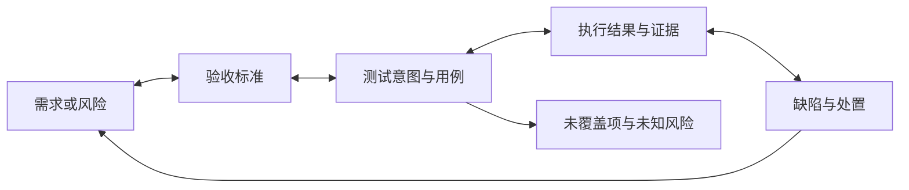

# Vibe Testing：用测试意图验证 AI 生成的软件

**来源**：ACCELQ 博客《What Is Vibe Testing? The Complete AI QA Guide》，正文标题为《How Vibe Testing Changes the Way Teams Think About Quality》。页面标注 2026 年 8 月 25 日发布，另显示 8 月 31 日日期；作者姓名在页面不同位置拼写不一致，本文不据此补充作者背景。

本文以原文为主，区分原文论点、厂商案例和少量工程实践补充。ACCELQ 是测试工具厂商，文中的产品定位和客户收益数字按厂商自述理解。

原文：https://www.accelq.com/blog/vibe-testing/

## 为什么 AI 生成的软件需要新的验证思路

Vibe Testing（氛围测试）是一种 AI 辅助的质量验证方式：测试人员用自然语言描述预期行为，再由 AI Agent 帮助生成、执行和维护测试。它借鉴了 Vibe Coding 的交互方式，把输入从具体点击步骤提升到业务意图。

这并不意味着测试从此不需要代码，也不意味着自然语言能自动消除歧义。测试人员仍需描述目标、确认判定条件、检查生成的测试是否测对，并判断证据是否足以支持后续决策。

Vibe Coding 一词由 Andrej Karpathy 在 2025 年初提出，用自然语言驱动 AI 生成代码。Replit、Cursor、Bolt、Lovable 等工具让开发者和非开发者都能快速搭建应用。速度提高了，验证责任没有因此消失。代码能够编译、单元测试全部通过，仍可能在完整业务流程或用户体验上出错：例如移动端结账按钮可以点击，但确认步骤悄悄失败；登录功能本身成功，错误提示和页面跳转却让新用户摸不着头绪。

Vibe Testing 想补的是这段验证空隙。问题从“测试通过了吗？”扩展为“软件做的是我们想要的事吗？用户能顺利完成目标吗？”功能正确和体验符合预期并不是一回事。

## 意图优先、自适应与体验验证

| 特征 | 具体含义 | 需要留意的边界 |
|---|---|---|
| 意图优先 | 描述希望用户完成的结果，而不是逐条指定元素、选择器和点击步骤 | “确保结账可用”仍然太含糊，AI 可能自行补出错误的规则 |
| 持续适应 | 页面或流程变化后，AI 尝试重新生成或自愈测试 | 自愈可能掩盖回归，也可能无意改变测试原本的语义 |
| 体验验证 | 关注完整交互是否连贯，而不仅是单个控件是否返回预期值 | “体验好”需要具体、可复核的依据，不能只靠模型感觉 |

因此，Agent 不应该自己决定什么算正确。更稳妥的做法是让它从已经确认的业务意图、验收标准、设计规范和用户研究证据中推导测试；它无法确认的假设要明确标出，留给人判断。

## 从测试意图到质量证据

ACCELQ 原文把 Vibe Testing 描述为对话式、反复迭代的循环，而非线性脚本流程：

1. **定义意图**：测试人员用自然语言描述预期行为，不必指定具体元素、选择器或步骤。原文的例子是让一位新用户注册、浏览商品并完成购买，全程不需要求助客服。
2. **AI 扩展场景**：Agent 把意图转成具体用例，包括正常路径、边界情况，以及测试人员未想到的边界值和异常输入组合。
3. **自动执行并观察**：用例在不同浏览器、设备和环境中运行，无需每次手动触发。
4. **系统尝试自愈**：界面元素移动或流程变化时，AI 调整受影响的测试步骤，而不是直接失败后等待人工修复。
5. **人工核验意图与结果**：原文称这一步不可省略。AI 确认软件能够运行，人确认它是否按真实意图运行；Vibe Testing 放大 QA 判断，不会消除对判断的需要。

原文的“通过”并不代表已经证明所有业务规则都得到验证。**工程实践延伸**：为了复核结果，可以同时保留测试意图、生成用例、模型和工具版本、运行环境、执行证据及人工判断，并记录仍未覆盖的风险。

## Vibe Coding 与 Vibe Testing 各自负责什么

| 维度 | Vibe Coding | Vibe Testing |
|---|---|---|
| 生命周期环节 | 构建软件 | 验证软件 |
| 典型输入 | “做一个支持保存银行卡的结账流程” | “验证老用户能顺利完成结账” |
| 典型输出 | 应用代码、界面和功能 | 已执行的测试、结果、缺陷和质量证据 |
| 常见参与者 | 开发者、非技术构建者 | QA、产品经理、设计师、开发者 |
| 主要风险 | 代码能运行，但实现未经充分理解和验证 | AI 推断出的测试场景或通过标准不正确 |

原文还提到 Vibe Coding QA：专门验证通过 Vibe Coding 构建的应用，重点留意原始提示词没有写明的行为、异常路径和跨功能副作用。业务人员和设计师可能不熟悉脚本，但通常能判断流程是否让用户困惑；他们可以参与测试，不代表 QA 专业审查可以省略。

## 与传统自动化测试怎样配合

| 维度 | Vibe Testing 的常见做法 | 传统自动化的常见做法 | 需要避免的误解 |
|---|---|---|---|
| 创建入口 | 用自然语言表达业务意图 | 用代码、测试模型或其他方式构建脚本 | 传统测试也可以需求驱动，并非只能按步骤录制 |
| 核心问题 | 用户是否能按预期完成目标？ | 具体功能和断言是否符合预期？ | 两边都要关注行为正确性和用户结果 |
| 参与门槛 | 领域人员更容易描述预期结果 | 脚本创建和维护通常需要工程技能 | 降低表达门槛不等于不需要测试设计能力 |
| 维护方式 | AI 尝试自愈或重生成 | 团队维护抽象、定位器和脚本 | 自愈不保证总成本更低，错误修复也可能藏住缺陷 |
| 反馈时机 | 可持续运行并随提交反馈 | 同样可以接入 CI/CD 持续运行 | 传统自动化并不只能等到迭代末或发布前 |
| 适用重点 | 快速变化的界面、AI 生成应用和体验流程 | 深度回归、复杂逻辑、性能、安全和集成验证 | 两种方式互补，不能互相替代 |

原文把传统自动化描述得较为狭窄。实际项目里，脚本化测试同样可以在每次提交时运行，也可以验证端到端流程和用户体验。Vibe Testing 的价值更具体：让业务意图更容易进入测试设计，并把部分场景扩展、执行和维护交给 AI 辅助完成。

性能基准、安全验证、复杂集成和深度功能回归仍需要有针对性的测试设计与专门证据。Vibe Testing 可以为这些工作提供补充信号，不能仅凭一句自然语言描述就替代它们。

## 原文中的三个应用场景

**界面频繁变化的 SaaS 团队。** 原文举例说，一支每周调整导航和结账流程的团队，Selenium 测试维护占去约一半 QA 精力。团队改用意图描述和 AI 自愈后，QA 可以把更多时间放回探索式测试和边界场景。这个比例是原文的情景案例，不是独立研究结论；实际收益取决于应用可测性、自愈误修率和人工复核成本。

**新用户引导流程。** 功能测试没有报错，但产品经理发现新用户反复卡在引导流程里。团队从完整旅程检查步骤顺序、提示文案和完成路径。原文称 AI 找到了脚本检查未发现的摩擦点，重新设计后激活率得到可测量的改善；原文没有给出具体指标，这仍是来源中的案例主张。

**设计师验证 AI 生成的表单。** 设计师用自然语言说明表单要保存回答、发送确认邮件、处理较长输入并适配手机，AI 据此生成并运行一套测试。原文把它作为非技术人员无需 QA 专家即可参与验证的例子；这不单独证明复杂生产系统可以省略 QA 判断。

## 测试治理：生成的测试凭什么可信

自然语言有歧义。“确保结账可用”可能没有说清优惠叠加、退款、失败重试或数据一致性。规模化后，至少要回答三件事：测试追溯到什么、为什么判定通过、工具没有测到什么。

| 治理问题 | 要回答的问题 | 应保留的证据 |
|---|---|---|
| 可追溯性 | 测试对应哪条需求、用户故事或风险？ | 需求或风险标识、验收标准、测试意图和测试编号 |
| 可审计性 | 之后能否还原为什么测试通过？ | 判定依据、模型与提示版本、执行环境、日志和审批记录 |
| 覆盖置信度 | 工具是否说明了没测什么？ | 覆盖映射、排除项、未知项和残余风险 |

双向追溯不等于要求每个探索性发现都硬连到已有工单。发现了新的风险或隐含业务规则，可以先建立对应记录，再关联测试；不要让 AI 为了填满链路而虚构一个并不存在的需求。

原文引用了 2024 年 CrowdStrike 事故中“代码覆盖率达到 94%”的说法。学习笔记没有独立核验这个具体数字，因此本文不把它当作已证实事实。可以确认的一般原则是：代码覆盖率说明哪些代码被执行过，不说明关键业务规则是否被正确验证。

## 自愈需要保留原测试意图

当页面变化导致测试失败，AI 可能建议修复定位器或重新生成步骤。这个建议不能因为能让测试变绿就自动接受。关键是检查它有没有保留原来的断言和业务含义。

自动修改断言、跳过关键步骤、降低阈值，或把“用户无法完成目标”改成“页面没有报错”，都属于高风险变化。修复应恢复有效验证，而不是抹掉失败信号。测试意图、旧版与新版步骤、模型建议、人工决定和执行证据都应能被追溯。

## 企业业务流程跨越多个系统

许多演示围绕新建 Web 应用展开。企业中的业务过程却可能同时经过 Web、API、桌面端、SAP、Salesforce、ServiceNow 和大型机。一个只会操作单页 Web 应用的 Agent，无法据此证明跨系统交易已经完整成功。

原文举例指出，单页 React 应用测试工具无法验证同一交易里 Salesforce 案例更新和 ServiceNow 工单创建是否都完成。跨系统意图测试的价值取决于工具能触达并核验多大的业务范围。

## 原文列出的工具定位

以下是 ACCELQ 原文对产品的描述，不是独立测评，也不是对当前市场能力的完整核验。作者所属厂商的产品信息需要结合实际场景做 PoC。

| 工具 | 原文描述的能力 | 原文定位 | 阅读时的边界 |
|---|---|---|---|
| ACCELQ | 覆盖 Web、API、移动、桌面和套装应用，并提供自愈与追溯 | 需要跨系统覆盖的企业团队 | 厂商自述，应单独验证适用范围与成本 |
| testRigor | 用自然语言创建测试 | 小型 QA 团队 | 需要评估语义稳定性和复核成本 |
| Appvance AIQ | 学习应用并生成测试 | 现有覆盖较少的新 SaaS 产品 | 需要评估生成结果是否可解释、可维护 |
| LambdaTest KaneAI | 自然语言生成端到端 Web 流程测试 | 已使用其执行环境的中型团队 | 需核对当前集成和支持范围 |
| Testsigma | 自然语言及 Jira、Figma 相关测试生成 | 敏捷 Web 团队 | 需验证真实追溯与执行能力 |

原文另有一节介绍 ACCELQ 自身能力：Autopilot 从应用行为发现业务流程并生成端到端测试场景；Converse 将有状态的对话式意图贯穿规划、执行和分析；自愈能力应对 SAP、Salesforce 等打包应用更新；双向追溯将测试连接到需求和缺陷。以上都是厂商的产品主张，应在具体场景中核验。

原文称 ACCELQ 客户报告“自动化开发快 7.5 倍、维护开销降低超过 72%”，并引用一条中型企业 G2 用户评价，称自愈能力和对象库改善了测试覆盖；原文还列出 4.8/5、114+ 条经验证评价。这些是原文转述的厂商和用户信息，不是独立对照实验；G2 数字会变化。

G2 页面：https://www.g2.com/products/accelq/reviews

## 如何评估它是否真的有用

评估时不要只看生成一条测试要多久，还要看整个生命周期的结果。下面这些是基于学习笔记整理的工程评估维度，不是原文公布的行业标准。

| 维度 | 可观察的问题 |
|---|---|
| 测试有效性 | 关键需求命中多少？错误断言有多少？ |
| 风险发现 | 是否发现真实缺陷和关键覆盖缺口？ |
| 可维护性 | 页面变化后需要多少人工修复？自愈误修率如何？ |
| 可审计性 | 测试、需求、证据和审批能否相互追溯？ |
| 运行稳定性 | 不稳定率、误报和漏报是否可接受？ |
| 端到端能力 | 能否覆盖跨系统关键路径并观察最终结果？ |
| 经济性 | 把模型、工具、执行和人工复核成本算在一起后，净收益如何？ |

## 与 Shift-left 和质量工程闭环的关系

自然语言降低了表达预期的门槛，产品经理、设计师和业务分析师可以在功能完成前参与定义用户结果。Shift-left 的价值在于尽早发现需求歧义、错误假设和质量风险。

原文 FAQ 将这种参与方式与 Shift-left 联系起来：产品经理、设计师和业务人员可以在开发完成前定义质量检查，让质量讨论更早进入并持续伴随开发。质量责任仍由团队承担，工具不能取代测试设计、风险判断或发布责任。

## 常见问题

以下问答按 ACCELQ 原文 FAQ 整理，涉及平台能力和可靠性的说法均按原文主张呈现。

### 什么是 Vibe Testing？

测试人员用自然语言描述预期行为，由 AI Agent 生成、执行和维护测试。它关注应用是否实现预期的用户体验，而不只看单项功能通过还是失败。

### Vibe Testing 和 Vibe Coding 是一回事吗？

不是。Vibe Coding 用自然语言描述要构建的应用，再由 AI 生成可运行代码；Vibe Testing 使用意图优先的方式验证生成的软件是否按预期运行。

### 有哪些常见的 Vibe Coding 工具？

原文列出 Replit、Cursor、Bolt 和 Lovable。它们让用户通过自然语言描述应用并获得代码，原文将这种开发方式视为 Vibe Testing 需求的来源。

### Vibe Coding 会怎样影响用户体验？

应用可能功能正确，却仍让用户困惑或遇到不一致的交互。原文认为，AI 生成代码可能满足提示词的字面要求，却没有顾及真实用户如何理解和感受流程。

### Vibe Testing 有哪些应用例子？

原文列出的例子包括：快速变化的结账流程、新用户引导摩擦，以及非技术人员验证 AI 生成的应用。设计师用一条自然语言测试描述验证表单、无需另聘 QA 专家，是原文案例中的说法；它不代表生产系统可以省略 QA 判断。

### Vibe Testing 足以支持生产发布吗？

原文认为它可支持功能验证、体验检查和边界场景发现，但不能完全替代结构化性能测试或复杂多系统集成测试。生成的测试仍需人工复核并追溯到需求。原文还称某些设计完善的平台会自动补充常见安全场景，这需要按具体工具核验。

### Vibe Coding QA 和一般的 Vibe Testing 有什么区别？

Vibe Coding QA 专门测试由 Vibe Coding 构建的应用。团队可能不了解全部生成代码，因此除了意图优先测试，也要特别寻找原始提示词没有说明的行为。

### Vibe Testing 怎样支持 Shift-left？

自然语言降低了定义测试的技术门槛，让产品经理、设计师和业务人员可以在开发完成前参与定义质量检查，把质量讨论提前并带入开发过程。

## 结论

Vibe Testing 让业务意图更直接地进入测试设计，让 AI 分担部分场景扩展、执行和维护，并让质量反馈更早进入研发流程。QA 仍要处理自然语言歧义、核对 AI 推断的预期、审查自愈是否掩盖缺陷，并结合其他证据判断体验和发布风险。

要让这种做法站得住，团队需要意图优先、证据驱动、双向追溯、人工负责关键判断，并与传统工程化测试互补。原文将更大的变化概括为质量从发布门禁检查点转为开发过程中的持续共享信号，并预测尽早建立这种纪律的团队会设定竞争者未来两年的质量门槛；后者是作者的展望，不是已验证结果。

工具可以帮助团队提速，团队仍要证明自己验证的是正确目标。

**延伸阅读**

ACCELQ 原文：https://www.accelq.com/blog/vibe-testing/
