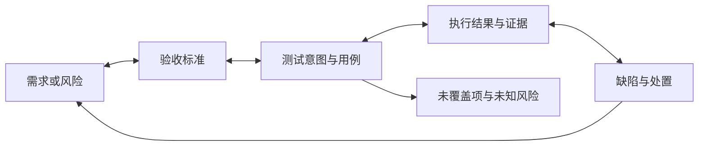
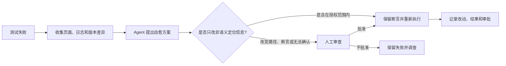
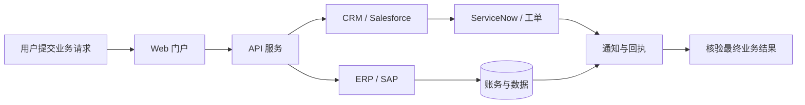

# Vibe Testing：用测试意图验证 AI 生成的软件

**来源**：ACCELQ 博客《What Is Vibe Testing? The Complete AI QA Guide》，正文副标题为《How Vibe Testing Changes the Way Teams Think About Quality》，2026 年 8 月 25 日。页面不同位置的作者姓名拼写不一致，本文不据此补充作者背景。

这篇文章以原文和完整学习笔记为基础。原文观点、厂商案例与数据会明确标注；额外的工程实践会作为延伸说明。ACCELQ 是测试工具厂商，文中的产品定位和客户收益数字应按厂商自述理解。

原文: https://www.accelq.com/blog/vibe-testing/

## 为什么 AI 生成的软件需要新的验证思路

Vibe Testing（氛围测试）是一种 AI 辅助的质量验证方式：测试人员用自然语言描述预期行为，再由 AI Agent 帮助生成、执行和维护测试。它借鉴了 Vibe Coding 的交互方式，把输入从具体点击步骤提升到业务意图。

这并不意味着测试从此不需要代码，也不意味着自然语言能自动消除歧义。Vibe Testing 目前更像一类正在演化的实践和市场术语，没有统一定义、认证或质量保证标准。真正发生变化的是测试工作的入口：测试人员需要描述目标、确认判定条件、检查生成的测试是否测对，并判断证据是否足以支持后续决策。

Vibe Coding 一词由 Andrej Karpathy 在 2025 年初提出，用自然语言驱动 AI 生成代码。Replit、Cursor、Bolt、Lovable 等工具让开发者和非开发者都能快速搭建应用。速度提高了，验证责任没有因此消失。代码能够编译、单元测试全部通过，仍可能在完整业务流程或用户体验上出错：例如移动端结账按钮可以点击，但确认步骤悄悄失败；登录功能本身成功，错误提示和页面跳转却让新用户摸不着头绪。

Vibe Testing 想补的是这段验证空隙。问题从“测试通过了吗？”扩展为“软件做的是我们想要的事吗？用户能顺利完成目标吗？”功能正确和体验符合预期并不是一回事。

## 意图优先、自适应与体验验证

| 特征 | 具体含义 | 需要留意的边界 |
|---|---|---|
| 意图优先 | 描述希望用户完成的结果，而不是逐条指定元素、选择器和点击步骤 | “确保结账可用”仍然太含糊，AI 可能自行补出错误的规则 |
| 持续适应 | 页面或流程变化后，AI 尝试重新生成或自愈测试 | 自愈可能掩盖回归，也可能无意改变测试原本的语义 |
| 体验验证 | 关注完整交互是否连贯，而不仅是单个控件是否返回预期值 | “体验好”需要具体、可复核的依据，不能只靠模型感觉 |

因此，Agent 不应该自己决定什么算正确。更稳妥的做法是让它从已经确认的业务意图、验收标准、设计规范和用户研究证据中推导测试；它无法确认的假设要明确标出，留给人判断。

## 从测试意图到质量证据

原文给出的循环包括定义意图、扩展场景、自动执行、自愈和人工核验。落到工程流程时，还需要把需求关联、判定标准、证据记录和语义变更审查放进去。

AI 可以补出正常路径、边界值和异常输入组合，也可以在多个浏览器、设备和环境中运行测试。但每次执行的“通过”都只说明当前检查没有报错。它不自动证明测试覆盖了重要规则，更不等于已经做出安全的发布决定。人仍需确认测试是否忠实表达意图、结果是否可信、还有哪些未知风险。

这就是质量 Loop（质量闭环）：每次运行发现的问题、误报、自愈建议和人工判断都要记录；再从中提炼需求背景、判定规则和工具限制，作为下一次运行的上下文，继续测试和优化。不同模型、Agent 工具和业务场景会有不同表现，测试意图、提示词、权限和人工检查点都要根据实际反馈调整。没有哪套设置能一次确定后永久适用。

| 阶段 | 需要留下的东西 |
|---|---|
| 记录与测试 | 需求、测试意图、模型与工具版本、执行结果、问题和人工判断 |
| 形成上下文 | 已确认的规则、误判模式、未覆盖风险、自愈边界和适用环境 |
| 再次运行 | 将上下文用于下一轮测试，比较结果，继续修订测试与工作方法 |

## Vibe Coding 与 Vibe Testing 各自负责什么

| 维度 | Vibe Coding | Vibe Testing |
|---|---|---|
| 生命周期环节 | 构建软件 | 验证软件 |
| 典型输入 | “做一个支持保存银行卡的结账流程” | “验证老用户能顺利完成结账” |
| 典型输出 | 应用代码、界面和功能 | 已执行的测试、结果、缺陷和质量证据 |
| 常见参与者 | 开发者、非技术构建者 | QA、产品经理、设计师、开发者 |
| 主要风险 | 代码能运行，但实现未经充分理解和验证 | AI 推断出的测试场景或通过标准不正确 |

原文还提到 Vibe Coding QA：专门验证通过 Vibe Coding 构建的应用，重点留意原始提示词没有写明的行为、异常路径和跨功能副作用。业务人员和设计师可能不熟悉脚本，但通常能判断流程是否让用户困惑；他们可以参与测试，不代表 QA 专业审查可以省略。

## 与传统自动化测试怎样配合

| 维度 | Vibe Testing 的常见做法 | 传统自动化的常见做法 | 需要避免的误解 |
|---|---|---|---|
| 创建入口 | 用自然语言表达业务意图 | 用代码、测试模型或其他方式构建脚本 | 传统测试也可以需求驱动，并非只能按步骤录制 |
| 核心问题 | 用户是否能按预期完成目标？ | 具体功能和断言是否符合预期？ | 两边都要关注行为正确性和用户结果 |
| 参与门槛 | 领域人员更容易描述预期结果 | 脚本创建和维护通常需要工程技能 | 降低表达门槛不等于不需要测试设计能力 |
| 维护方式 | AI 尝试自愈或重生成 | 团队维护抽象、定位器和脚本 | 自愈不保证总成本更低，错误修复也可能藏住缺陷 |
| 反馈时机 | 可持续运行并随提交反馈 | 同样可以接入 CI/CD 持续运行 | 传统自动化并不只能等到迭代末或发布前 |
| 适用重点 | 快速变化的界面、AI 生成应用和体验流程 | 深度回归、复杂逻辑、性能、安全和集成验证 | 两种方式互补，不能互相替代 |

原文把传统自动化描述得较为狭窄。实际项目里，脚本化测试同样可以在每次提交时运行，也可以验证端到端流程和用户体验。Vibe Testing 的价值更具体：让业务意图更容易进入测试设计，并把部分场景扩展、执行和维护交给 AI 辅助完成。

性能基准、安全验证、复杂集成和深度功能回归仍需要有针对性的测试设计与专门证据。Vibe Testing 可以为这些工作提供补充信号，不能仅凭一句自然语言描述就替代它们。

## 原文中的三个应用场景

**界面频繁变化的 SaaS 团队。** 原文举例说，一支每周调整导航和结账流程的团队，Selenium 测试维护占去约一半 QA 精力。团队改用意图描述和 AI 自愈后，QA 可以把更多时间放回探索式测试和边界场景。这个比例是原文的情景案例，不是独立研究结论；实际收益取决于应用可测性、自愈误修率和人工复核成本。

**新用户引导流程。** 功能测试没有报错，但产品经理发现新用户反复卡在引导流程里。团队从完整旅程检查步骤顺序、提示文案和完成路径，找出逐个检查字段时看不到的摩擦点。AI 可以提供问题线索，但“用户是否困惑”最好再结合漏斗数据、访谈、可用性测试或其他用户行为证据。

**设计师验证 AI 生成的表单。** 设计师用自然语言说明表单要保存回答、发送确认邮件、处理较长输入并适配手机，AI 据此生成和运行测试。这个例子展示了非技术角色可以参与质量验证，不是说复杂产品可以不需要 QA。

## 测试治理：生成的测试凭什么可信

自然语言有歧义。“确保结账可用”可能没有说清优惠叠加、退款、失败重试或数据一致性。规模化后，至少要回答三件事：测试追溯到什么、为什么判定通过、工具没有测到什么。

| 治理问题 | 要回答的问题 | 应保留的证据 |
|---|---|---|
| 可追溯性 | 测试对应哪条需求、用户故事或风险？ | 需求或风险标识、验收标准、测试意图和测试编号 |
| 可审计性 | 之后能否还原为什么测试通过？ | 判定依据、模型与提示版本、执行环境、日志和审批记录 |
| 覆盖置信度 | 工具是否说明了没测什么？ | 覆盖映射、排除项、未知项和残余风险 |

双向追溯不等于要求每个探索性发现都硬连到已有工单。发现了新的风险或隐含业务规则，可以先建立对应记录，再关联测试；不要让 AI 为了填满链路而虚构一个并不存在的需求。

原文引用了 2024 年 CrowdStrike 事故中“代码覆盖率达到 94%”的说法。学习笔记没有独立核验这个具体数字，因此本文不把它当作已证实事实。可以确认的一般原则是：代码覆盖率说明哪些代码被执行过，不说明关键业务规则是否被正确验证。

## 自愈需要保留原测试意图

当页面变化导致测试失败，AI 可能建议修复定位器或重新生成步骤。这个建议不能因为能让测试变绿就自动接受。关键是检查它有没有保留原来的断言和业务含义。

自动修改断言、跳过关键步骤、降低阈值，或把“用户无法完成目标”改成“页面没有报错”，都属于高风险变化。修复应恢复有效验证，而不是抹掉失败信号。测试意图、旧版与新版步骤、模型建议、人工决定和执行证据都应能被追溯。

## 企业业务流程跨越多个系统

许多演示围绕新建 Web 应用展开。企业中的业务过程却可能同时经过 Web、API、桌面端、SAP、Salesforce、ServiceNow 和大型机。一个只会操作单页 Web 应用的 Agent，无法据此证明跨系统交易已经完整成功。

跨系统意图测试还要关注身份传播、异步一致性、接口契约、测试数据生命周期和可观察性。意图优先的测试究竟有多大价值，取决于工具能触达并核验多大的业务范围。

## 原文列出的工具定位

以下是 ACCELQ 原文对产品的描述，不是独立测评，也不是对当前市场能力的完整核验。作者所属厂商的产品信息需要结合实际场景做 PoC。

| 工具 | 原文描述的能力 | 原文定位 | 阅读时的边界 |
|---|---|---|---|
| ACCELQ | 覆盖 Web、API、移动、桌面和套装应用，并提供自愈与追溯 | 需要跨系统覆盖的企业团队 | 厂商自述，应单独验证适用范围与成本 |
| testRigor | 用自然语言创建测试 | 小型 QA 团队 | 需要评估语义稳定性和复核成本 |
| Appvance AIQ | 学习应用并生成测试 | 现有覆盖较少的新 SaaS 产品 | 需要评估生成结果是否可解释、可维护 |
| LambdaTest KaneAI | 自然语言生成端到端 Web 流程测试 | 已使用其执行环境的中型团队 | 需核对当前集成和支持范围 |
| Testsigma | 自然语言及 Jira、Figma 相关测试生成 | 敏捷 Web 团队 | 需验证真实追溯与执行能力 |

原文还提到 ACCELQ 客户报告“自动化开发快 7.5 倍、维护开销降低超过 72%”。这是厂商引用的客户结果，不是独立对照实验，也不能直接推断其他团队会得到相同收益。

## 如何评估它是否真的有用

评估时不要只看生成一条测试要多久，还要看整个生命周期的结果。下面这些是基于学习笔记整理的工程评估维度，不是原文公布的行业标准。

| 维度 | 可观察的问题 |
|---|---|
| 测试有效性 | 关键需求命中多少？错误断言有多少？ |
| 风险发现 | 是否发现真实缺陷和关键覆盖缺口？ |
| 可维护性 | 页面变化后需要多少人工修复？自愈误修率如何？ |
| 可审计性 | 测试、需求、证据和审批能否相互追溯？ |
| 运行稳定性 | 不稳定率、误报和漏报是否可接受？ |
| 端到端能力 | 能否覆盖跨系统关键路径并观察最终结果？ |
| 经济性 | 把模型、工具、执行和人工复核成本算在一起后，净收益如何？ |

## 与 Shift-left 和质量工程闭环的关系

自然语言降低了表达预期的门槛，产品经理、设计师和业务分析师可以在功能完成前参与定义用户结果。Shift-left 的价值在于尽早发现需求歧义、错误假设和质量风险。

作为学习笔记的工程延伸，可以从 AI Native QE（AI 原生质量工程）的角度，把 Vibe Testing 放在三个相互制约的层面中理解：

| 层面 | 需要回答的问题 |
|---|---|
| 能力（Capability） | 能否把自然语言意图转成可执行测试，并在应用变化后维护测试？ |
| 质量工程（Quality Engineering） | 生成的测试是否准确、稳定、有风险价值，是否真的验证了业务意图？ |
| 治理（Governance） | 谁批准测试意图和高风险自愈？决策与证据如何追溯？Agent 权限如何控制？ |

能力越强，越需要相应的质量评估和治理。自然语言可以成为入口，不能取代测试设计、可观察性、测试数据工程、风险评估和发布责任。

质量责任仍由团队承担。Vibe Testing 改变测试的交互方式和参与方式；团队仍要对风险、测试有效性和发布结论负责。每个新模型、提示词、工具版本和业务场景，都需要回到质量闭环里重新验证。

## 结论

Vibe Testing 让业务意图更直接地进入测试设计，让 AI 分担部分场景扩展、执行和维护，并让质量反馈更早进入研发流程。QA 仍要处理自然语言歧义、核对 AI 推断的预期、审查自愈是否掩盖缺陷，并结合其他证据判断体验和发布风险。

要让这种做法站得住，团队需要意图优先、证据驱动、双向追溯、人工负责关键判断，并与传统工程化测试互补。每轮执行还要记录问题、形成可复用上下文，再带着这些结论进入下一轮。工具能帮忙跑得更快，团队仍要证明它测的是正确的东西。

**延伸阅读**

ACCELQ 原文: https://www.accelq.com/blog/vibe-testing/
